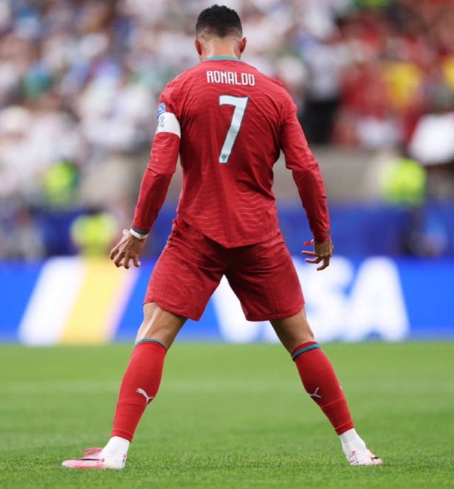
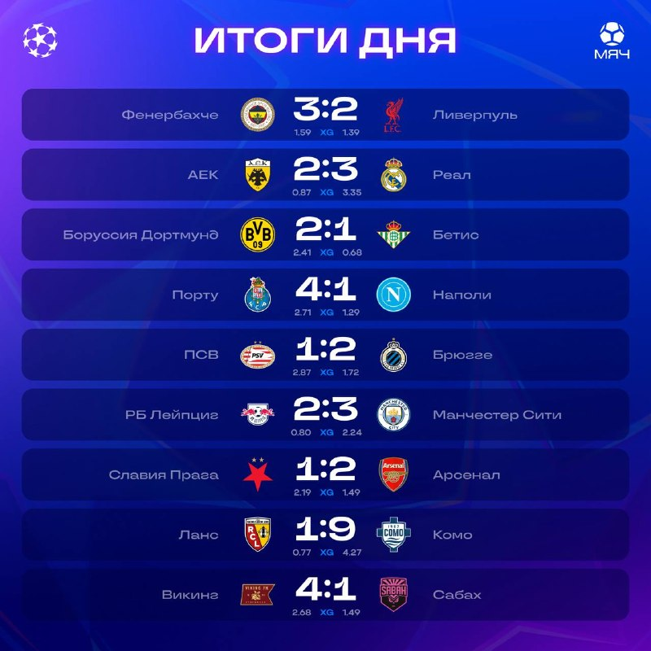
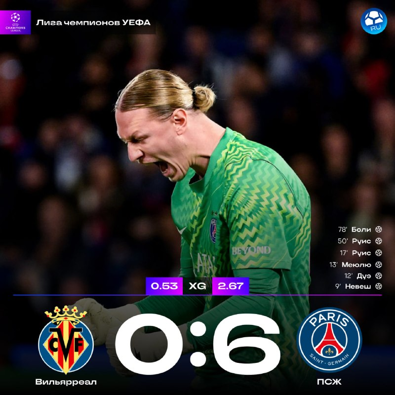
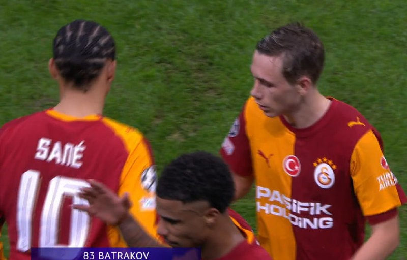
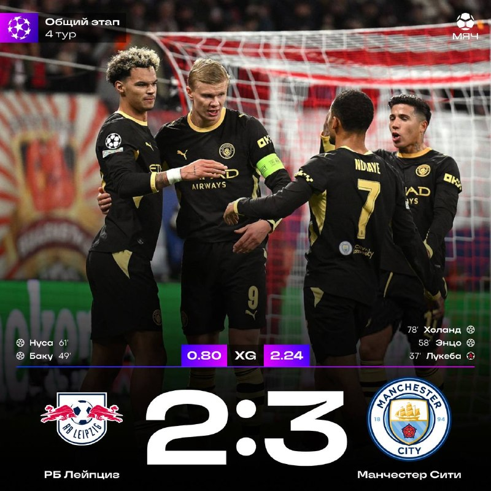

# Футбольный дайджест — 5 ноября 2026

_Период: последние 48 часов (первый выпуск)_

## ⭐ Главное
- **Криштиану Роналду завершил карьеру в сборной Португалии.** За 23 года в сборной: 234 матча, 146 голов, 45 ассистов, Евро-2016 и две Лиги наций. Сборная готовит церемонию в его честь, дату пока не назвали. [МЯЧ](https://t.me/myachPRO/25127) · [заявление](https://t.me/myachPRO/25130) · [Okko](https://t.me/okkosport/44417)

## ⚽ Результаты
- **ЛЧ, 4-й тур: АЕК — Реал 2:3.** Реал дважды отыгрывался, победу на 90+2' принёс Вальверде. Голы: Беллингем 32', Мбаппе 78', Вальверде 90+2'. У Реала 12 очков из 12, столько же только у ПСЖ. [МЯЧ](https://t.me/myachPRO/25122) · [таблица](https://t.me/myachPRO/25123) · [Real Madrid](https://www.realmadrid.com/en-US/news/football/first-team/reports/cronica-aek-atenas-real-madrid-champions-03-11-2026)

- **Зенит** за эти дни не играл. Последний матч был 2 ноября: «Крылья Советов» — «Зенит» 0:3, шестая победа подряд и 1-е место в РПЛ. Следующий матч: **8 ноября, «Зенит» — «Ростов», 18:30 МСК**. [Lenta](https://lenta.ru/news/2026/11/02/zenit-vyigral-shestoy-match-podryad-v-rpl-i-vernulsya-na-pervoe-mesto/)

## 👤 Мои игроки
- **Сафонов** отстоял на ноль: «Вильярреал» — ПСЖ 0:6 (3 ноября). Это его первый сухой матч в ЛЧ в этом сезоне, ПСЖ лидирует с 12 очками. Сам он пошутил про «прекрасный счёт для тенниса». [Матч ТВ](https://matchtv.ru/football/matchtvnews_NI2382823_PSZh_razgromil_Viljarreal_v_matche_Ligi_chempionov_Safonov_otygral_na_nol) · [МЯЧ RU](https://t.me/myachrus/10112)

- **Батраков** оформил дубль за 3 минуты (12' и 15'): «Галатасарай» — «Штутгарт» 2:0 (3 ноября). Он первый за 11 лет россиянин с дублем в ЛЧ, признан лучшим игроком матча и попал в символическую сборную тура. [Lenta](https://lenta.ru/news/2026/11/03/batrakov-oformil-dubl-za-galatasaray-v-matche-ligi-chempionov/) · [Okko](https://t.me/okkosport/44415)

- **Холанд** забил «Лейпцигу» (2:3). Теперь у него 62 гола в 61 матче ЛЧ и 2-е место в списке лучших бомбардиров турнира. [МЯЧ](https://t.me/myachPRO/25120)

- **Беллингем** открыл счёт Реала в Афинах на 32-й минуте. [МЯЧ](https://t.me/myachPRO/25122)
- **Мбаппе** забил на 78-й и сравнял счёт 2:2, после чего Вальверде вырвал победу. [МЯЧ](https://t.me/myachPRO/25122)
- **Куртуа** сделал 3 сейва против АЕК, два из них сохранили Реалу шансы на победу. [Goal](https://goal.com/en-in/news/real-madrid-vs-aek-athens-player-ratings-champions-league/blte0ce92d36f7434da)
- **Глушенков** забил 10 голов в РПЛ, столько же у Соболева. По данным «МЯЧ RU», 70% голов команды в чемпионате забили россияне. [МЯЧ RU](https://t.me/myachrus/10118)

## 🔁 Трансферы
- **Официально:** нет новостей.
- **Слухи:** нет новостей по Реалу и Зениту.

## 🩹 Травмы
- Реал: Родриго (колено) выбыл примерно до конца декабря, Менди под вопросом до конца года. У Вальверде проблема с бедром, но серьёзную травму обследование исключило. [Sports Mole](https://www.sportsmole.co.uk/football/real-madrid/injury-news/injuries-and-suspensions/vinicius-rodrygo-updates-real-madrid-injury-suspension-news-vs-valencia_608458.html)

## 🔥 Ещё важное
- **«Комо» разгромил «Ланс» 9:1 в гостях** — это самая крупная выездная победа в истории ЛЧ. Дувикас сделал хет-трик и отдал ассист. [Okko](https://t.me/okkosport/44407) · [МЯЧ](https://t.me/myachPRO/25121)
- **«Ливерпуль» неожиданно проиграл «Фенербахче» 2:3.** [МЯЧ](https://t.me/myachPRO/25122)
- **УЕФА наказал «Ланс»** за беспорядки болельщиков в Брюгге: на два следующих выезда в ЛЧ фанатов клуба не пустят. [МЯЧ](https://t.me/myachPRO/25126)
- **РПЛ:** по данным «МЯЧ RU», «Локомотив» решил расстаться с Галактионовым и объявит об этом после матча с «Рубином» в пятницу. Пока это слух. [МЯЧ RU](https://t.me/myachrus/10117)

## 📅 Ближайшие матчи
- **«Валенсия» — Реал**, Ла Лига, 7 ноября, 23:00 МСК (в гостях). [ESPN](https://www.espn.com/soccer/match/_/gameId/401882808)
- **Зенит — Ростов**, РПЛ, 8 ноября, 18:30 МСК. [РИА](https://ria.ru/category_premier_league_russia/)
