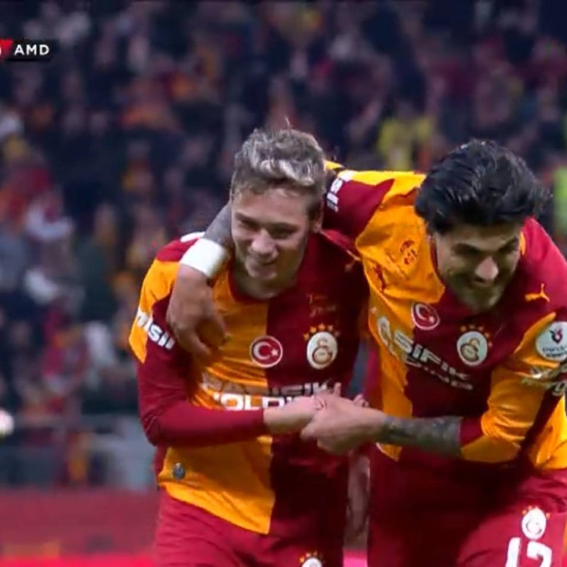
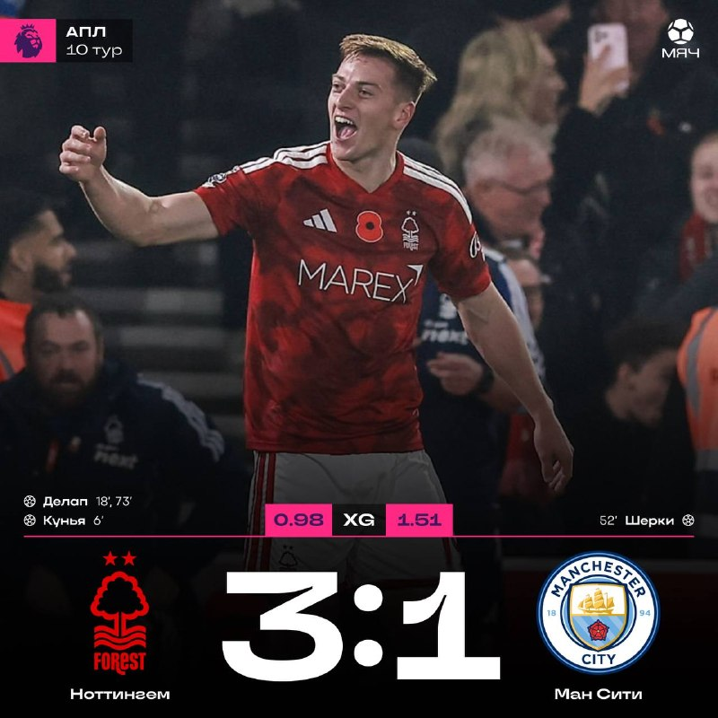

# Футбольный дайджест — 7 ноября 2026

_Период: с 5 по 7 ноября (материалы собраны 7 ноября в 22:40 МСК; матч «Валенсия» — Реал начнётся в 23:00 и сюда не вошёл)_

## ⭐ Главное
- **Батраков забил в третьем матче подряд.** В чемпионате Турции «Галатасарай» обыграл «Амедспор» 4:3 (главного преследователя), Алексей пробил из-за штрафной на 59-й минуте и отпраздновал под «Калинку-малинку». Теперь в «Гала» у него 11 матчей, 6 голов и 3 передачи, по голам он лидер клуба. Плюс «Галатасарай», по данным «Спорт-Экспресса», предложит ему новый контракт с повышенной зарплатой и крупной неустойкой. [МЯЧ](https://t.me/myachPRO/25162) · [Sports.ru](https://t.me/sportsru/131484) · [Спорт-Экспресс](https://t.me/sportexpress/84736)

## ⚽ Результаты
- **Зенит** за эти дни не играл. Следующий матч: **8 ноября, «Зенит» — «Ростов», 18:30 МСК, РПЛ**. [ESPN](https://www.espn.com/soccer/match/_/gameId/401879809)
- **Реал** в окне не играл. Ближайший матч: **«Валенсия» — Реал, Ла Лига, 7 ноября, 23:00 МСК** (в гостях). Следующий после него матч Реала в материалах не указан — уточняется. [ESPN](https://www.espn.com/soccer/match/_/gameId/401882808)
- **Турция: «Галатасарай» — «Амедспор» 4:3.** Голы: Леао 7', автогол Лафона 45', Батраков 59', Йылмаз 80'; за гостей Саба 62', Орбан 65', Сор 90+2'. [ESPN](https://www.espn.com/soccer/match/_/gameId/401888371)
- **РПЛ:** «Краснодар» — ЦСКА 4:2 (дубль Кордобы), «Факел» — «Динамо» 1:2 (Тюкавин забил на 90+1'), «Ахмат» — «Родина» 1:0; 6 ноября «Локомотив» — «Рубин» 0:1. [Краснодар—ЦСКА](https://www.espn.com/soccer/match/_/gameId/401879811) · [Факел—Динамо](https://www.espn.com/soccer/match/_/gameId/401879808) · [Локомотив—Рубин](https://www.espn.com/soccer/match/_/gameId/401879812)
- **Ла Лига:** «Севилья» — «Алавес» 0:0, «Эспаньол» — «Депортиво» 0:0, «Осасуна» — «Атлетик» 1:1 (Н. Уильямс 84', Катена 90'). [ESPN](https://www.espn.com/soccer/match/_/gameId/401882811)

## 👤 Мои игроки
- **Роналду** официально попрощался со сборной Португалии (об этом писали в прошлом выпуске). Новое: капитаном сборной станет Бернарду Силва, по данным Фабрицио Романо; Жорже Жезуш заявил, что ничего бы не менял в истории с уходом Криштиану. Ещё Роналду выступил продюсером первого фильма «Stuntnuts» (Хемсворт и Рокуэлл, камео Мэтта Деймона), по данным Deadline через Sports.ru. [Романо](https://t.me/FabrizioRomanoTG/68103) · [Okko](https://t.me/okkosport/44486) · [Sports.ru](https://t.me/sportsru/131453)
- **Батраков** — гол и 3-й матч подряд с голом против «Амедспора» (см. «Главное»). [Okko](https://t.me/okkosport/44514)
- **Глушенков** признан лучшим игроком «Зенита» в октябре. В ноябрьскую заявку сборной России он не попал: по данным «МЯЧ RU», из-за публичного конфликта с Карпиным; от «Зенита» вызван только Карпукас. [Зенит](https://t.me/fczenit/38492) · [МЯЧ RU](https://t.me/myachrus/10139)

- **Сафонов**: в EA FC 27 в ноябрьском обновлении появится его геймфейс. Он в заявке сборной России на ноябрьские матчи. [Sports.ru](https://t.me/sportsru/131431) · [Okko](https://t.me/okkosport/44472)
- **Холанд**: «Манчестер Сити» проиграл «Ноттингему» 1:3 — третье поражение в АПЛ подряд. Холанд в материалах не упомянут. [Романо](https://t.me/FabrizioRomanoTG/68110)
- **Мбаппе, Беллингем, Куртуа, Аршавин** — новостей в материалах нет (Реал играет сегодня вечером).

## 🔁 Трансферы
- **Официально:** нет новостей.
- **Слухи / почти официально:** 16-летний талант JJ Gabriel, по данным Фабрицио Романо, выбрал «Реал»: его команда известила все клубы, условия согласовываются — «Here we go, soon». Сам игрок сказал Marca: «Барселона или Реал? Конечно, Реал». Пока сделка клубом не объявлена. [Романо](https://t.me/FabrizioRomanoTG/68068) · [Романо](https://t.me/FabrizioRomanoTG/68094)

## 🩹 Травмы
- **Реал:** Винисиус дисквалифицирован и, по данным Marca, во время матча с «Валенсией» будет в Дубае на съёмке для спонсора. [Sports.ru](https://t.me/sportsru/131447)
- **Нойер** («Бавария») получил третью травму за сезон и был заменён в матче с «Майнцем». [МЯЧ](https://t.me/myachPRO/25159)

## 🔥 Ещё важное
- **«Манчестер Сити» проиграл «Ноттингему» 1:3 — третье поражение в АПЛ подряд.** Делап (52,5 млн евро летом) оформил дубль и отпраздновал как Роналду; «Арсенал» оторвался на 6 очков, а «МЮ» из-за этого оказался в зоне вылета. [МЯЧ](https://t.me/myachPRO/25165) · [МЯЧ](https://t.me/myachPRO/25164)

- **«Локомотив» уволил Галактионова** после поражения «Рубину»: о расставании на пресс-конференции объявил Юрий Нагорных. Клуб на предпоследнем месте, тренер проработал почти четыре года (в сезоне-25/26 — 3-е место в РПЛ). Преемник в материалах не назван. [Чемпионат](https://t.me/championat/89193) · [МЯЧ RU](https://t.me/myachrus/10147)
- **Алькарас вышел в финал «Мастерса» в Париже**, обыграв Рууда; за титул сыграет с Шелтоном. [Okko](https://t.me/okkosport/44516)

## 📅 Ближайшие матчи
- **«Валенсия» — Реал**, Ла Лига, 7 ноября, 23:00 МСК. [ESPN](https://www.espn.com/soccer/match/_/gameId/401882808)
- **Зенит — «Ростов»**, РПЛ, 8 ноября, 18:30 МСК. [ESPN](https://www.espn.com/soccer/match/_/gameId/401879809)
- **«Атлетико» — «Барселона»**, Ла Лига, 8 ноября, 23:00 МСК. [ESPN](https://www.espn.com/soccer/match/_/gameId/401882816)
- **Лига наций, 14 ноября:** Португалия — Дания, 22:45 МСК. [ESPN](https://www.espn.com/soccer/match/_/gameId/401861167)
- **Лига наций, 12 ноября, 22:45 МСК:** Италия — Франция, Англия — Хорватия, Чехия — Испания. [ESPN](https://www.espn.com/soccer/match/_/gameId/401861151)
