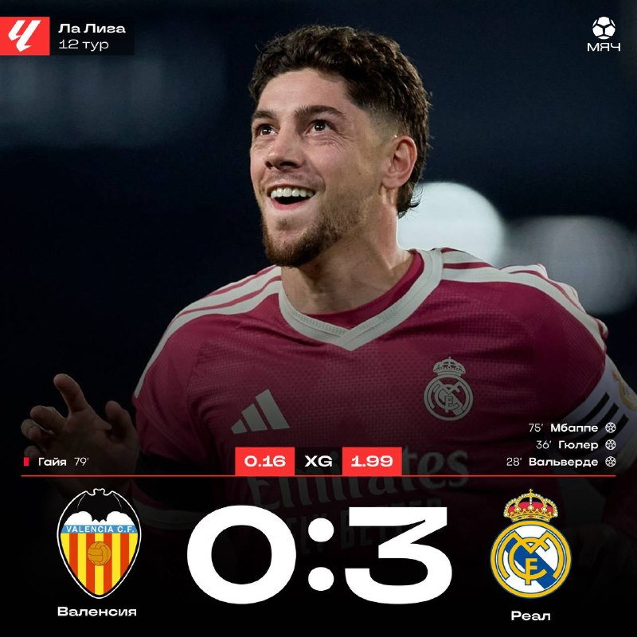
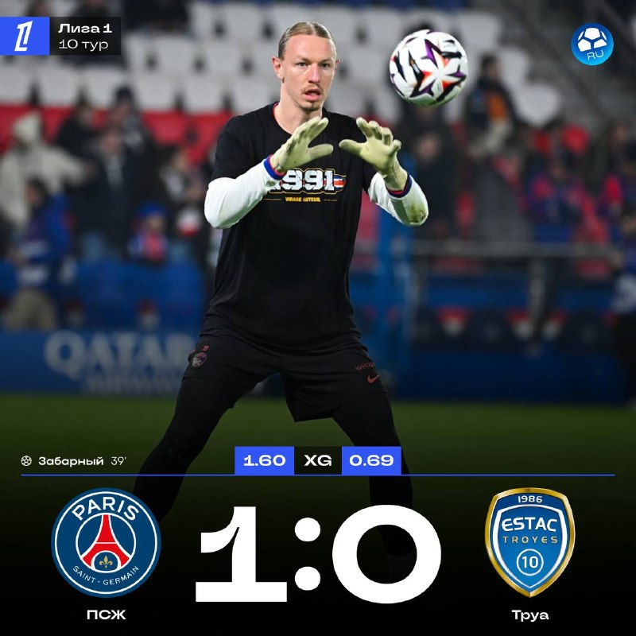
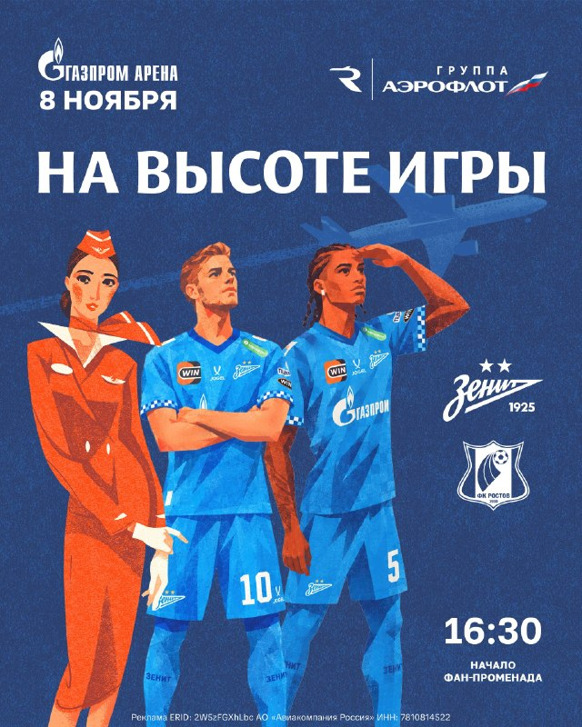

# Футбольный дайджест — 8 ноября 2026

_Период: с 7 по 8 ноября (материалы собраны 8 ноября в 07:05 МСК; матч «Зенит» — «Ростов» сегодня в 18:30 ещё впереди)_

## ⭐ Главное
- **«Реал» победил в Валенсии 3:0 и выиграл восьмой матч подряд.** Голы: Вальверде (28'), Гюлер (36') и Мбаппе (75'). Это первая такая серия мадридцев с 2022 года; после паузы на сборные команда Моуринью выиграла 8 из 8, а в последних 7 матчах забила 23 гола. «Реал» догнал «Барселону» по очкам (по 30), но «Барса» ещё играет с «Атлетико» вечером 8 ноября. Мбаппе забил 13 голов в 12 играх Ла Лиги (17 в 16 матчах во всех турнирах), у Гюлера 11 результативных действий (гол+пас) в сезоне. [МЯЧ](https://t.me/myachPRO/25169) · [Романо](https://t.me/FabrizioRomanoTG/68118) · [Романо](https://t.me/FabrizioRomanoTG/68116) · [Романо](https://t.me/FabrizioRomanoTG/68115)

## ⚽ Результаты
- **Реал:** «Валенсия» — «Реал» 0:3 (Вальверде 28', Гюлер 36', Мбаппе 75'). Следующий матч Реала в материалах не указан: впереди пауза на сборные (7 дней вперёд в расписании только Лига наций) — дата уточняется. [ESPN](https://www.espn.com/soccer/match/_/gameId/401882808)
- **Зенит** не играл. Следующий матч: **8 ноября, «Зенит» — «Ростов», 18:30 МСК, РПЛ**. [ESPN](https://www.espn.com/soccer/match/_/gameId/401879809)
- **Лига 1:** «ПСЖ» — «Труа» 1:0 (Забарный 39') — 11-я победа подряд во всех турнирах. [ESPN](https://www.espn.com/soccer/match/_/gameId/401876407) · [Романо](https://t.me/FabrizioRomanoTG/68119)
- **Ла Лига:** «Малага» — «Расинг» 1:2 (Дотор 28'; Луке 50', Забири 60'). [ESPN](https://www.espn.com/soccer/match/_/gameId/401882812)
- **Саудовская Лига:** «Аль-Хазм» — «Аль-Наср» — в ESPN статус «перенесён». [ESPN](https://www.espn.com/soccer/match/_/gameId/401900442)

## 👤 Мои игроки
- **Роналду:** «Аль-Наср» в этот тур не играл — матч с «Аль-Хазмом» перенесён (статус ESPN), новая дата в материалах не указана. [ESPN](https://www.espn.com/soccer/match/_/gameId/401900442)
- **Мбаппе** — гол на 75-й минуте в Валенсии; 13 голов в 12 матчах Ла Лиги. [Романо](https://t.me/FabrizioRomanoTG/68116)
- **Сафонов** — третий «сухарь» в последних четырёх матчах: «ПСЖ» обыграл «Труа» 1:0, у Матвея 3 сейва и 0,17 предотвращённого гола; болельщики снова хвалят его игру ногами. Порталы приписывали ему ассист на Забарного, но, как пишут «МЯЧ» и «МЯЧ RU», голевой передачи от Сафонова не было — скидывал Меюлю. [МЯЧ RU](https://t.me/myachrus/10169) · [МЯЧ](https://t.me/myachPRO/25167) · [Sports.ru](https://t.me/sportsru/131494)

- **Беллингем, Куртуа** — в материалах не упомянуты. **Холанд, Батраков, Глушенков, Аршавин** — новостей с прошлого выпуска нет.

## 🔁 Трансферы
- **Официально:** нет новостей.
- **Слухи:** Ферран Торрес, по данным El Nacional (через Sports.ru), сообщил окружению, что хочет вернуться в «Барселону»: за «ПСЖ» он не забивает 7 матчей подряд. [Sports.ru](https://t.me/sportsru/131496)

## 🩹 Травмы
- Нет новостей по ключевым игрокам. Вини Жуниор дисквалифицирован и пропускал матч в Валенсии (Marca, через Sports.ru). [Sports.ru](https://t.me/sportsru/131495)

## 🔥 Ещё важное
- **Моуринью про календарь:** «Надеюсь, Ла Лига не устроит такую шутку снова — марафон матчей на этой неделе. Игрокам нужен отдых». [Романо](https://t.me/FabrizioRomanoTG/68120)
- **Месси второй год подряд — лучший бомбардир MLS** (Золотая бутса): 29 голов в 28 матчах в 2025-м и 26 в 31 в 2026-м; первый игрок в истории с таким дублем. [Романо](https://t.me/FabrizioRomanoTG/68122)
- **«Манчестер Юнайтед» — в зоне вылета АПЛ** после поражения «Сити»; чтобы выбраться, нужна победа над «Астон Виллой». «Сити» проиграл три матча АПЛ подряд впервые с 2024-го. [МЯЧ](https://t.me/myachPRO/25166) · [Романо](https://t.me/FabrizioRomanoTG/68110)
- **«Краснодар» не проигрывает ЦСКА дома 9 лет** (последняя победа гостей — 2017-й); 4:2 прервало серию из 7 туров без побед. [МЯЧ RU](https://t.me/myachrus/10164)

## 📅 Ближайшие матчи
- **Зенит — «Ростов»**, РПЛ, 8 ноября, 18:30 МСК (Газпром Арена; фан-променад с 16:30). [ESPN](https://www.espn.com/soccer/match/_/gameId/401879809) · [Зенит](https://t.me/fczenit/38497)

- **Реал:** ближайший матч в материалах не указан — уточняется.
- **«Атлетико» — «Барселона»**, Ла Лига, 8 ноября, 23:00 МСК. [ESPN](https://www.espn.com/soccer/match/_/gameId/401882816)
- **Лига наций, 12 ноября:** Чехия — Испания, Англия — Хорватия, Италия — Франция (22:45 МСК). [ESPN](https://www.espn.com/soccer/match/_/gameId/401861148)
- **Лига наций, 14 ноября:** Португалия — Дания, 22:45 МСК. [ESPN](https://www.espn.com/soccer/match/_/gameId/401861167)
- **Лига наций, 15 ноября:** Испания — Англия, 22:45 МСК. [ESPN](https://www.espn.com/soccer/match/_/gameId/401861175)
