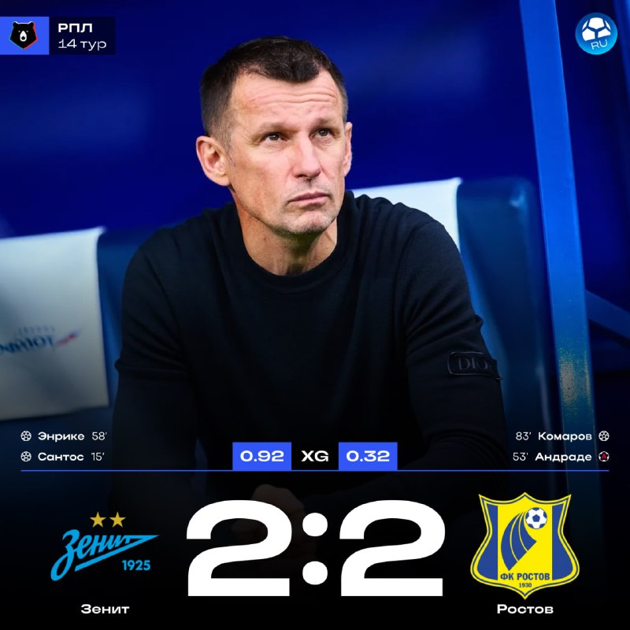
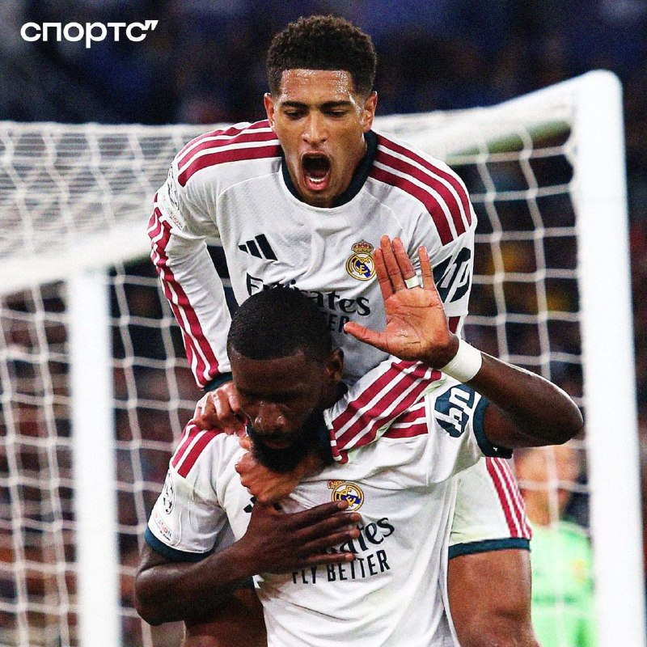
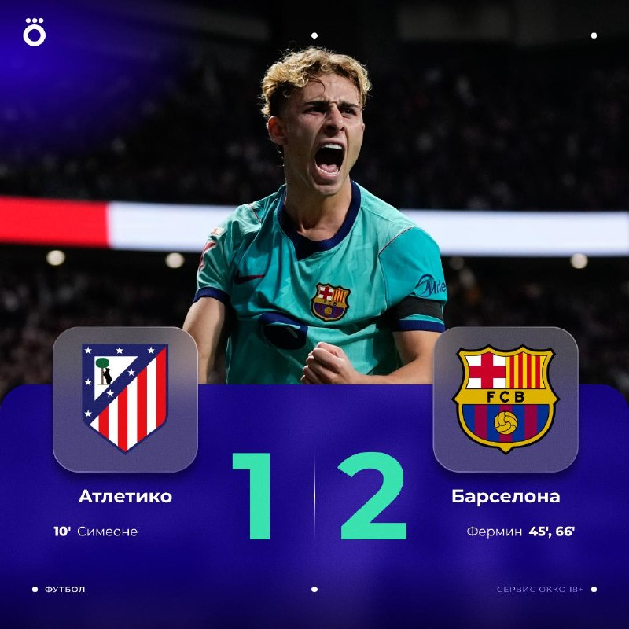
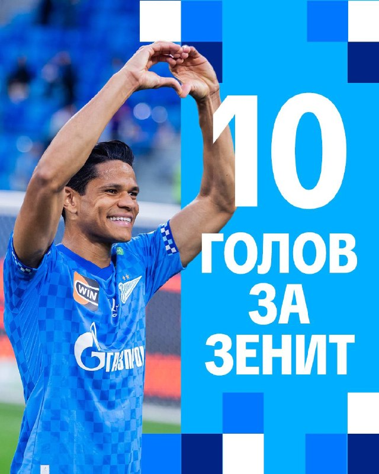

# Футбольный дайджест — 9 ноября 2026

_Период: с 8 по 9 ноября (материалы собраны 9 ноября в 07:11 МСК; плюс то, что выпуск 8 ноября пропустил: гол Батракова и уход Роналду из сборной)_

## ⭐ Главное
- **«Зенит» дома сыграл 2:2 с «Ростовом» — первая ничья петербуржцев в сезоне.** Дуглас Сантос открыл счёт на 15-й минуте, после перерыва «Ростов» сравнял автоголом Андраде (53'), Луис Энрике вернул лидерство дальним ударом (58'), но Комаров на 83-й спас гостям очко. Глушенков отдал 5-й ассист в сезоне (2-й показатель лиги). «Зенит» делит первое место в РПЛ с «Динамо», «Спартак» — 3-й с отставанием в 2 очка. [МЯЧ RU](https://t.me/myachrus/10179) · [Sports.ru](https://t.me/sportsru/131525) · [ESPN](https://www.espn.com/soccer/match/_/gameId/401879809)

- **Беллингему и Рюдигеру грозит до 12 матчей дисквалификации.** По данным испанских СМИ (À Punt, Marca, AS), в перерыве матча в Валенсии в подтрибунке вспыхнула потасовка: Джуд якобы ударил охранника, Рюдигер дал пощёчину другому сотруднику. Судья эпизоды в протоколе не отразил, но у «Валенсии» есть видео — оно может стать основанием для наказания. Официального решения пока нет. [Sports.ru](https://t.me/sportsru/131511) · [Окко Спорт](https://t.me/okkosport/44530) · [Спорт-Экспресс](https://t.me/sportexpress/84786)

- **Роналду объявил об уходе из сборной Португалии** (сообщение 7 ноября — в прошлом выпуске его не было). 23 года, 146 голов за национальную команду. По данным Романо, новым капитаном станет Бернарду Силва. Болельщики «Спортинга» почтили Криштиану на 7-й минуте матча с «Морейренсе», авиакомпания Transavia France вывела из продажи место 7C на рейсах на Мадейру. [Окко Спорт](https://t.me/okkosport/44509) · [Романо](https://t.me/FabrizioRomanoTG/68103) · [Sports.ru](https://t.me/sportsru/131506) · [Sports.ru](https://t.me/sportsru/131469)

## ⚽ Результаты
- **«Атлетико» — «Барселона» 1:2** (Симеоне 10'; Фермин Лопес 45', 66'). «Барса» горела 0:1, но дубль Фермина (7 голов и 5 передач в 11 играх Ла Лиги) вывел её на единоличное первое место — 33 очка против 30 у «Реала». Семиматчевая победная серия «Атлетико» прервана. [ESPN](https://www.espn.com/soccer/match/_/gameId/401882816) · [Романо](https://t.me/FabrizioRomanoTG/68135) · [МЯЧ](https://t.me/myachPRO/25201)

- **«Зенит»** — «Ростов» 2:2 (Дуглас Сантос 15', Луис Энрике 58'; Андраде, а/г, 53', Комаров 83'). Следующий матч: **15 ноября, товарищеский «Зенит» — «Трабзонспор», «Газпром Арена», 15:00 МСК** (клуб продаёт билеты; время — по данным поиска, перед игрой стоит свериться на сайте клуба). Матч РПЛ после паузы — дата уточняется. [ESPN](https://www.espn.com/soccer/match/_/gameId/401879809) · [Зенит](https://t.me/fczenit/38543)
- **Дуглас Сантос** забил юбилейный, 10-й гол за «Зенит»: «Мне очень хотелось забить — уже некоторое время не получалось. Я рад голу, но ещё больше хотел бы радоваться победе». [Зенит](https://t.me/fczenit/38558) · [Зенит](https://t.me/fczenit/38559)

- **«Реал»** в этот период не играл. Последний результат: «Валенсия» — «Реал» 0:3 (8-я победа подряд). Следующий матч в материалах не указан — дата и соперник уточняются (впереди пауза на сборные). [ESPN](https://www.espn.com/soccer/match/_/gameId/401882808)
- **РПЛ, 14-й тур:** «Спартак» — «Акрон» 2:1, «Крылья Советов» — «Газовик» 2:0, «Балтика» — «Динамо» Махачкала 0:1. [ESPN](https://www.espn.com/soccer/match/_/gameId/401879815) · [ESPN](https://www.espn.com/soccer/match/_/gameId/401879814) · [ESPN](https://www.espn.com/soccer/match/_/gameId/401879813)

## 👤 Мои игроки
- **Роналду:** завершил карьеру в сборной Португалии (146 голов, 23 года). За «Аль-Наср» матч с «Аль-Хазмом» перенесён (вся программа 13-го тура Саудовской лиги сдвинута), новая дата не подтверждена; по одному из источников, ближайшая игра — с «Аль-Кадсией» 20 ноября. [Окко Спорт](https://t.me/okkosport/44509) · [ESPN](https://www.espn.com/soccer/match/_/gameId/401900442)
- **Батраков** (догоняем 7 ноября): забил «Амедспору» (4:3) — третий матч подряд с голом, шестой мяч за «Галатасарай» (плюс 3 передачи). Мяч после отскока от вратаря, праздновал под «Калинку»; клуб добавил в магазине джерси с фамилией на кириллице. [МЯЧ](https://t.me/myachPRO/25162) · [Sports.ru](https://t.me/sportsru/131484) · [Окко Спорт](https://t.me/okkosport/44514) · [МЯЧ RU](https://t.me/myachrus/10170)
- **Глушенков:** ассист в матче с «Ростовом» (5-й в сезоне), жёлтая карточка на 72'. 10 голов — делит с Соболевым лидерство среди бомбардиров РПЛ, лучший по «гол+пас» (15 очков). Ранее «Зенит» признал его лучшим игроком октября. [МЯЧ RU](https://t.me/myachrus/10179) · [МЯЧ RU](https://t.me/myachrus/10180) · [Зенит](https://t.me/fczenit/38492)
- **Беллингем** — см. «Главное»: возможная дисквалификация за драку в Валенсии. [Sports.ru](https://t.me/sportsru/131511)
- **Холанд:** «Сити» проиграл в АПЛ третий матч подряд (1:3 в Ноттингеме, Дилап — дубль); в гонке бомбардиров у Холанда 9 голов, Исак («Ливерпуль») — 7. [МЯЧ](https://t.me/myachPRO/25178)
- **Мбаппе, Куртуа, Сафонов, Аршавин** — новых новостей с прошлого выпуска нет.

## 🔁 Трансферы
- **Официально:** нет новостей.
- **Слухи:** нет новостей.

## 🩹 Травмы
- **Нойер** («Бавария»): частичный разрыв сухожилия правой стопы, «Бавария» подтвердила диагноз; вернётся не раньше января (по Bild — около двух месяцев). [Романо](https://t.me/FabrizioRomanoTG/68124) · [Чемпионат](https://t.me/championat/89238)
- **Винисиус:** по данным AS, потерял место в основе «Реала» — Моуринью поддерживает бразильца, но выход в старте больше не гарантирует. [Sports.ru](https://t.me/sportsru/131508)

## 🔥 Ещё важное
- **«Манчестер Юнайтед» — 4:4 с «Астон Виллой»** на «Олд Траффорд»: очередной камбэк и спасённое очко, но команда уходит на паузу 18-й, в зоне вылета, с одной победой в 10 турах АПЛ. [Романо](https://t.me/FabrizioRomanoTG/68130) · [Романо](https://t.me/FabrizioRomanoTG/68131)
- **«Ливерпуль» победил «Кристал Пэлас» 3:1** (Мак Аллистер, Вирц, Исак): Вирц впервые забил в этой АПЛ, команда Ираолы — в трёх очках от «Сити». [МЯЧ](https://t.me/myachPRO/25178)
- **«Локомотив» уволил Галактионова.** Об этом объявил председатель совета директоров Юрий Нагорных; неустойку выплатят по контракту, хотя, по данным Sports.ru, стороны спорили, кто должен платить. [Спорт-Экспресс](https://t.me/sportexpress/84788) · [Sports.ru](https://t.me/sportsru/131507)
- **Месси остаётся в «Интер Майами» до 2028 года** и стал лучшим бомбардиром MLS второй сезон подряд (26 голов в 31 матче). [Романо](https://t.me/FabrizioRomanoTG/68127) · [Чемпионат](https://t.me/championat/89231)

## 📅 Ближайшие матчи
- **«Зенит» — «Трабзонспор»**, товарищеский, 15 ноября, 15:00 МСК, «Газпром Арена». [Зенит](https://t.me/fczenit/38543)
- **«Реал»:** клубных матчей в материалах нет — уточняется.
- **Лига наций, 12 ноября:** Чехия — Испания, Англия — Хорватия, Италия — Франция (22:45 МСК). [ESPN](https://www.espn.com/soccer/match/_/gameId/401861148)
- **Лига наций, 14 ноября:** Норвегия — Уэльс (20:00 МСК), Португалия — Дания (22:45 МСК). [ESPN](https://www.espn.com/soccer/match/_/gameId/401861167)
- **Лига наций, 15 ноября:** Испания — Англия, Франция — Турция (22:45 МСК). [ESPN](https://www.espn.com/soccer/match/_/gameId/401861175)
