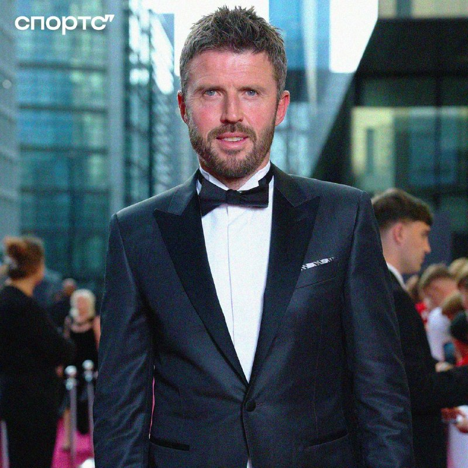
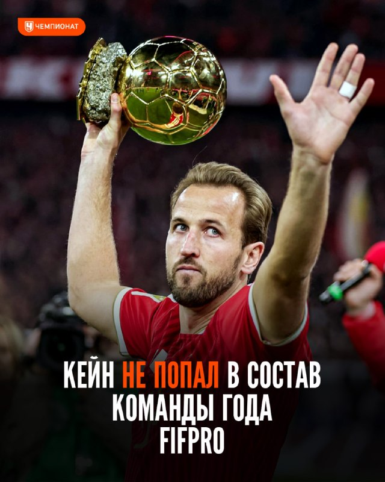
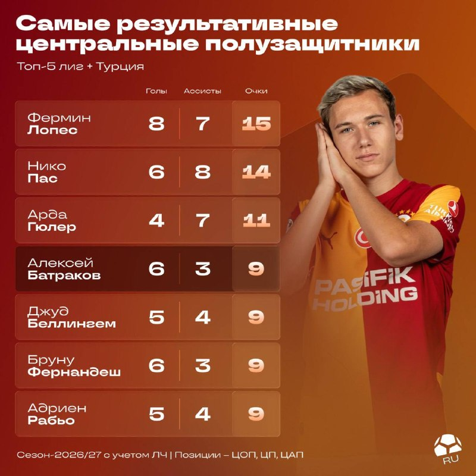
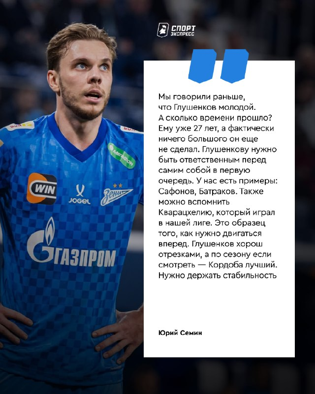
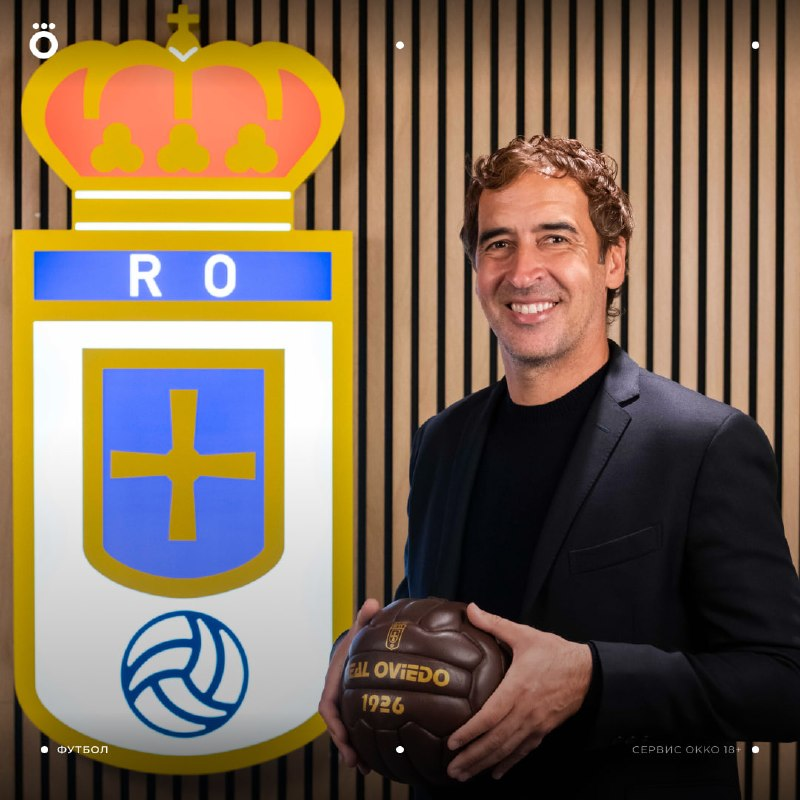

# Футбольный дайджест — 10 ноября 2026

_Период: с 9 по 10 ноября (материалы собраны 10 ноября в 07:03 МСК)_

## ⭐ Главное
- **«Манчестер Юнайтед» близок к увольнению Каррика.** По данным The Athletic, боссы «МЮ» склоняются к отставке тренера и уверены, что найдут замену к матчу с «Ливерпулем» после паузы сборных; Орнштейн пишет то же самое. Романо уточняет: после двух внутренних встреч должность Каррика под серьёзной угрозой, окончательного решения пока нет. Среди основных кандидатов — Почеттино: в его контракте со сборной США есть пункт о досрочном расторжении (Бен Джейкобс). Всё это слухи/инсайды, официально — ничего. Напомним: после 4:4 с «Астон Виллой» «МЮ» — 18-й в АПЛ. [МЯЧ](https://t.me/myachPRO/25212) · [Sports.ru](https://t.me/sportsru/131574) · [Sports.ru](https://t.me/sportsru/131575) · [Романо](https://t.me/FabrizioRomanoTG/68166)

- **Команда года FIFPro: обладателя «Золотого мяча» Кейна в ней нет — впервые с 2005 года.** Среди нападающих победил Мбаппе (46% голосов), в топ-11 также Ямаль, Месси и Холанд; Кейн — 5-й (27,6%), Роналду набрал 13,2%. Вратарь — Райя (51,9%), Куртуа — вторым, за ним Мартинес. В середине поля побеждает Родри (33,4%), Беллингем в топ-11, Вальверде — 8-й. [Романо](https://t.me/FabrizioRomanoTG/68150) · [Романо](https://t.me/FabrizioRomanoTG/68165) · [Романо](https://t.me/FabrizioRomanoTG/68162) · [Романо](https://t.me/FabrizioRomanoTG/68164) · [Чемпионат](https://t.me/championat/89268)

## ⚽ Результаты
- **«Реал»** с прошлого выпуска не играл: последний результат — 3:0 в Валенсии (8-я победа подряд), в Ла Лиге 30 очков, на 3 меньше «Барселоны». Следующий матч в ESPN-расписании не указан — дата и время уточняются (по данным поиска, ориентировочно «Сельта» 21–22 ноября, не подтверждено). Моуринью назван лучшим тренером Ла Лиги в октябре. [Sports.ru](https://t.me/sportsru/131558) · [Романо](https://t.me/FabrizioRomanoTG/68143)
- **«Зенит»** не играл: последний матч — 2:2 с «Ростовом». Следующий: **15 ноября, товарищеский «Зенит» — «Трабзонспор», «Газпром Арена»** (время — на сайте клуба; клуб готовит тематический фан-променад «Турецкий базар»). Также «Зенит» открыл продление и продажу абонементов на второй круг сезона. [Зенит](https://t.me/fczenit/38562) · [Зенит](https://t.me/fczenit/38563)

## 👤 Мои игроки
- **Батраков** — в топ-4 по результативности среди центральных полузащитников Европы (с учётом Турции и ЛЧ): после перехода в «Галатасарай» 6 голов и 3 ассиста в 13 матчах (9 очков), на уровне Беллингема и Бруну Фернандеша; впереди только Фермин, Пас и Гюлер. Ещё фанат подарил ему шапку-ушанку с эмблемой «Галатасарая». [МЯЧ RU](https://t.me/myachrus/10185) · [Окко Спорт](https://t.me/okkosport/44559)

- **Глушенков:** Юрий Семин раскритиковал его: «Ему уже 27 лет, а фактически ничего большого он ещё не сделал… хорош отрезками, а по сезону лучший — Кордоба. Нужно держать стабильность». Напомним, у Макса 10 голов и 5 ассистов в сезоне РПЛ. [Спорт-Экспресс](https://t.me/sportexpress/84836)

- **Роналду:** набрал 13,2% голосов среди нападающих в голосовании FIFPro за команду года (в топ-11 не вошёл). Матч «Аль-Насра» с «Аль-Хазмом» перенесён, новая дата не подтверждена; по данным поиска, ближайшая игра — с «Аль-Кадсией» 20 ноября. [Романо](https://t.me/FabrizioRomanoTG/68165)
- **Мбаппе:** признан лучшим игроком октября в Ла Лиге и победил в голосовании FIFPro среди нападающих (46%). [Романо](https://t.me/FabrizioRomanoTG/68151) · [Романо](https://t.me/FabrizioRomanoTG/68165)
- **Куртуа:** второй в голосовании FIFPro среди вратарей (победил Райя, 51,9%). [Романо](https://t.me/FabrizioRomanoTG/68162)
- **Беллингем:** вошёл в топ-11 голосования FIFPro среди полузащитников. Вопрос возможной дисквалификации за драку в Валенсии (прошлый выпуск) — без официального решения в материалах. [Романо](https://t.me/FabrizioRomanoTG/68164)
- **Холанд:** получил «Золотой игрок» (Golden Boy) 2026 по сообщению Романо и вошёл в топ-11 FIFPro среди нападающих. Лучшим молодым игроком Европы признан Кубарси. [Романо](https://t.me/FabrizioRomanoTG/68155) · [Романо](https://t.me/FabrizioRomanoTG/68145)
- **Сафонов:** прилетел в Москву к сборной России и остался без багажа: «Хорошо, не с бутсами, мне хоть есть в чём тренироваться». Матч с Узбекистаном — дата в материалах не указана. [Окко Спорт](https://t.me/okkosport/44553)
- **Аршавин** — новостей нет.

## 🔁 Трансферы
- **Официально:** Нет новостей
- **Слухи:** Почеттино — один из основных кандидатов на пост тренера «МЮ» (Бен Джейкобс через Sports.ru; см. «Главное»). Защитник «Аугсбурга» Хрислен Матсима сменил агентство, клуб ранее отклонил €25 млн от «Кристал Пэлас» (Романо). [Sports.ru](https://t.me/sportsru/131575) · [Романо](https://t.me/FabrizioRomanoTG/68160)

## 🩹 Травмы
- **Барселона:** **Ямаль:** боль в правом колене после матча с «Атлетико» — пропустит игру сборной Испании с Чехией, к команде присоединится перед матчем с Англией. [Романо](https://t.me/FabrizioRomanoTG/68142) · [Sports.ru](https://t.me/sportsru/131556)
- **Ливерпуль:** **Ван Дейк** и Бробби не помогут сборной Нидерландов — оба не в форме. [Романо](https://t.me/FabrizioRomanoTG/68152)
- **Бавария:** **Мусиала** потерял сознание во второй раз за три дня (Sports.ru). [Sports.ru](https://t.me/sportsru/131546)

## 🔥 Ещё важное
- **Рауль возглавил «Реал Овьедо»** — первая работа главным тренером в карьере. Легенда «Реала» ранее тренировал «Кастилью»; «Овьедо» играет в Сегунде. [Романо](https://t.me/FabrizioRomanoTG/68144) · [Окко Спорт](https://t.me/okkosport/44552) · [Чемпионат](https://t.me/championat/89270)

- **«Динамо» отстранило Тамбиева** от должности главного тренера после словесной перепалки с болельщиками после 3:4 с «Торпедо»; исполняющим обязанности назначен Олег Ореховский. [Чемпионат](https://t.me/championat/89262) · [Спорт-Экспресс](https://t.me/sportexpress/84827)
- **Умер форвард «Тенерифе» Хесус де Мигель** — ему было 30 лет; накануне он перенёс остановку сердца и дыхания после столкновения с вратарём «Андорры». [Sports.ru](https://t.me/sportsru/131572)
- **Мирра Андреева** с баранкой обыграла Свитолину на старте Итогового турнира WTA и вышла с Соболенко в лидеры группы. [Чемпионат](https://t.me/championat/89276)

## 📅 Ближайшие матчи
- **«Зенит» — «Трабзонспор»** — Товарищеский · «Газпром Арена», время уточняется. [Зенит](https://t.me/fczenit/38562)
- **«Реал»** — дата и время следующего матча уточняются.
- **Лига наций, 12 ноября:** Турция — Бельгия (20:00 МСК), Англия — Хорватия, Чехия — Испания, Италия — Франция (22:45 МСК). [ESPN](https://www.espn.com/soccer/match/_/gameId/401861148)
- **Лига наций, 13 ноября:** Сербия — Германия, Нидерланды — Греция, Шотландия — Северная Македония (22:45 МСК). [ESPN](https://www.espn.com/soccer/match/_/gameId/401861158)
- **Лига наций, 14 ноября:** Норвегия — Уэльс (20:00 МСК), Швеция — Босния и Герцеговина, Румыния — Польша (22:45 МСК). [ESPN](https://www.espn.com/soccer/match/_/gameId/401861165)
