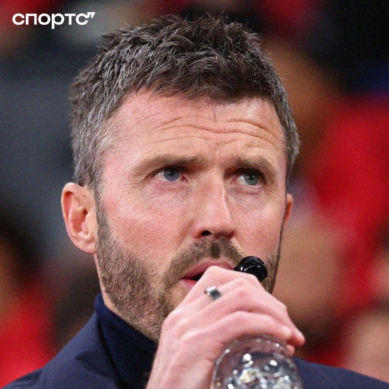
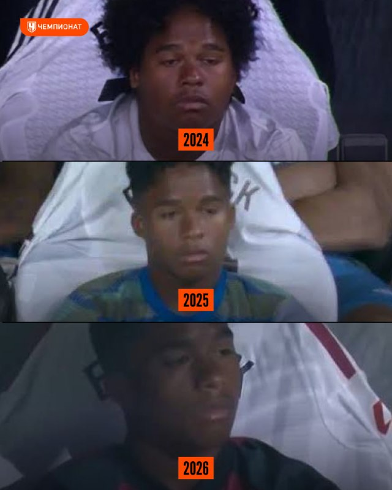
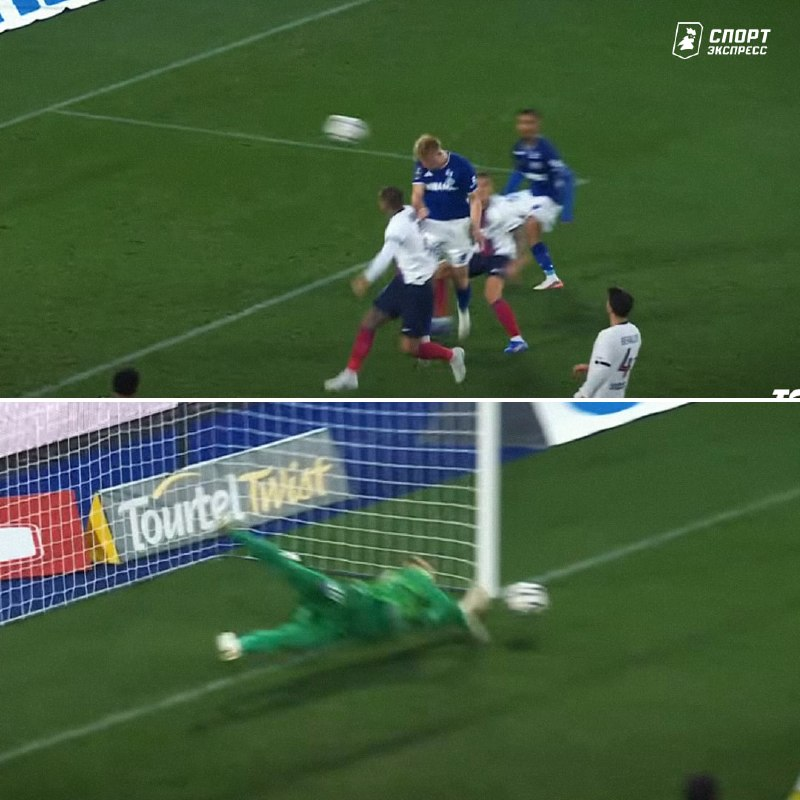
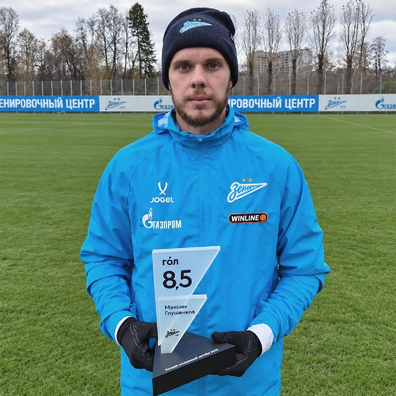
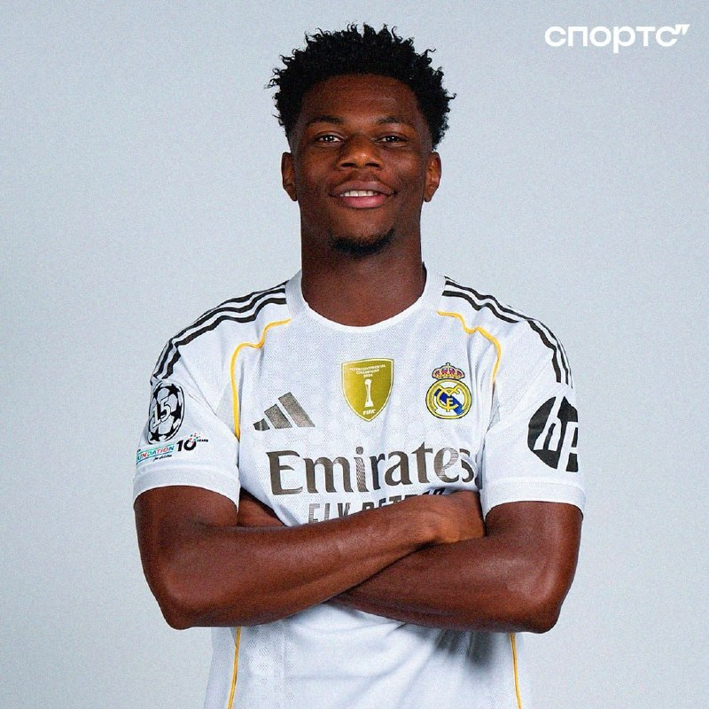

# Футбольный дайджест — 11 ноября 2026

_Период: с 10 по 11 ноября (материалы собраны 11 ноября в 07:10 МСК)_

## ⭐ Главное
- **«Манчестер Юнайтед» вот-вот уволит Каррика.** The Telegraph пишет, что Майклу Каррику «уже сегодня» сообщат об увольнении. Главный претендент — Маурисио Почеттино (недавно продлил контракт со сборной США до 2030 года); Окко Спорт со ссылкой на BBC добавляет, что аргентинский специалист открыт к переходу в «МЮ». Сам Кэррик после 4:4 с «Астон Виллой» заявил, что уходить не собирается. Официального объявления в материалах нет — это инсайды. [Sports.ru](https://t.me/sportsru/131583) · [Чемпионат](https://t.me/championat/89277) · [Окко Спорт](https://t.me/okkosport/44564)

- **Эндрик снова просится из «Реала».** По данным As, бразилец допускает зимнюю аренду ради игровой практики: в этом сезоне у него лишь 140 минут за «Реал» во всех турнирах (85 — в Ла Лиге). Называют «Рому», «Милан» и «Спортинг». Сам игрок: «Я очень верю в Моуринью, он каждый день интересуется моей жизнью», а про январь — «это в руках Бога». Грустное лицо Эндрика на лавке — мем уже третий год. [Sports.ru](https://t.me/sportsru/131597) · [Чемпионат](https://t.me/championat/89297) · [Романо](https://t.me/FabrizioRomanoTG/68172) · [Романо](https://t.me/FabrizioRomanoTG/68173)

## ⚽ Результаты
- **«Реал»** с прошлого выпуска не играл — пауза сборных. Последний результат: 3:0 в Валенсии. Следующий матч в ESPN-расписании не указан — дата и время уточняются. Карлос Эспи после игры в Валенсии (родные края форварда) сфотографировался с двумя бабушками. [Sports.ru](https://t.me/sportsru/131598)
- **«Зенит»** не играл: последний матч — 2:2 с «Ростовом». Следующий: **15 ноября, 17:00 МСК, «Зенит» — «Трабзонспор»**, «Газпром Арена» (матч WINLINE Суперсерии; покажут в Китае, Казахстане и Бразилии). Клуб открыл голосование за лучшего игрока матча с «Ростовом». [Зенит](https://t.me/fczenit/38570) · [Зенит](https://t.me/fczenit/38567)

## 👤 Мои игроки
- **Сафонов:** его сейв в матче со «Страсбуром» признан лучшим спасением октября в Лиге 1: вытащил сложнейший удар из нижнего угла — один из семи сейвов в том матче, плюс лучшая оценка на поле. Но в топ-10 вратарей года FIFPro Матвея нет. [Спорт-Экспресс](https://t.me/sportexpress/84853) · [Спорт-Экспресс](https://t.me/sportexpress/84838)

- **Глушенков:** признан лучшим нападающим РПЛ в октябре по Индексу ГОЛа — оценка 8,5 (самая высокая среди всех лучших игроков месяца, 8,52), четыре мяча в трёх матчах. [Зенит](https://t.me/fczenit/38566) · [Sports.ru](https://t.me/sportsru/131581)

- **Роналду:** в символическую сборную FIFPro не попал, но Championat напоминает: 15 лет на топ-уровне — ни у кого больше нет и 12 попаданий в сборную года (у Месси — 18-е). Матчей «Аль-Насра» в материалах нет; дата следующей игры уточняется. [Чемпионат](https://t.me/championat/89283)
- **Батраков:** вошёл в «Команду недели» МЯЧ (стартовый состав, 10-й выпуск) за два хороших матча. Агент рассказал: сделка едва не сорвалась — Ротенберг требовал поднять долю с перепродажи с 10 до 15%; Алексей отказался от части выплат, отступные в контракте с «Галатасараем» выросли с €50 до €55 млн. «Галатасарай» выпустит шапку-ушанку и коллекцию мерча с его фамилией на кириллице. [МЯЧ](https://t.me/myachPRO/25213) · [Спорт-Экспресс](https://t.me/sportexpress/84839) · [Sports.ru](https://t.me/sportsru/131579)
- **Беллингем:** Джуд и его брат Джоб впервые тренировались вместе в сборной Англии — Джоб получил первый вызов в основную команду. [Романо](https://t.me/FabrizioRomanoTG/68187) · [Окко Спорт](https://t.me/okkosport/44572)
- **Мбаппе:** вирусное видео — мальчик из толпы дважды назвал Килиана «диктатором», тот с трудом улыбнулся и быстро ушёл. [Sports.ru](https://t.me/sportsru/131584) · [Чемпионат](https://t.me/championat/89287)
- **Куртуа, Холанд, Аршавин** — новостей нет.

## 🔁 Трансферы
- **Официально:** Нет новостей
- **Слухи:** Эндрик («Реал») — аренда зимой: «Рома», «Милан», «Спортинг» (As через Sports.ru). Лорис Кариус («Шальке», 33 года) — кандидат на роль вратаря «Баварии» (Флориан Плеттенберг; Sky). «Наполи» хочет расстаться с Де Брюйне в январе (Il Mattino). Индзаги, по Championat/Скире, не будет продлевать контракт с «Аль-Хилялем», но его агент называет это неправдой — решения нет. [Sports.ru](https://t.me/sportsru/131597) · [Sports.ru](https://t.me/sportsru/131580) · [Sports.ru](https://t.me/sportsru/131587) · [Романо](https://t.me/FabrizioRomanoTG/68175)

## 🩹 Травмы
- **Реал:** **Тчуамени** получил травму лобка на тренировке сборной Франции (L’Équipe) и покинет команду; завтра будет в Мадриде, где определят объём повреждения. Тюрам тоже выбыл из сборной из-за мышечной травмы, вместо него вызван Эли Жюниор Круапи; вместо травмированного Калюлю — Саэль Кумбеди. [Sports.ru](https://t.me/sportsru/131595) · [Романо](https://t.me/FabrizioRomanoTG/68188) · [Романо](https://t.me/FabrizioRomanoTG/68183) · [Sports.ru](https://t.me/sportsru/131588)

- **Бавария:** **Компани** потерял сознание на тренировке (обострение вирусной инфекции, BILD), госпитализирован; уже вернулся на базу, первый матч проведёт после паузы сборных. [Окко Спорт](https://t.me/okkosport/44568) · [Чемпионат](https://t.me/championat/89285)

## 🔥 Ещё важное
- **Новый стадион «Милана» и «Интера» под угрозой:** городской совет Милана проголосовал против проекта нового стадиона и потребовал новое экологическое исследование. Если опасения подтвердятся, клубам придётся остаться на «Сан-Сиро». [Sports.ru](https://t.me/sportsru/131589)
- **Арсен Венгер близок к участию в выборах президента ФИФА** — чувствует «долг» помешать Инфантино остаться ещё на четыре года (L’Équipe). [Sports.ru](https://t.me/sportsru/131577)
- **Месси завершил карьеру в сборной Аргентины, а «десятка» свободна.** По ESPN, главные претенденты — Лаутаро Мартинес и Нико Пас; выбор могут отложить до 2027 года. [Чемпионат](https://t.me/championat/89292) · [Окко Спорт](https://t.me/okkosport/44570)
- **Семин может возглавить «Локомотив».** Слух от Спорт-Экспресс; официального подтверждения нет. [Спорт-Экспресс](https://t.me/sportexpress/84851)

## 📅 Ближайшие матчи
- **«Зенит» — «Трабзонспор»** — Товарищеский (WINLINE Суперсерия) · «Газпром Арена», 17:00 МСК. [Зенит](https://t.me/fczenit/38570)
- **«Реал»** — дата и время следующего матча уточняются.
- **Лига наций, 12 ноября:** Турция — Бельгия (20:00 МСК), Чехия — Испания, Англия — Хорватия, Италия — Франция (22:45 МСК). [ESPN](https://www.espn.com/soccer/match/_/gameId/401861148)
- **Лига наций, 13 ноября:** Сербия — Германия, Нидерланды — Греция, Шотландия — Северная Македония (22:45 МСК). [ESPN](https://www.espn.com/soccer/match/_/gameId/401861158)
- **Лига наций, 14 ноября:** Норвегия — Уэльс (20:00 МСК), Португалия — Дания, Швеция — Босния и Герцеговина (22:45 МСК). [ESPN](https://www.espn.com/soccer/match/_/gameId/401861165)
- **Лига наций, 15 ноября:** Испания — Англия, Бельгия — Италия, Франция — Турция (22:45 МСК). [ESPN](https://www.espn.com/soccer/match/_/gameId/401861175)
