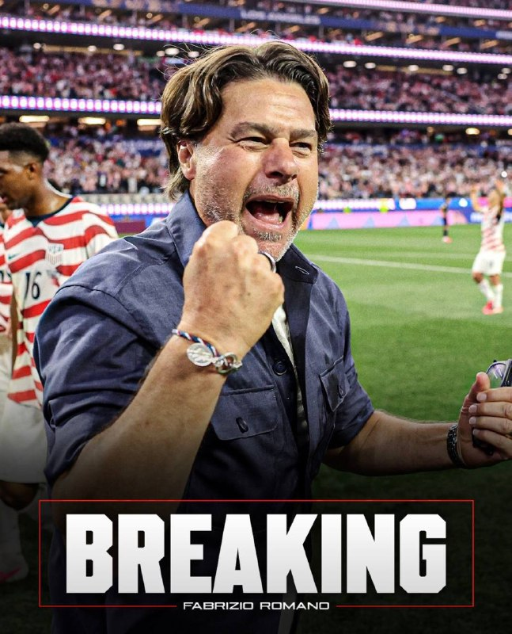
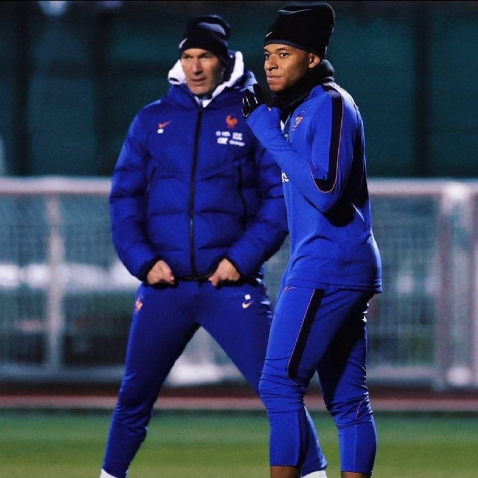
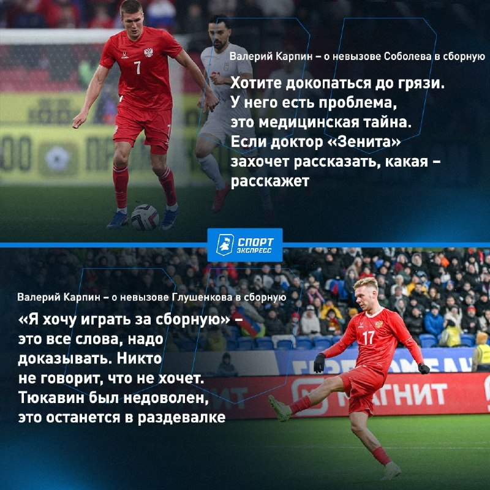

# Футбольный дайджест — 12 ноября 2026

_Период: с 11 по 12 ноября (материалы собраны 12 ноября в 07:10 МСК)_

## ⭐ Главное
- **«Манчестер Юнайтед» договорился с Почеттино.** Фабрицио Романо: «МЮ» устно согласовал с Маурисио Почеттино условия в принципе — он станет новым главным тренером. Идут переговоры со Федерацией футбола США: у аргентинца есть пункт об отступных в $10 млн. Дальше — формальные шаги, и только потом «here we go». Каррику, по данным МЯЧ, об увольнении ещё не сообщали. Параллельно The Athletic пишет, что сборная США попытается назначить вместо Почеттино Пепа Гвардиолу. Официального объявления клуба нет — это инсайды. [Романо](https://t.me/FabrizioRomanoTG/68214) · [МЯЧ](https://t.me/myachPRO/25231) · [Sports.ru](https://t.me/sportsru/131622)

- **Мбаппе пропустит матч Италия — Франция.** Килиан получил дискомфорт в задней поверхности бедра на сборе и не сыграет 12 ноября против Италии (решение принято, Романо). По версии МЯЧ и Окко, к воскресенью, матчу с Турцией, он может восстановиться. L’Équipe добавляет: Мбаппе не понравилось, что Зидан ставил Дембеле центрфорвардом, а его самого сместил на фланг в игре с Турцией, и в сентябре они почти не общались; Зидан попробует наладить отношения. [Романо](https://t.me/FabrizioRomanoTG/68205) · [МЯЧ](https://t.me/myachPRO/25225) · [Окко Спорт](https://t.me/okkosport/44579) · [Sports.ru](https://t.me/sportsru/131609)

## ⚽ Результаты
- **«Реал»** с прошлого выпуска не играл — пауза сборных. Следующий матч в расписании ESPN на 7 дней не указан; по поиску, ближайшая игра — вероятно, 21–22 ноября (Ла Лига), а 24 ноября в Лиге чемпионов — «Реал» — ПСВ; дата и время не подтверждены, уточняются. Эспи в интервью El Larguero: к нему были готовы клубы АПЛ, «но потом появился «Реал», и отказать невозможно — сделка была закрыта за 48 часов»; «Моуринью очень обо мне заботится». [Романо](https://t.me/FabrizioRomanoTG/68202) · [Романо](https://t.me/FabrizioRomanoTG/68201)
- **«Зенит»** не играл. Следующий матч: **15 ноября, 17:00 МСК, «Зенит» — «Трабзонспор»** («Газпром Арена», WINLINE Суперсерия); перед игрой — автограф-сессия Александра Ерохина. Затем — **24 ноября, 19:30 МСК, «Зенит» — «Крылья Советов»**, FONBET Кубок России: билеты уже в продаже. [Зенит](https://t.me/fczenit/38577) · [Зенит](https://t.me/fczenit/38580)

## 👤 Мои игроки
- **Глушенков:** Карпин объяснил, почему нападающий не в сборной: «“Я хочу играть за сборную” — это слова, надо доказывать. Никто не говорит, что не хочет. Тюкавин был недоволен — это останется в раздевалке». Про Соболева: у него «проблема — медицинская тайна». Параллельно «Зенит» признал Максима лучшим игроком матча с «Ростовом» (результативное действие). МЯЧ при этом ставит его в стартовый состав «самых используемых» при Карпине. [Спорт-Экспресс](https://t.me/sportexpress/84878) · [Зенит](https://t.me/fczenit/38579) · [МЯЧ](https://t.me/myachrus/10199)

- **Роналду:** матчей и новостей в материалах нет. По найденному в поиске, «Аль-Наср» ждёт игра 20 ноября после переноса 13-го тура (соперник в источниках указан по-разному — уточняется). [Worldsoccertalk](https://worldsoccertalk.com/amp/news/cristiano-ronaldo-handed-new-brutal-al-nassr-schedule-as-seven-matches-confirmed-before-2026-end-after-saudi-pro-leagues-major-fixture-changes)
- **Куртуа:** про Моуринью: «Он заполняет комнату — присутствие чувствуется, как только заходит в раздевалку. Нам нужно было что-то такое» (Sky). Про Беллингема: «лучший игрок чемпионата мира». [Романо](https://t.me/FabrizioRomanoTG/68208) · [Романо](https://t.me/FabrizioRomanoTG/68210)
- **Мбаппе:** см. «Главное» — травма бедра, пропускает Италию. [Романо](https://t.me/FabrizioRomanoTG/68205)
- **Сафонов и Батраков:** Forbes включил обоих в топ-10 самых ценных брендов российских спортсменов: Сафонов — 5-й, Батраков — 7-й (первый Махачев). Болельщики «Галатасарая» в опросе Tivibu Spor оценивают Батракова в €100–120 млн; турецкие СМИ пишут, что клуб готовит новый контракт с отступными. [Sports.ru](https://t.me/sportsru/131624) · [Чемпионат](https://t.me/championat/89317)
- **Беллингем:** признался, что в быту «абсолютно беспомощен»: не водит, не готовит и не убирается — хотя сыграл почти 400 матчей. [Sports.ru](https://t.me/sportsru/131610)
- **Холанд, Аршавин:** новостей нет.

## 🔁 Трансферы
- **Официально:** Нет новостей
- **Слухи:** Эндрик («Реал») — зимняя аренда; более вероятна «Рома», а не «Милан»: по Corriere dello Sport, бразилец не хочет в «Милан» из-за прозвища «дьяволы» (через Sports.ru). «Наполи» хочет продать Де Брюйне в январе (Sports.ru). [Sports.ru](https://t.me/sportsru/131611) · [Sports.ru](https://t.me/sportsru/131614)

## 🩹 Травмы
- **Франция:** **Мбаппе** — дискомфорт в бедре, пропускает Италию, к воскресенью возможен возврат. [МЯЧ](https://t.me/myachPRO/25225)

## 🔥 Ещё важное
- **Каннаваро о России:** накануне матча Россия — Узбекистан в Ташкенте (12 ноября) тренер узбеков назвал нашу сборную «очень тяжёлой: агрессивной, компактной». Время матча в материалах не указано. [Чемпионат](https://t.me/championat/89316) · [Окко Спорт](https://t.me/okkosport/44584)
- **Фенербахче и Кюйт расстались:** голландец не вошёл в штаб нового тренера Эмре Белезоглу; при нём клуб обыграл «Ливерпуль» в ЛЧ и проиграл «Гезтепе». [Sports.ru](https://t.me/sportsru/131612)
- **Мирра Андреева — в полуфинале Итогового турнира:** обыграла Соболенко, взяв 11 геймов подряд после 1:4 в первом сете. [Чемпионат](https://t.me/championat/89328)
- **Рекорд в женской молодёжке:** Виолетта Кахраманзаде («Спартак») забила 8 мячей «Енисею» (13:0), в сезоне — 32 гола в 21 матче. [Sports.ru](https://t.me/sportsru/131620)

## 📅 Ближайшие матчи
- **«Зенит» — «Трабзонспор»** — Товарищеский (WINLINE Суперсерия) · «Газпром Арена», 17:00 МСК. [Зенит](https://t.me/fczenit/38577)
- **«Зенит» — «Крылья Советов»** — Кубок России · 19:30 МСК. [Зенит](https://t.me/fczenit/38580)
- **«Реал»** — дата и время ближайшего матча уточняются.
- **Лига наций, 12 ноября:** Турция — Бельгия (20:00 МСК), Чехия — Испания, Англия — Хорватия, Италия — Франция (22:45 МСК). [ESPN](https://www.espn.com/soccer/match/_/gameId/401861148)
- **Лига наций, 13 ноября:** Сербия — Германия, Нидерланды — Греция, Шотландия — Северная Македония (22:45 МСК). [ESPN](https://www.espn.com/soccer/match/_/gameId/401861158)
- **Лига наций, 14 ноября:** Норвегия — Уэльс (20:00 МСК), Португалия — Дания, Швеция — Босния и Герцеговина (22:45 МСК). [ESPN](https://www.espn.com/soccer/match/_/gameId/401861165)
- **Лига наций, 15 ноября:** Испания — Англия, Бельгия — Италия, Франция — Турция (22:45 МСК). [ESPN](https://www.espn.com/soccer/match/_/gameId/401861175)

