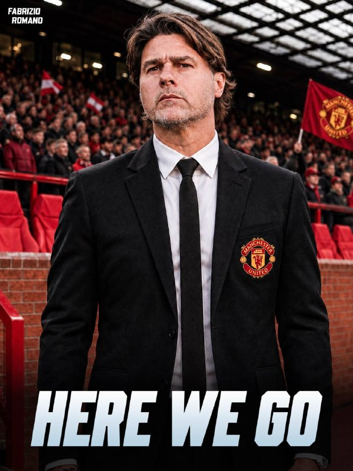
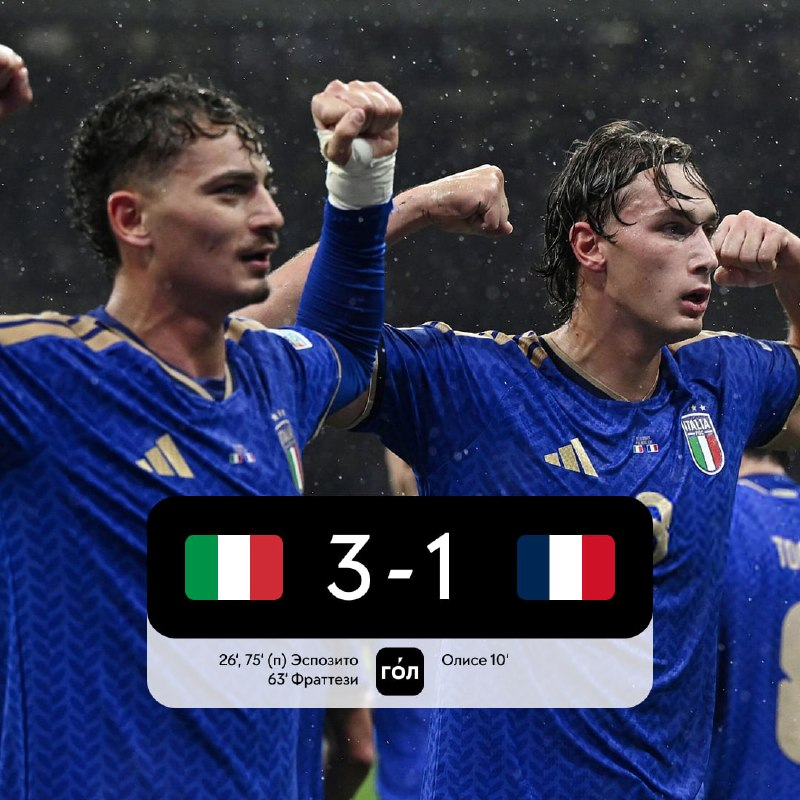
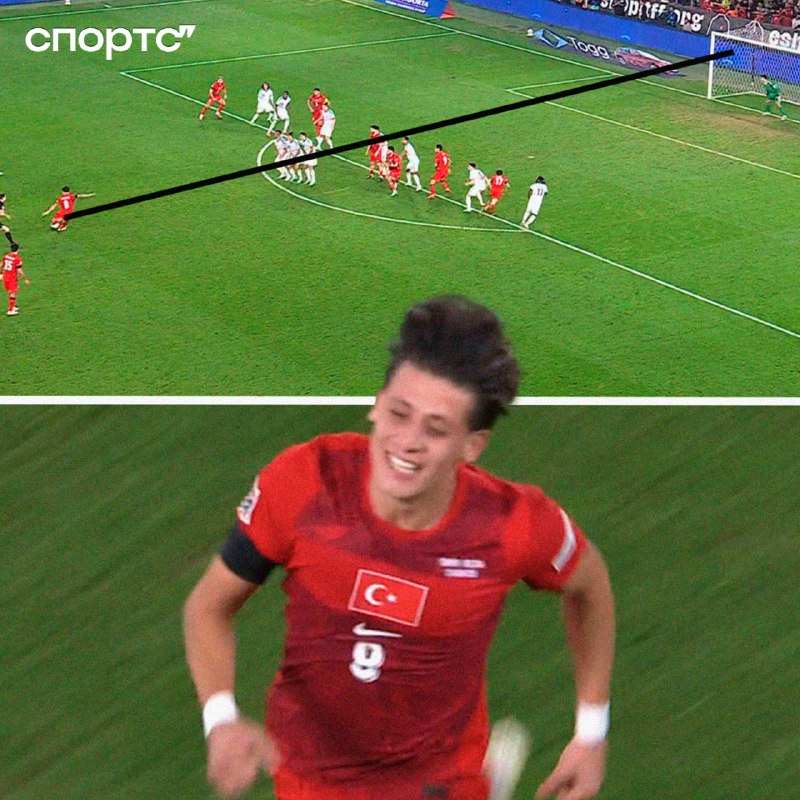
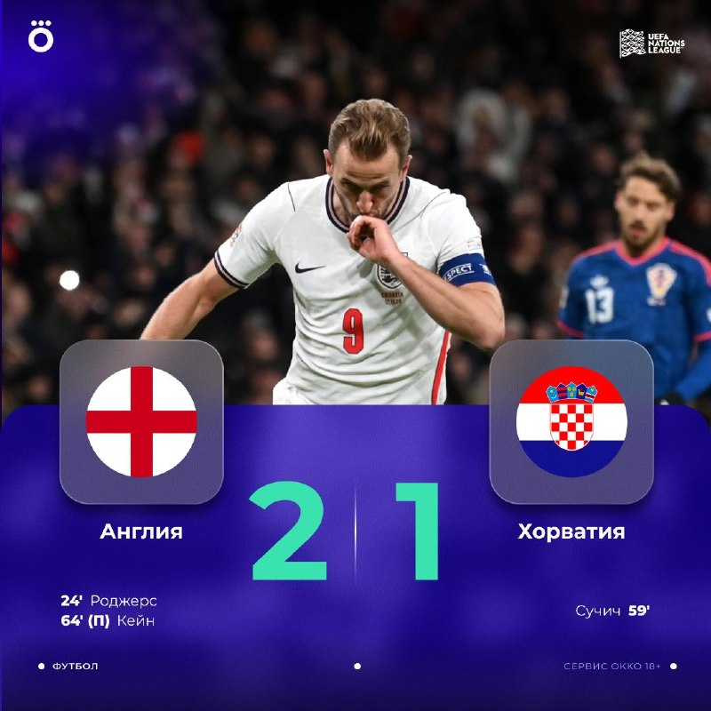

# Футбольный дайджест — 13 ноября 2026

_Период: с 12 по 13 ноября (материалы собраны 13 ноября в 07:08 МСК)_

## ⭐ Главное
- **«Манчестер Юнайтед» назначил Почеттино.** Фабрицио Романо: «here we go» — Маурисио Почеттино новый главный тренер «МЮ», сделка закрыта, «зелёный свет» от Федерации футбола США, условия он согласовал ещё в среду. По данным МЯЧ, манкунианцам пришлось заплатить сборной США отступные в 10 млн евро; для аргентинца это четвёртое назначение в клуб АПЛ. Накануне, по Романо, «МЮ» уволил Майкла Каррика. Официального заявления клуба в материалах пока нет. [Романо](https://t.me/FabrizioRomanoTG/68225) · [Романо](https://t.me/FabrizioRomanoTG/68228) · [МЯЧ](https://t.me/myachPRO/25245) · [Sports.ru](https://t.me/sportsru/131630)

- **Италия — Франция 3:1: французы без Мбаппе проиграли в гостях.** Олисе открыл счёт на 10-й минуте после ошибки Доннаруммы (пять голов в пяти матчах Лиги наций), но дальше Италия перевернула игру: Пио Эспозито на 26-й и с пенальти на 75-й, Фраттези на 63-й. Первая домашняя победа Италии над Францией с 1962 года и первое поражение сборной Франции при Зидане; итальянцы вышли на первое место в группе. Мбаппе в этом матче не играл — вместо него в центре нападения вышел Дуэ. [ESPN](https://www.espn.com/soccer/match/_/gameId/401861151) · [Sports.ru](https://t.me/sportsru/131664) · [Спорт-Экспресс](https://t.me/sportexpress/84912) · [МЯЧ](https://t.me/myachPRO/25239) · [Чемпионат](https://t.me/championat/89359)

## ⚽ Результаты
- **Турция — Бельгия 1:2.** Арда Гюлер открыл счёт на 20-й минуте — «невероятный» гол со штрафного, первый матч турок после увольнения Монтеллы. Но Бельгия быстро перевернула игру: Де Брюйне на 27-й и Де Кетеларе на 30-й. У Турции в Лиге наций пять матчей — пять поражений, разница мячей 3:13. Вратарь бельгийцев Лемменс: «Снимаю шляпу перед Гюлером — можно только поздравить его с голом». [ESPN](https://www.espn.com/soccer/match/_/gameId/401861145) · [Sports.ru](https://t.me/sportsru/131652) · [Чемпионат](https://t.me/championat/89355) · [Романо](https://t.me/FabrizioRomanoTG/68229)

- **«Реал»** с прошлого выпуска не играл — пауза сборных. В расписании ESPN на 7 дней матчей «Реала» нет; дата и время следующей игры уточняются.
- **«Зенит»** не играл. Следующий матч: 15 ноября, 17:00 МСК, «Зенит» — «Трабзонспор» («Газпром Арена», WINLINE Суперсерия); затем 24 ноября, 19:30 МСК, «Зенит» — «Крылья Советов» (Кубок России). Семак тепло поздравил Хиддинка с юбилеем на английском и поблагодарил за всё, что тот сделал для российского футбола. [Зенит](https://t.me/fczenit/38577) · [Зенит](https://t.me/fczenit/38580) · [Спорт-Экспресс](https://t.me/sportexpress/84911)
- **Россия — Узбекистан 3:2 (в Ташкенте).** Россия проигрывала 0:2 до 70-й минуты, но за девять минут перевернула игру: дубль Николая Комличенко (первый его гол за сборную с 2019 года; Данилов с дебютным ассистом) и гол Алексея Миранчука — все трое вышли на замену. Мяч на 2:2 — после грубой ошибки вратаря Узбекистана. По МЯЧ, это мог быть худший матч при Карпине: два гола пропущены после ошибок на 0,3 xG. [Sports.ru](https://t.me/sportsru/131650) · [МЯЧ](https://t.me/myachPRO/25238) · [Окко Спорт](https://t.me/okkosport/44615) · [Спорт-Экспресс](https://t.me/sportexpress/84901)

## 👤 Мои игроки
- **Роналду:** в материалах матчей и новостей нет. Ближайшие игры: «Аль-Наср» — «Аль-Ахли» (гости) 20 ноября, 20:30 МСК; Португалия — Дания 14 ноября, 22:45 МСК. Включён ли Роналду в заявку сборной — в материалах не указано, уточняется. [ESPN](https://www.espn.com/soccer/match/_/gameId/401900905) · [ESPN](https://www.espn.com/soccer/match/_/gameId/401861167)
- **Мбаппе:** в матче Италия — Франция не играл (Дуэ вышел в центре нападения). Чемпионат со ссылкой на L’Équipe: Мбаппе и Конате убеждают Олисе перейти в «Реал» — в Мадриде по-прежнему хотят 24-летнего вингера, но «Бавария» не намерена его отпускать и в ближайшие дни начнёт переговоры о продлении контракта на улучшенных условиях. Следующая игра Франции — с Турцией 15 ноября, 22:45 МСК; готовность Килиана в материалах не подтверждена. [Sports.ru](https://t.me/sportsru/131664) · [МЯЧ](https://t.me/myachPRO/25239) · [Чемпионат](https://t.me/championat/89357)
- **Батраков:** «Галатасарай» запустил «Батраков-бокс»: уникальная джерси (6 660 ₽) в отдельной упаковке, шапка-ушанка (2 800 ₽), худи (4 000 ₽), брелки, подставка и чехлы для iPhone; коллекция доступна по предзаказу из-за высокого спроса. [МЯЧ](https://t.me/myachrus/10211) · [Sports.ru](https://t.me/sportsru/131657)
- **Глушенков, Сафонов, Куртуа, Беллингем, Холанд, Аршавин:** новостей в материалах нет.

## 🔁 Трансферы
- **Официально:** Скалони продлил контракт со сборной Аргентины до 2030 года. Вальтер Самуэль покидает штаб сборной Аргентины, чтобы начать карьеру главного тренера (Романо: OFFICIAL). [Sports.ru](https://t.me/sportsru/131654) · [Чемпионат](https://t.me/championat/89356) · [Романо](https://t.me/FabrizioRomanoTG/68226)
- **Слухи:** Почеттино — «МЮ»: Романо «here we go», но объявления клуба ещё нет (см. «Главное»). Олисе — «Реал»: интерес Мадрида, по L’Équipe через Чемпионат, «Бавария» хочет продлить контракт. «Ювентус» сохраняет интерес к вратарю Агкацеву (Tuttosport через Sports.ru), но первый вариант — Пальмизани из «Фрозиноне». [Романо](https://t.me/FabrizioRomanoTG/68225) · [Чемпионат](https://t.me/championat/89357) · [Sports.ru](https://t.me/sportsru/131660)

## 🩹 Травмы
- **Франция:** Новых травм ключевых игроков в материалах нет. Мбаппе пропустил матч с Италией (дискомфорт в бедре, по прошлому выпуску), статус на игру с Турцией — уточняется. [МЯЧ](https://t.me/myachPRO/25239)

## 🔥 Ещё важное
- **Кейн — рекордсмен сборной Англии.** Гарри Кейн вышел в старте против Хорватии на 126-й матч за сборную, обойдя Питера Шилтона, — и забил победный гол с пенальти (64'). Англия — Хорватия 2:1: Роджерс (24'), Сучич (59'). Победитель группы Лиги наций определится в очном матче Испания — Англия 15 ноября. [ESPN](https://www.espn.com/soccer/match/_/gameId/401861150) · [Sports.ru](https://t.me/sportsru/131658) · [Окко Спорт](https://t.me/okkosport/44638)

- **Испания продолжает давить в группе.** Чехия — Испания 0:2 (Баена с пенальти, Пубилль на 90+6'), хозяева не нанесли ни одного удара в створ, капитана Чехии Крейчи снова удалили. У Испании 15 очков, у Англии 12; испанцы обошлись без Ямаля. [ESPN](https://www.espn.com/soccer/match/_/gameId/401861148) · [МЯЧ](https://t.me/myachPRO/25243) · [Sports.ru](https://t.me/sportsru/131665) · [Окко Спорт](https://t.me/okkosport/44636)

## 📅 Ближайшие матчи
- **«Зенит» — «Трабзонспор»** — Товарищеский (WINLINE Суперсерия) · «Газпром Арена», 17:00 МСК. [Зенит](https://t.me/fczenit/38577)
- **«Зенит» — «Крылья Советов»** — Кубок России · 19:30 МСК. [Зенит](https://t.me/fczenit/38580)
- **«Реал»** — дата и время ближайшего матча уточняются.
- **«Аль-Ахли» — «Аль-Наср» (Роналду)** — Чемпионат Саудовской Аравии · 20:30 МСК. [ESPN](https://www.espn.com/soccer/match/_/gameId/401900905)
- **Лига наций, 13 ноября:** Сербия — Германия, Нидерланды — Греция, Шотландия — Северная Македония (22:45 МСК); Молдавия — Казахстан (20:00 МСК). [ESPN](https://www.espn.com/soccer/match/_/gameId/401861158)
- **Лига наций, 14 ноября:** Норвегия — Уэльс (20:00 МСК); Португалия — Дания, Швеция — Босния и Герцеговина (22:45 МСК). [ESPN](https://www.espn.com/soccer/match/_/gameId/401861167)
- **Лига наций, 15 ноября:** Испания — Англия, Бельгия — Италия, Франция — Турция (22:45 МСК). [ESPN](https://www.espn.com/soccer/match/_/gameId/401861175)
- **Лига наций, 16–17 ноября:** 16-го: Германия — Нидерланды (22:45 МСК); 17-го: Уэльс — Португалия, Дания — Норвегия (22:45 МСК). [ESPN](https://www.espn.com/soccer/match/_/gameId/401861185)
