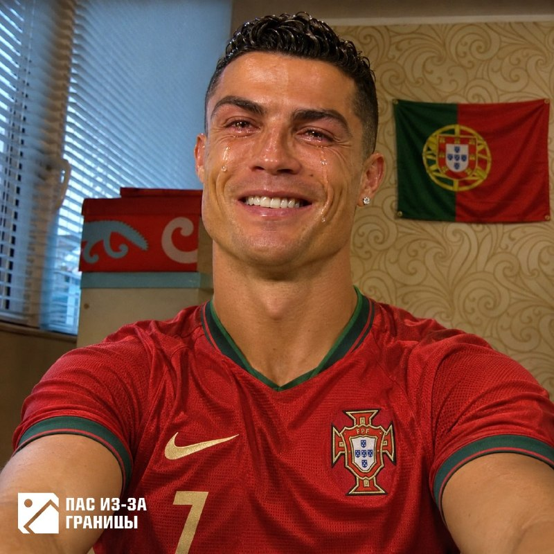
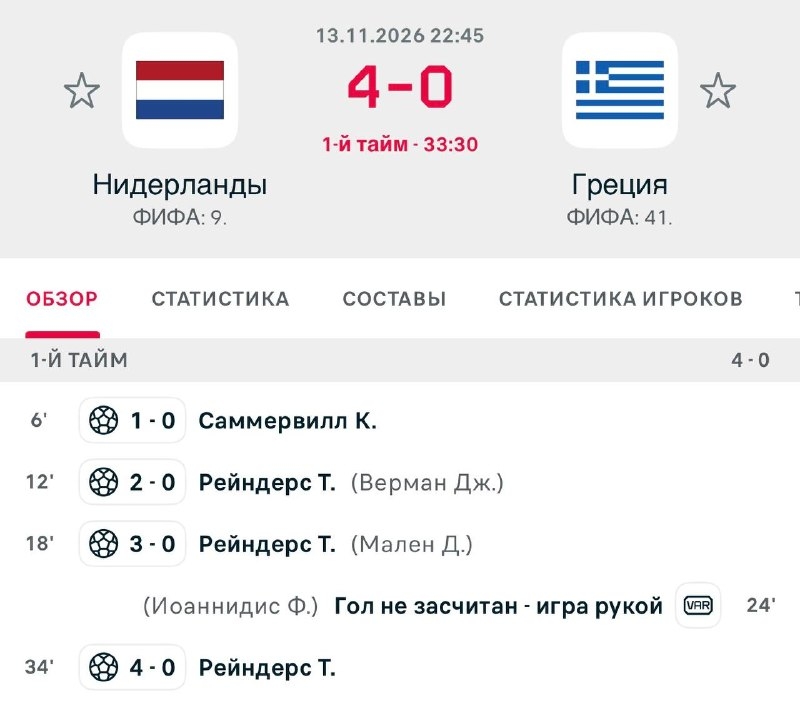
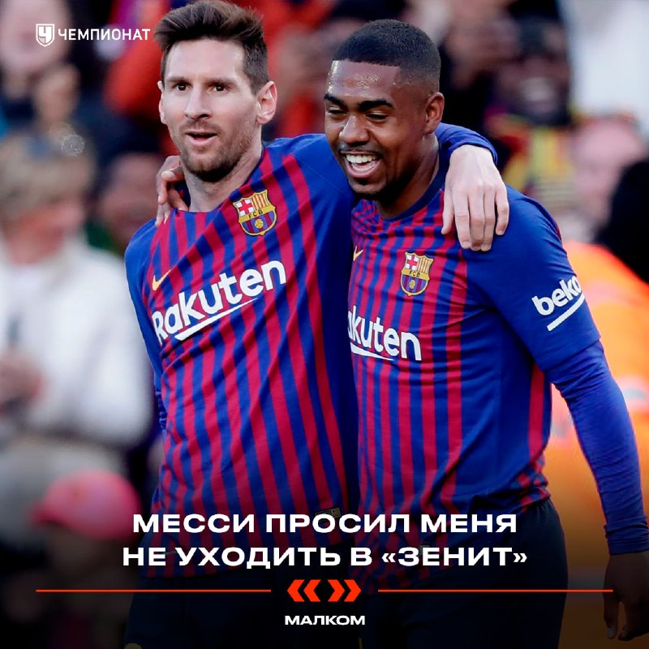

# Футбольный дайджест — 14 ноября 2026

_Период: с 13 по 14 ноября (материалы собраны 14 ноября в 07:05 МСК)_

## ⭐ Главное
- **Португалия прощается с Роналду — но сам Криш, похоже, прощаться не хочет.** Федерация придумала жест: перед матчем с Данией (14 ноября, 22:45 МСК) игроки выйдут в футболках с номером 7, на базе сборной оставят пустой комнату Роналду, а на 7-й минуте болельщики и футболисты поаплодируют ему. Но Sports.ru со ссылкой на португальский Observador пишет: Роналду не хочет проводить даже прощальный матч — с Жезушем он по-прежнему не общается, запланированный на пятницу телефонный разговор не состоялся. Официального заявления самого Роналду в материалах нет. [Спорт-Экспресс](https://t.me/sportexpress/84928) · [Окко Спорт](https://t.me/okkosport/44655) · [Sports.ru](https://t.me/sportsru/131691)

- **Почеттино — официально главный тренер «МЮ».** Вчера был «here we go» от Романо, сегодня по Sports.ru всё закреплено: аргентинец подписал контракт до 2029 года, а дебютный матч — против «Ливерпуля» уже через неделю. Об этом же — слёзы Почеттино на прощальной пресс-конференции сборной США. [Sports.ru](https://t.me/sportsru/131678) · [Романо](https://t.me/FabrizioRomanoTG/68243)

## ⚽ Результаты
- **Нидерланды — Греция 7:0.** Сборная Нидерландов «во главе с Хави» устроила показательный разгром: Саммервилл на 6-й, хет-трик Рейндерса (12', 18', 33'), дубль Тимбера (40', 59') и гол Малена на 61-й. Греция, по Sports.ru, до этого больше года не проигрывала. [ESPN](https://www.espn.com/soccer/match/_/gameId/401861159) · [МЯЧ](https://t.me/myachPRO/25254) · [Окко Спорт](https://t.me/okkosport/44674) · [Sports.ru](https://t.me/sportsru/131701)

- **«Реал»** не играл — пауза сборных. Следующий матч: 21 ноября, 23:00 МСК, «Реал» — «Сельта» (Ла Лига, дома). [ESPN](https://www.espn.com/soccer/match/_/gameId/401882798)
- **«Зенит»** не играл. Следующий матч: 15 ноября, 17:00 МСК, «Зенит» — «Трабзонспор» (товарищеский, «Газпром Арена»); затем 21 ноября, 17:30 МСК, «Рубин» — «Зенит» (РПЛ, гости). Даниил Кондаков помог молодёжной сборной России разгромить Киргизию 7:0 — ответный матч 16 ноября. [Зенит](https://t.me/fczenit/38598) · [ESPN](https://www.espn.com/soccer/match/_/gameId/401879801)
- **Сербия — Германия 1:3.** Автогол Бабича на 3-й минуте, Вирц (14') и Груда (50'); Бабич из «Спартака» сам сократил на 56-й — так он забил в обе стороны. До этого матча у Клоппа в сборной Германии была лишь одна победа в четырёх играх. [ESPN](https://www.espn.com/soccer/match/_/gameId/401861158) · [Sports.ru](https://t.me/sportsru/131702) · [Окко Спорт](https://t.me/okkosport/44675)
- **Шотландия — Северная Македония 2:1.** Дубль Макгинна (54', 74' с пенальти) принёс победу. **Молдавия — Казахстан 2:1** (дубль Попеску). [ESPN](https://www.espn.com/soccer/match/_/gameId/401861161) · [ESPN](https://www.espn.com/soccer/match/_/gameId/401861162)

## 👤 Мои игроки
- **Роналду:** Португалия играет с Данией без привычной атмосферы — см. «Главное». Следующий клубный матч: «Аль-Ахли» — «Аль-Наср» 20 ноября, 20:30 МСК. [ESPN](https://www.espn.com/soccer/match/_/gameId/401900905)
- **Глушенков:** МЯЧ разбирает конфликт вокруг игрока в сборной после матча с Нигерией: недовольны были несколько партнёров, Даниил Круговой «жёстко наехал» на Максима. Автор признаёт, что по игре в сезоне вопросов нет — Глушенков сейчас лучший в РПЛ и один из главных кандидатов на отъезд в Европу, — и отдаёт должное Семаку за баланс в «Зените». [МЯЧ](https://t.me/myachrus/10214)
- **Мбаппе, Батраков, Сафонов, Куртуа, Беллингем, Холанд, Аршавин:** новостей в материалах нет.

## 🔁 Трансферы
- **Официально:** Почеттино — главный тренер «МЮ», контракт до 2029 года (Sports.ru, см. «Главное»). Дидье Дегар назначен главным тренером «Ланса» с немедленным вступлением в должность (Романо; Пьер Саж отказывался от всех предложений). [Sports.ru](https://t.me/sportsru/131678) · [Романо](https://t.me/FabrizioRomanoTG/68247)
- **Слухи:** «Реал» заключил контракт с 19-летним ганским полузащитником Латифом Исманом из «Логроньес» (действует с 2027 года, до июня 2030-го, сначала в «Кастилью») — Романо: «сделка завершена» со ссылкой на Marca, объявления клуба в материалах нет. Трент Александер-Арнольд, по DAZN, не планирует уходить из «Реала» в январе. «Бенфика» близка к новому контракту с Престианни (президент клуба Руи Кошта). [Романо](https://t.me/FabrizioRomanoTG/68235) · [Романо](https://t.me/FabrizioRomanoTG/68245) · [Романо](https://t.me/FabrizioRomanoTG/68248)

## 🩹 Травмы
- **Франция:** Дуэ выбили зуб в матче с Италией — Фраттези зацепил его локтем, судья нарушения не увидел. Больше новостей о травмах ключевых игроков нет. [Чемпионат](https://t.me/championat/89361)

## 🔥 Ещё важное
- **Малком: «Месси просил меня не уходить в „Зенит“».** Бывший нападающий «Зенита» вспомнил лето 2019-го: Лео подошёл и сказал «Останься, ты один из игроков будущего „Барселоны“». Малком всё равно уехал в Россию за 41,5 млн евро; сейчас ему 29 и он играет в лиге ОАЭ. [Чемпионат](https://t.me/championat/89374) · [МЯЧ](https://t.me/myachrus/10215) · [Спорт-Экспресс](https://t.me/sportexpress/84925)

- **Салах — лучший бомбардир в истории сборной Египта.** 70 голов за национальную команду — рекорд, Романо: «Легенда». [Романо](https://t.me/FabrizioRomanoTG/68246)
- **Трагедия в Испании: умер игрок «Тенерифе» Де Мигель** после жёсткого столкновения с вратарём «Андорры». Вратарь Хесус Овоно дисквалифицирован на 12 матчей. [МЯЧ](https://t.me/myachPRO/25253) · [Sports.ru](https://t.me/sportsru/131699)

## 📅 Ближайшие матчи
- **Лига наций, 14 ноября:** Норвегия — Уэльс (20:00 МСК); **Португалия — Дания**, Швеция — Босния и Герцеговина, Австрия — Ирландия (22:45 МСК). [ESPN](https://www.espn.com/soccer/match/_/gameId/401861167)
- **«Зенит» — «Трабзонспор»** — 15 ноября, 17:00 МСК, товарищеский. [Зенит](https://t.me/fczenit/38577)
- **Лига наций, 15 ноября:** Испания — Англия, Бельгия — Италия, Франция — Турция (22:45 МСК). [ESPN](https://www.espn.com/soccer/match/_/gameId/401861175)
- **Лига наций, 16–17 ноября:** 16-го Германия — Нидерланды (22:45 МСК); 17-го Уэльс — Португалия, Дания — Норвегия (22:45 МСК). [ESPN](https://www.espn.com/soccer/match/_/gameId/401861185)
- **«Аль-Ахли» — «Аль-Наср» (Роналду)** — 20 ноября, 20:30 МСК. [ESPN](https://www.espn.com/soccer/match/_/gameId/401900905)
- **«Рубин» — «Зенит»** — 21 ноября, 17:30 МСК, РПЛ. [ESPN](https://www.espn.com/soccer/match/_/gameId/401879801)
- **«Реал» — «Сельта»** — 21 ноября, 23:00 МСК, Ла Лига. [ESPN](https://www.espn.com/soccer/match/_/gameId/401882798)
