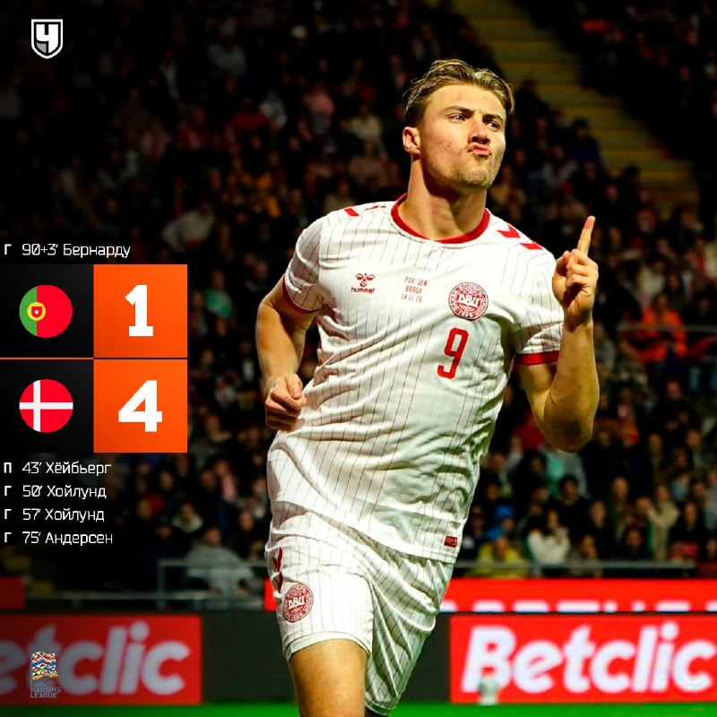
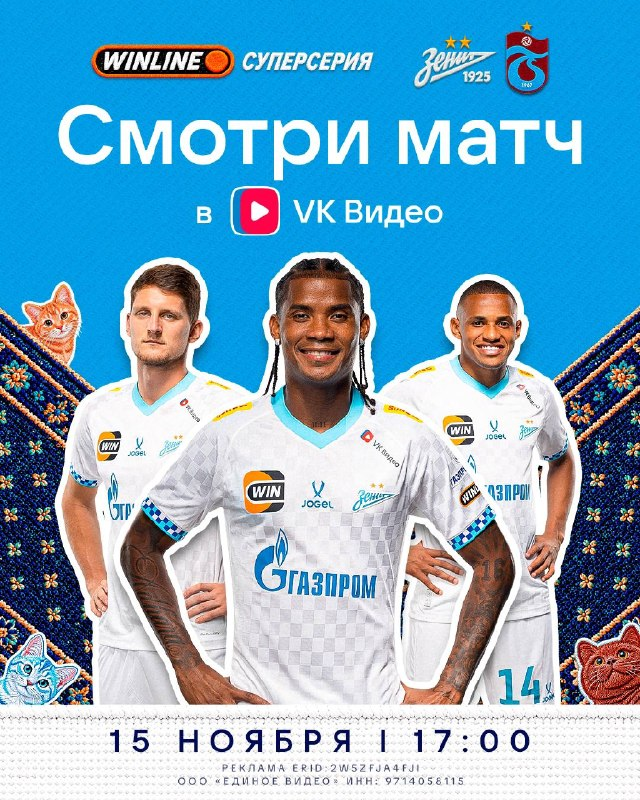
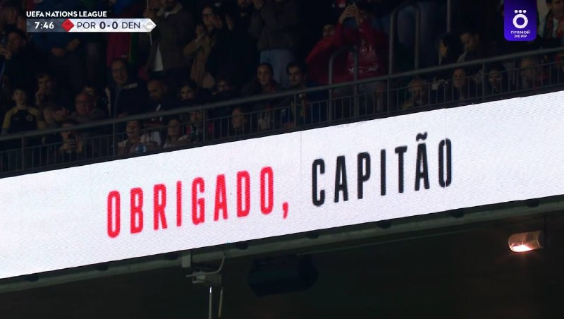
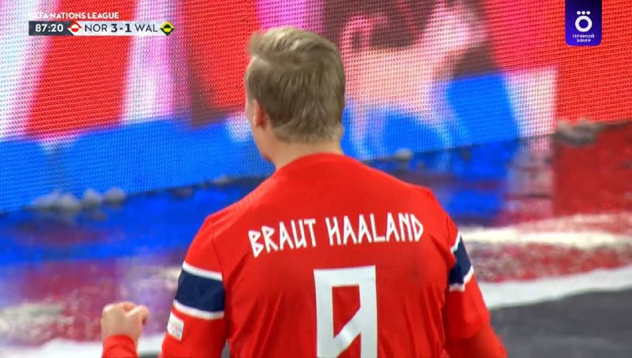

# Футбольный дайджест — 15 ноября 2026

_Период: с 14 по 15 ноября (материалы собраны 15 ноября в 07:06 МСК)_

## ⭐ Главное
- **Дань уважения Роналду — и разгром Португалии 1:4 от Дании.** Перед матчем все игроки сборной вышли в футболках с номером 7, фанаты развернули баннер «Спасибо, капитан», на 7-й минуте трибуны аплодировали Кришу. А затем начался кошмар: пенальти Хёйберга (43'), дубль Хойлунда (50', 57') и гол Андерсена (75'); Бернарду Силва отыграл лишь на 90+3'. Это первый матч Португалии после ухода Роналду из сборной. МЯЧ вспоминает: накануне Аргентина так же проиграла первый матч без Месси (1:2 с Уругваем). Датские фанаты при 0:4, по МЯЧу, скандировали имя Месси. Следующий матч — 17 ноября, Уэльс — Португалия. [Чемпионат](https://t.me/championat/89409) · [Окко Спорт](https://t.me/okkosport/44714) · [МЯЧ](https://t.me/myachPRO/25270) · [ESPN](https://www.espn.com/soccer/match/_/gameId/401861167)

## ⚽ Результаты
- **«Зенит»** не играл в паузу сборных. Сегодня, 15 ноября, 17:00 МСК, «Зенит» — «Трабзонспор» (WINLINE Суперсерия, «Газпром Арена», трансляция в VK Видео). Спорт-Экспресс: в заявке турок нет Салаха, Онаны и Фабиньо, хотя они были в анонсе. Затем 21 ноября, 17:30 МСК, «Рубин» — «Зенит» (РПЛ, в гостях). [Зенит](https://t.me/fczenit/38606) · [Спорт-Экспресс](https://t.me/sportexpress/84946) · [ESPN](https://www.espn.com/soccer/match/_/gameId/401879801)

- **Женский «Зенит» — четырёхкратный чемпион России!** В 26-м туре Суперлиги петербурженки обыграли «Енисей» 2:1 и вернули титул. Итог сезона: 20 побед, 3 ничьи, 1 поражение, 59 забитых — меньше всех пропущено; лучший бомбардир лиги Нина Матейич (17 голов). Тренер Алексей Тарасюк выиграл титул в первый сезон. Сегодня в 16:45 на «Газпром Арене» чемпионок поздравят. [Зенит](https://t.me/fczenit/38603) · [Спорт-Экспресс](https://t.me/sportexpress/84942) · [Зенит (церемония)](https://t.me/fczenit/38607)
- **«Реал»** не играл — пауза сборных. Следующий матч: 21 ноября, 23:00 МСК, «Реал» — «Сельта» (Ла Лига, дома). [ESPN](https://www.espn.com/soccer/match/_/gameId/401882798)
- **Португалия — Дания 1:4** — см. «Главное». **Норвегия — Уэльс 3:1:** Нуса (59'), Шельдеруп (68'), Брукс отыграл на 79-й, Холанд с пенальти поставил точку на 88-й. **Швеция — Босния 3:2:** Свенссон (5') и дубль Дьёкереша с двух пенальти (11', 45+2'); Гиджович и Колашинац сравняли после перерыва, но шведы удержали победу. **Австрия — Ирландия 1:0** (Калайджич, 78'), **Румыния — Польша 2:1**, **Северная Ирландия — Украина 1:0** (Девлин, 68'), **Венгрия — Грузия 2:0** в гостях. [ESPN](https://www.espn.com/soccer/match/_/gameId/401861165) · [ESPN](https://www.espn.com/soccer/match/_/gameId/401861166) · [ESPN](https://www.espn.com/soccer/match/_/gameId/401861170) · [ESPN](https://www.espn.com/soccer/match/_/gameId/401861168) · [ESPN](https://www.espn.com/soccer/match/_/gameId/401861169) · [ESPN](https://www.espn.com/soccer/match/_/gameId/401861164)
- **Товарищеские:** Япония обыграла Бразилию 3:2 — первое поражение команды Анчелотти после ЧМ; у Рафиньи и самого Анчелотти красные карточки (МЯЧ). Аргентина проиграла Уругваю 1:2 — первый матч без Месси. [МЯЧ](https://t.me/myachPRO/25259) · [Sports.ru](https://t.me/sportsru/131712) · [Спорт-Экспресс](https://t.me/sportexpress/84937)

## 👤 Мои игроки
- **Роналду:** на поле не выходил — он завершил карьеру в сборной, но весь вечер был в центре внимания (см. «Главное»). Хорхе Жезуш на вопрос, скучает ли по Роналду: «Скучаю по чему? Он больше не в сборной». Позже, по Романо, тренер назвал дань уважения Кришу «заслуженной за всё, что он сделал для сборной и Португалии». Руден Диаш: «Мы хотели посвятить Кришу особую победу… больно проиграть дома». Федерация официально сменила шрифт семёрки на футболках — прежний навсегда закреплён за Роналду; номер 7 на матч получил Карлуш Форбш из «Брюгге» (Леау из-за травмы отсутствует). Следующий клубный матч: «Аль-Ахли» — «Аль-Наср», 20 ноября, 20:30 МСК. [Романо](https://t.me/FabrizioRomanoTG/68270) · [Романо](https://t.me/FabrizioRomanoTG/68269) · [Романо](https://t.me/FabrizioRomanoTG/68260) · [Чемпионат](https://t.me/championat/89406) · [ESPN](https://www.espn.com/soccer/match/_/gameId/401900905)

- **Холанд:** на 88-й минуте реализовал пенальти (3:1 с Уэльсом) — Романо отмечает: 66 голов в 60 матчах за сборную. [ESPN](https://www.espn.com/soccer/match/_/gameId/401861165) · [Романо](https://t.me/FabrizioRomanoTG/68262)

- **Беллингем:** по данным «Чемпионата», подписал с «Реалом» новый контракт до 2031 года с повышением зарплаты; в Испании пишут, что Моуринью отводит ему ключевую роль. Официального сообщения клуба в материалах нет. [Чемпионат](https://t.me/championat/89390)
- **Батраков:** «Галатасарай» выпустил большую коллекцию мерча с Лёшей — джерси с фамилией кириллицей, шапки-ушанки, худи, чехлы. [Окко Спорт](https://t.me/okkosport/44680)
- **Мбаппе:** Зидан: «Отношения с Мбаппе у нас очень хорошие, меня раздражают эти ненастоящие споры вокруг него». [Романо](https://t.me/FabrizioRomanoTG/68265)
- **Куртуа, Сафонов, Глушенков, Аршавин:** новостей в материалах нет.

## 🔁 Трансферы
- **Официально:** нет новостей по моим клубам.
- **Слухи:** Роналду в Турции: по словам инсайдера Ягыза Сабунджуоглу (пересказ МЯЧа), им интересуются «Галатасарай», «Фенербахче» и «Трабзонспор»; контракт с «Аль-Насром» истекает летом. «Милан», по Sports.ru, мечтает о ван Дейке — игрок нравится Ибрагимовичу. «Манчестер Юнайтед» договорился с 16-летним форвардом Тайлером Аджеем из «Рединга» — Романо: «всё сделано», объявления клуба пока нет. Окружение Хамзы Абделькарима отрицает переговоры с «Комо» и намерение уйти из «Барселоны» в январе (Романо). «Локомотив» не продлит контракт Кристиана Рамиреса (по информации МЯЧа). [МЯЧ](https://t.me/myachrus/10219) · [Sports.ru](https://t.me/sportsru/131715) · [Романо](https://t.me/FabrizioRomanoTG/68254) · [Романо](https://t.me/FabrizioRomanoTG/68255) · [МЯЧ](https://t.me/myachrus/10222)

## 🩹 Травмы
- **Новости:** Де Йонг снова получил повреждение в сборной через 18 дней после возвращения (МЯЧ). Де Лигт вернулся к тренировкам с «МЮ» после травмы спины. Рафинья из-за красной пропустит матч с Сингапуром; президент федерации Бразилии заявил, что в «Барселону» его не отпустят, он остаётся в сборной. Новостей о травмах моих игроков нет. [МЯЧ](https://t.me/myachPRO/25262) · [Sports.ru](https://t.me/sportsru/131708) · [МЯЧ](https://t.me/myachPRO/25263)

## 🔥 Ещё важное
- **Винисиус забил впервые с сентября — но Бразилия проиграла.** Дубль Вини в матче с Японией (оба мяча с передач Бруну Гимарайнса) — его первые голы за сборную с сентября и первые вообще с августа, если считать «Реал» (Романо); до этого в сезоне у него было всего два гола. По Романо, это его 100-й гол при Анчелотти (90 за «Реал» и 10 за Бразилию). Но Япония победила 3:2. [МЯЧ](https://t.me/myachPRO/25259) · [Романо](https://t.me/FabrizioRomanoTG/68257) · [Романо](https://t.me/FabrizioRomanoTG/68264)
- **Нет Месси — нет аншлага.** На матч Аргентины с Уругваем пришло около 25 тысяч (30% «Бомбонеры»), итог 1:2. [Спорт-Экспресс](https://t.me/sportexpress/84937) · [Sports.ru](https://t.me/sportsru/131706)
- **Дьёкереш забил в 8-м матче Лиги наций подряд** — с отрывом лучшая серия в истории турнира, никто другой не забивал в 5+ матчах подряд. Против Боснии — дубль с двух пенальти, 6 голов за сборную в сезоне. [МЯЧ](https://t.me/myachPRO/25265) · [Романо](https://t.me/FabrizioRomanoTG/68268)
- **Мирра Андреева — в финале Итогового WTA.** 19-летняя россиянка обыграла Пегулу 6:3, 6:4, не отдав ни одного сета, и стала второй ракеткой мира. Ждёт победителя пары Носкова — Свитолина. [Чемпионат](https://t.me/championat/89408) · [Sports.ru](https://t.me/sportsru/131736)

## 📅 Ближайшие матчи
- **«Зенит» — «Трабзонспор»** — сегодня, 15 ноября, 17:00 МСК, товарищеский. [Зенит](https://t.me/fczenit/38606)
- **Лига наций, 15 ноября, 22:45 МСК:** Испания — Англия, Бельгия — Италия, Франция — Турция, Хорватия — Чехия. [ESPN](https://www.espn.com/soccer/match/_/gameId/401861175)
- **Лига наций, 16–17 ноября:** 16-го Германия — Нидерланды, Швейцария — Шотландия, Греция — Сербия (22:45 МСК); 17-го **Уэльс — Португалия**, Дания — Норвегия, Польша — Швеция (22:45 МСК). [ESPN](https://www.espn.com/soccer/match/_/gameId/401861185) · [ESPN](https://www.espn.com/soccer/match/_/gameId/401861189)
- **«Аль-Ахли» — «Аль-Наср» (Роналду)** — 20 ноября, 20:30 МСК. [ESPN](https://www.espn.com/soccer/match/_/gameId/401900905)
- **«Рубин» — «Зенит»** — 21 ноября, 17:30 МСК, РПЛ. [ESPN](https://www.espn.com/soccer/match/_/gameId/401879801)
- **«Реал» — «Сельта»** — 21 ноября, 23:00 МСК, Ла Лига. [ESPN](https://www.espn.com/soccer/match/_/gameId/401882798)
