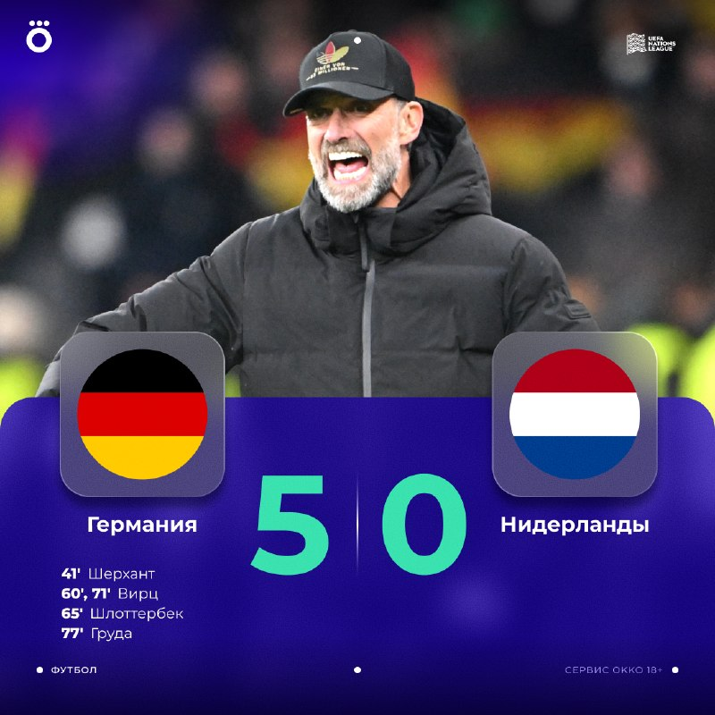
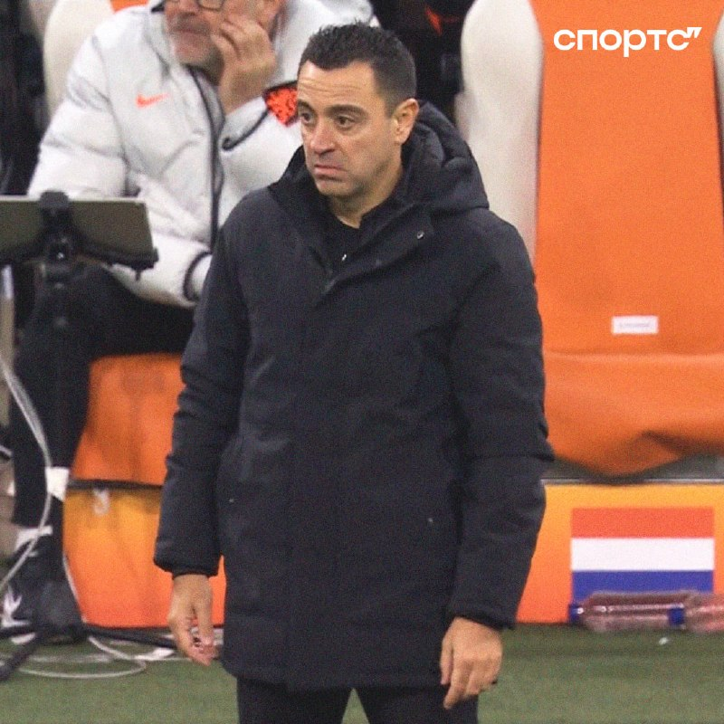

# Футбольный дайджест — 17 ноября 2026

_Период: с 16 по 17 ноября (ТГ-материалы и ESPN собраны 17 ноября в 07:08 МСК — свежие)_

## ⭐ Главное
- **Германия Клоппа разнесла Нидерланды 5:0 и вышла в плей-офф с первого места.** В Берлине счёт открыл дебютант Дерри Шерхант (41'), затем дубль Флориана Вирца (60', 71'), гол Шлоттербека (65') и Груды (77'). Для сборной Нидерландов — крупнейшее поражение в официальных турнирах за всю историю. Клопп после матча: «Это команда, полная великих игроков. Приходит новое поколение».

[Okko Спорт](https://t.me/okkosport/44771) · [Sports.ru](https://t.me/sportsru/131808) · [Фабрицио Романо](https://t.me/FabrizioRomanoTG/68328) · [ESPN](https://www.espn.com/soccer/match/_/gameId/401861185)

## ⚽ Результаты
- **«Реал»** и **«Зенит»** не играли. «Зенит» — «Рубин»: 21 ноября, 17:30 МСК (РПЛ, в гостях). [ESPN](https://www.espn.com/soccer/match/_/gameId/401879801)
- **«Реал» — «Сельта»:** 21 ноября, 23:00 МСК (Ла Лига, дома). [ESPN](https://www.espn.com/soccer/match/_/gameId/401882798)
- **Лига наций, 16 ноября:** Швейцария — Шотландия 4:0, Греция — Сербия 1:0 (гол Масураса, 69'), Исландия — Люксембург 3:0, Словения выиграла в Северной Македонии 3:0. [ESPN](https://www.espn.com/soccer/match/_/gameId/401861186)

## 👤 Мои игроки
- **Роналду:** мама Криштиану заявила, что рада разгромному поражению Португалии от Дании (1:4) в первом матче без Роналду: по её словам, в сборной сына не уважали. Жорже Жезуш ответил: «Я понимаю маму Роналду — мать есть мать». Матч сборной Португалии с Уэльсом — сегодня в 22:45 МСК; следующий клубный матч «Аль-Ахли» — «Аль-Наср» 20 ноября в 20:30 МСК.

[Sports.ru](https://t.me/sportsru/131799) · [Фабрицио Романо](https://t.me/FabrizioRomanoTG/68320) · [ESPN](https://www.espn.com/soccer/match/_/gameId/401900905)
- **Глушенков:** отдал голевую передачу на Соболева при 3:0 с «Трабзонспором». [СЭ](https://t.me/sportexpress/84965)
- **Батраков:** «Галатасарай» может поднять отступные до 70–75 млн евро и ввести бонусы за голы и ассисты вместо повышения зарплаты; январский трансфер маловероятен (Şok Gazetesi). [Sports.ru](https://t.me/sportsru/131801)
- **Беллингем:** в матче Испания — Англия отчитывал партнёра по «Реалу» Кукурелью, а на пути в подтрибунку толкнул его. [Чемпионат](https://t.me/championat/89442)
- **Холанд, Мбаппе, Куртуа, Сафонов, Аршавин:** новых подтверждённых новостей нет.

## 🔁 Трансферы
- **Официально:** «Кристал Пэлас» назначил Томаса Франка главным тренером до июня 2029 года. [Фабрицио Романо](https://t.me/FabrizioRomanoTG/68305)
- **Слухи:** по данным Фабрицио Романо, «Реал» на финальной стадии переговоров о Джей-Джей Габриэле из «Манчестер Юнайтед» — сделка в январе; Габриэль сменил агентство. [Фабрицио Романо](https://t.me/FabrizioRomanoTG/68323)

## 🩹 Травмы
- Нет новостей о травмах моих игроков. У «Барселоны» Пау Кубарси получил проблемы с бедром в матче с Англией — обследование, степень тяжести пока неизвестна. [Sports.ru](https://t.me/sportsru/131783)

## 🔥 Ещё важное
- **Хави и 0:5.** Сборная Нидерландов Хави потерпела самое крупное поражение в официальных турнирах в своей истории; в прошлом матче с Германией голландцы победили 7:0.

[Sports.ru](https://t.me/sportsru/131808) · [Мяч Pro](https://t.me/myachPRO/25302)
- **Винисиус объяснил слабый старт:** один гол за «Реал» к середине ноября — после чемпионата мира больше отдыхал и тренировался меньше. [Sports.ru](https://t.me/sportsru/131784)
- **Мбаппе/Роналду/Месси:** Пеле остаётся лидером по голам в ворота топ-сборных, Мбаппе — третий (18), Роналду — пятый (16). [Мяч Pro](https://t.me/myachPRO/25298)
- **Модрич** догнал Месси по матчам за сборную — 208; впереди только Роналду (234). [Okko Спорт](https://t.me/okkosport/44755)

## 📅 Ближайшие матчи
- **Лига наций, 17 ноября, 22:45 МСК:** **Уэльс — Португалия**, Дания — Норвегия, Польша — Швеция, Украина — Грузия, Израиль — Австрия. [ESPN](https://www.espn.com/soccer/match/_/gameId/401861189)
- **«Аль-Ахли» — «Аль-Наср» (Роналду)** — 20 ноября, 20:30 МСК. [ESPN](https://www.espn.com/soccer/match/_/gameId/401900905)
- **«Рубин» — «Зенит»** — 21 ноября, 17:30 МСК, РПЛ. [ESPN](https://www.espn.com/soccer/match/_/gameId/401879801)
- **«Реал» — «Сельта»** — 21 ноября, 23:00 МСК, Ла Лига. [ESPN](https://www.espn.com/soccer/match/_/gameId/401882798)
- **«Реал» — «ПСВ»** — 24 ноября, 23:00 МСК, Лига чемпионов. [ESPN](https://www.espn.com/soccer/match/_/gameId/401915298)
