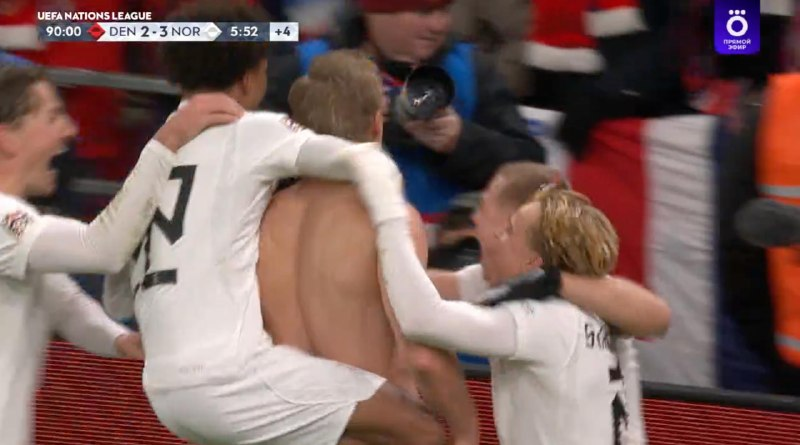
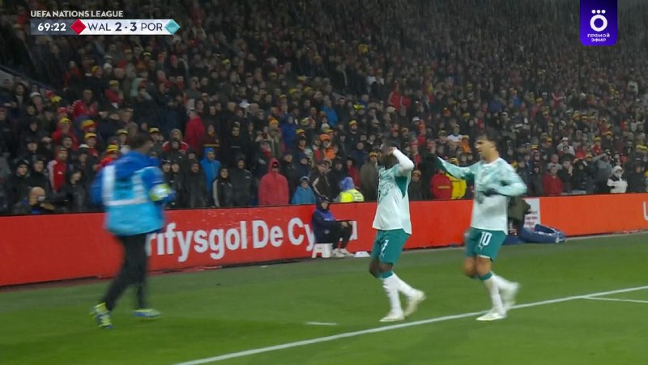
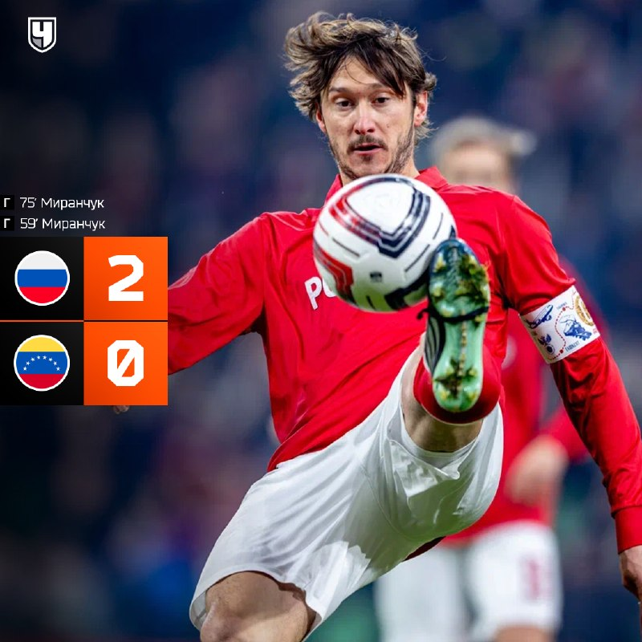
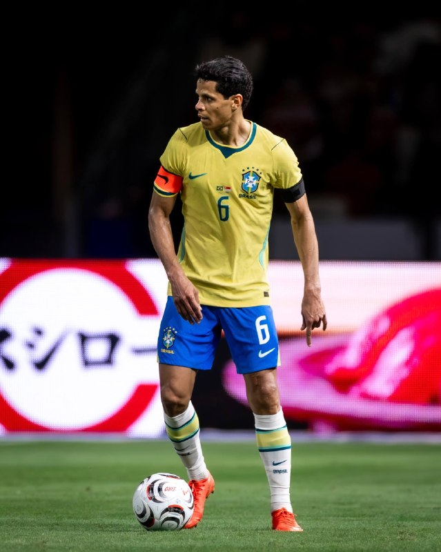

# Футбольный дайджест — 18 ноября 2026

_Период: с 17 по 18 ноября (ТГ-материалы и ESPN собраны 18 ноября в 07:10 МСК — свежие)_

## ⭐ Главное
- **Холанд вытащил Норвегию в плей-офф Лиги наций на 96-й минуте.** В Копенгагене норвежцы проигрывали Дании 0:2 (Хёйлунд — 11', Хойбьерг — 14'), но Холанд (37') и Эдегор (83') сравняли, а на 90+6' Эрлинг реализовал пенальти — 3:2. У Холанда теперь 68 голов в 61 матче за сборную. Дания вылетела, Италия тоже осталась за бортом.

[Okko Спорт](https://t.me/okkosport/44810) · [Чемпионат](https://t.me/championat/89494) · [Фабрицио Романо](https://t.me/FabrizioRomanoTG/68349) · [ESPN](https://www.espn.com/soccer/match/_/gameId/401861194)

## ⚽ Результаты
- **«Реал»** и **«Зенит»** не играли. «Зенит» — «Рубин»: 21 ноября, 17:30 МСК (РПЛ, в гостях). [ESPN](https://www.espn.com/soccer/match/_/gameId/401879801)
- **«Реал» — «Сельта»:** 21 ноября, 23:00 МСК (Ла Лига, дома). [ESPN](https://www.espn.com/soccer/match/_/gameId/401882798)
- **Лига наций, 17 ноября:** Уэльс — Португалия 2:3, Дания — Норвегия 2:3, Польша — Швеция 1:1, Украина — Грузия 1:0 (Сикан, 1'), Венгрия — Северная Ирландия 1:1, Ирландия — Косово 3:0 (дубль Паррота с пенальти), Израиль — Австрия 1:1, Босния и Герцеговина — Румыния 2:1. [ESPN](https://www.espn.com/soccer/match/_/gameId/401861189)
- **Товарищеский матч, 17 ноября:** Россия — Венесуэла 2:0 (Миранчук, 59', 75'). [Чемпионат](https://t.me/championat/89487)

## 👤 Мои игроки
- **Роналду:** Первая победа Португалии после ухода Криштиану из сборной: команда выиграла в Уэльсе 3:2 (Бруну Фернандеш, Педру Нету, дебютный гол Карлуша Форбша на 70'), выйдя в плей-офф Лиги наций с первого места, хотя Нету получил две жёлтые за две минуты и остальное время команда играла вдесятером. Новый обладатель «семёрки» Форбш забил первый гол за взрослую сборную. Гризманн: «Мне грустно из-за ухода Криштиану. Абсолютная легенда, машина по работе, голам и победам. Заменить его будет очень сложно». Следующий матч «Аль-Насра» с «Аль-Ахли» — 20 ноября в 20:30 МСК.

[Sports.ru](https://t.me/sportsru/131844) · [Мяч Pro](https://t.me/myachPRO/25318) · [Фабрицио Романо](https://t.me/FabrizioRomanoTG/68338) · [ESPN](https://www.espn.com/soccer/match/_/gameId/401861189)
- **Холанд:** дубль в Копенгагене (гол на 37' и пенальти на 90+6') — решающий для выхода Норвегии в плей-офф; 68 мячей в 61 игре за сборную. [Чемпионат](https://t.me/championat/89494)
- **Сафонов:** сухой матч с Венесуэлой в Краснодаре (2:0) — шестой «на ноль» в сезоне; соперник не нанёс ни одного удара в створ. Вышел в старте второй матч подряд. [Мяч Pro](https://t.me/myachPRO/25315)

[Чемпионат](https://t.me/championat/89487) · [Мяч Pro](https://t.me/myachPRO/25315)
- **Батраков:** в старте сборной России на Венесуэлу второй матч подряд. Fanatik: на матч «Галатасарая» с «Астон Виллой» в Лиге чемпионов за Алексеем персонально приедут следить скауты «Барселоны» и «Баварии»; «Галатасарай» хочет поднять отступные с 55 до 100 млн евро (слух, источник — Fanatik). [Sports.ru](https://t.me/sportsru/131828)
- **Глушенков:** признан «Игроком октября» по версии Winline. [Зенит](https://t.me/fczenit/38671)
- **Дуглас Сантос:** защитник «Зенита» вывел сборную Бразилии с капитанской повязкой в матче с Сингапуром (7:0) — несмотря на Габриэла, Винисиуса, Эндрика и Эстевао в составе. [Мяч Русь](https://t.me/myachrus/10238)

[Зенит](https://t.me/fczenit/38673)
- **Винисиус:** хет-трик за 21 минуту в матче Бразилии с Сингапуром (7:0); в прошлой игре с Японией был дубль. Эндрик: «Больше играть в „Реале“? Это решает Моуринью, не я. Надеюсь, проведу в „Реале“ всю жизнь». [Sports.ru](https://t.me/sportsru/131817) · [Фабрицио Романо](https://t.me/FabrizioRomanoTG/68341)
- **Мбаппе, Куртуа, Беллингем, Аршавин:** новых подтверждённых новостей нет.

## 🔁 Трансферы
- **Официально:** «Локомотив» объявил об уходе Галактионова; Сергей Овчинников назначен и. о. главного тренера. [Чемпионат](https://t.me/championat/89473) · [Чемпионат](https://t.me/championat/89483)
- **По Фабрицио Романо (клубных объявлений нет):** Витор Матуш согласился возглавить «Страсбур»; «Арсенал» договорился о новом контракте с Инкапье до июня 2032 и с Райей до июня 2030. [Матуш](https://t.me/FabrizioRomanoTG/68335) · [Инкапье](https://t.me/FabrizioRomanoTG/68342) · [Райя](https://t.me/FabrizioRomanoTG/68339)
- **Слухи / почти официально («here we go» скоро):** Джей-Джей Габриэл (16 лет) сам подтвердил, что покидает «Манчестер Юнайтед»; по Фабрицио Романо, он решил перейти в «Реал», сделка будет подписана, «here we go» последует очень скоро. Клубного объявления пока нет. [Фабрицио Романо](https://t.me/FabrizioRomanoTG/68343) · [Sports.ru](https://t.me/sportsru/131837)
- Педро Порро в «Барселону» в январе: по Романо, переговоров нет. [Фабрицио Романо](https://t.me/FabrizioRomanoTG/68337)

## 🩹 Травмы
- Нет новостей о травмах моих игроков. Педру Нету пропустит первый матч четвертьфинала Лиги наций из-за красной карточки. [Sports.ru](https://t.me/sportsru/131843)

## 🔥 Ещё важное
- **Россия закрыла 2026-й победой.** Дубль капитана Алексея Миранчука (4 гола в трёх последних матчах за сборную): за год команда Карпина проиграла только Египту — 7 побед, 2 ничьи, 1 поражение, разница мячей 25:8. Кисляк отдал ассист через 5 минут после выхода, Данилов впервые вышел в старте и отдал предголевую. Карпин о том, что Карпукас не сыграл ни минуты: «Моё тренерское решение». [Мяч Pro](https://t.me/myachPRO/25315) · [Мяч Русь](https://t.me/myachrus/10244)
- **Гризманн** признан лучшим новичком года в МЛС: 14 голов в 18 матчах чемпионата. [Чемпионат](https://t.me/championat/89488)
- **Зверев — в полуфинале Nitto ATP Finals.** [Okko Спорт](https://t.me/okkosport/44814)

## 📅 Ближайшие матчи
- **«Аль-Ахли» — «Аль-Наср» (Роналду)** — 20 ноября, 20:30 МСК. [ESPN](https://www.espn.com/soccer/match/_/gameId/401900905)
- **«Рубин» — «Зенит»** — 21 ноября, 17:30 МСК, РПЛ. [ESPN](https://www.espn.com/soccer/match/_/gameId/401879801)
- **«Реал» — «Сельта»** — 21 ноября, 23:00 МСК, Ла Лига. [ESPN](https://www.espn.com/soccer/match/_/gameId/401882798)
- **«Реал» — «ПСВ»** — 24 ноября, 23:00 МСК, Лига чемпионов. [ESPN](https://www.espn.com/soccer/match/_/gameId/401915298)
- **«Галатасарай» — «Астон Вилла» (Батраков)** — 24 ноября, 20:45 МСК, Лига чемпионов. [ESPN](https://www.espn.com/soccer/match/_/gameId/401915300)
- **Лига наций:** жеребьёвка четвертьфиналов — 20 ноября; матчи пройдут в марте. [Чемпионат](https://t.me/championat/89494)
