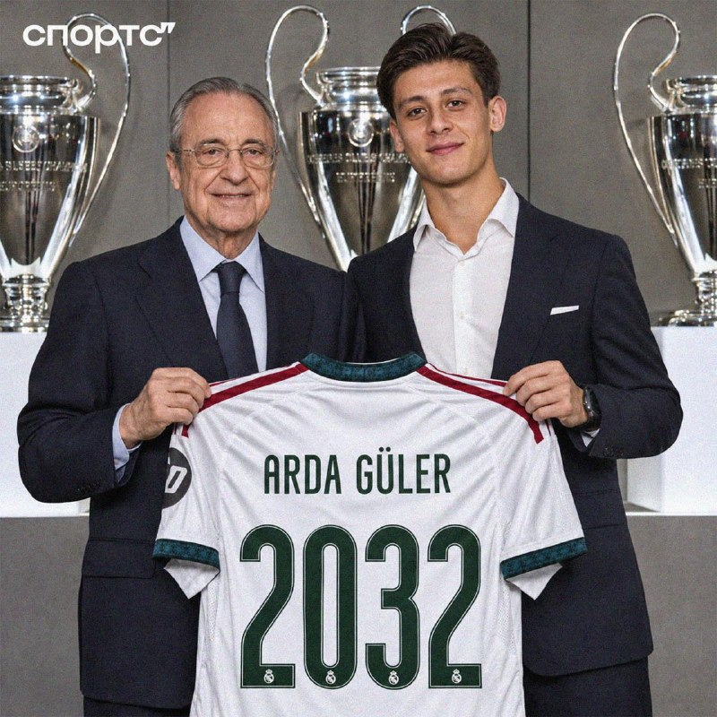
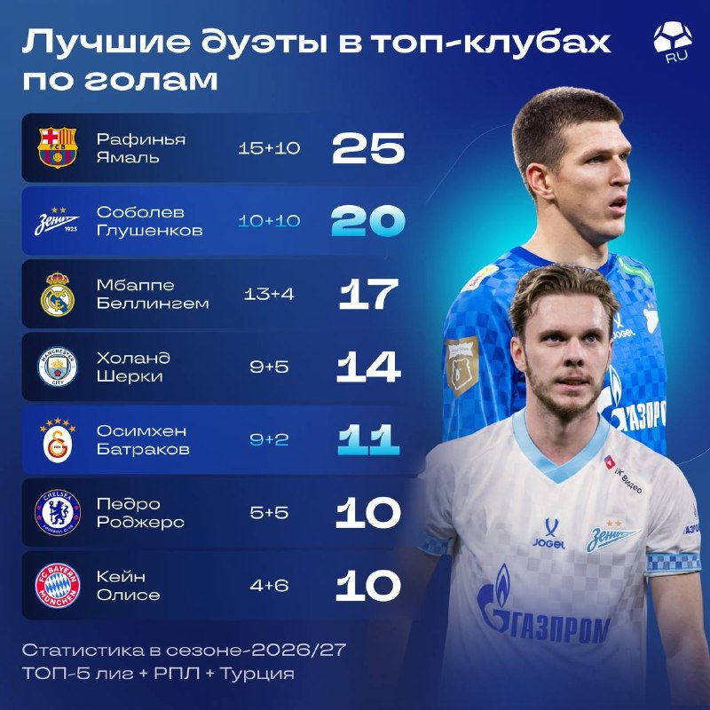
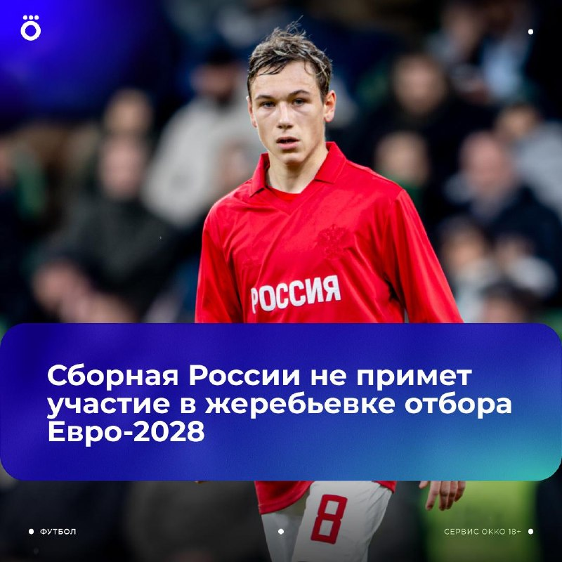

# Футбольный дайджест — 19 ноября 2026

_Период: с 18 по 19 ноября (ТГ-материалы и ESPN собраны 19 ноября в 07:12 МСК — свежие)_

## ⭐ Главное
- **Гюлер продлил контракт с «Реалом» до 2032 года.** По Фабрицио Романо, документы подписаны ещё в сентябре и вступают в силу с января, клуб это подтвердил — «Реал» закрепил полузащитника на пять с половиной лет. Арда в обращении к болельщикам: «Мечта — носить эту футболку много лет, выигрывать новые титулы и оставить свой след в этой уникальной истории». Мбаппе в ответ: «Спасибо. Сегодня я буду спать спокойнее». Sports.ru называет Арду лучшим в «Реале» в этом сезоне.

[Фабрицио Романо](https://t.me/FabrizioRomanoTG/68355) · [Фабрицио Романо: слова Гюлера](https://t.me/FabrizioRomanoTG/68361) · [Фабрицио Романо: Мбаппе](https://t.me/FabrizioRomanoTG/68360) · [Sports.ru](https://t.me/sportsru/131854) · [Мяч Pro](https://t.me/myachPRO/25324)

## ⚽ Результаты
- **«Реал»** и **«Зенит»** не играли — международная пауза. «Зенит» — «Рубин»: 21 ноября, 17:30 МСК (РПЛ, в гостях). [ESPN](https://www.espn.com/soccer/match/_/gameId/401879801)
- **«Реал» — «Сельта»:** 21 ноября, 23:00 МСК (Ла Лига, дома). [ESPN](https://www.espn.com/soccer/match/_/gameId/401882798)
- Новых сыгранных матчей мировых топ-лиг и сборных за период в материалах нет: последним был вечер 17 ноября (см. прошлый выпуск).

## 👤 Мои игроки
- **Роналду:** новостей нет. Следующий матч «Аль-Насра» — в гостях у «Аль-Ахли», 20 ноября, 20:30 МСК. [ESPN](https://www.espn.com/soccer/match/_/gameId/401900905)
- **Гюлер:** новый контракт до июня 2032 года (см. «Главное»). [Фабрицио Романо](https://t.me/FabrizioRomanoTG/68355)
- **Мбаппе и Беллингем:** по статистике Sports.ru, их дуэт в «Реале» — третий в Европе по голам в сезоне: 17 (13+4). Мбаппе о продлении Гюлера: «Спасибо. Сегодня я буду спать спокойнее». [Мяч Русь](https://t.me/myachrus/10252) · [Фабрицио Романо](https://t.me/FabrizioRomanoTG/68360)
- **Глушенков:** не поехал в сборную — и в топе-2 лучших дуэтов Европы по голам: с Соболевым на двоих 20 мячей в РПЛ (10+10), уступают только Рафинье и Ямалю (25). Следом Мбаппе и Беллингем (17), Холанд и Шерки (14). [Мяч Русь](https://t.me/myachrus/10252)
- **Холанд:** с Шерки — 14 голов на двоих (9+5) в сезоне. [Мяч Русь](https://t.me/myachrus/10252)
- **Батраков:** вместе с Осимхеном — 5-е место в рейтинге дуэтов Европы: 11 очков (9+2). «Галатасарай» — «Самсунспор» 21 ноября, 16:00 МСК. [Мяч Русь](https://t.me/myachrus/10252) · [ESPN](https://www.espn.com/soccer/match/_/gameId/401888245)

- **Сафонов:** после победы над Венесуэлой Сергей Галицкий зашёл в раздевалку сборной и вежливо отказался от майки Сафонова. [Спорт-Экспресс](https://t.me/sportexpress/85030)
- **Куртуа, Аршавин:** новых подтверждённых новостей нет.

## 🔁 Трансферы
- **Официально:** Гюлер продлил контракт с «Реалом» до 2032 года. [Фабрицио Романо](https://t.me/FabrizioRomanoTG/68355)
- **Официально:** «Манчестер Юнайтед» объявил штаб Почеттино (Хесус Перес, Мигель Д’Агостино, Тони Хименес, Алек Скотт, Себастьяно Почеттино); Бинниона, Эванса, Холланда, Мосона и Вудгейта клуб покидает вместе с Керриком. [Фабрицио Романо](https://t.me/FabrizioRomanoTG/68373) · [Фабрицио Романо](https://t.me/FabrizioRomanoTG/68374)
- **Официально:** с Мудрика сняли обвинения в допинге, он вернётся в состав «Челси» (по Фабрицио Романо). [Sports.ru](https://t.me/sportsru/131870)
- **Почти официально (клубного объявления нет):** Джей-Джей Габриэл (16 лет, экс-«Манчестер Юнайтед») посетил базу «Реала» с семьёй и агентами; по Романо, решение принято, переход оформят в ближайшие дни. [Фабрицио Романо](https://t.me/FabrizioRomanoTG/68370)
- **Слухи:** «Реал» хочет удержать Трента Александер-Арнольда и не обсуждает его уход (источник — Фабрицио Романо). «Барселона» — Педро Порро в январе: не вариант. [Фабрицио Романо](https://t.me/FabrizioRomanoTG/68357)
- **Слухи:** директор «Барсы» Деку о Шлоттербеке: «Лучше о нём не говорить, иначе его цена вырастет». О Балде: в январе уход не планируется. [Фабрицио Романо](https://t.me/FabrizioRomanoTG/68385) · [Фабрицио Романо](https://t.me/FabrizioRomanoTG/68376)

## 🩹 Травмы
- Нет новостей о травмах моих игроков.

## 🔥 Ещё важное
- **Почеттино возглавил «Манчестер Юнайтед».** Контракт до 2029 года, к работе приступил 18 ноября, ради возвращения в АПЛ покинул сборную США. «Верните Манчестеру красный цвет — дайте время, всё изменится!» — сказал он, когда ему напомнили, что Манчестер «всегда будет голубым». Первый матч — на «Энфилде». [Чемпионат](https://t.me/championat/89506) · [Фабрицио Романо](https://t.me/FabrizioRomanoTG/68359) · [Фабрицио Романо](https://t.me/FabrizioRomanoTG/68383)
- **Россия — единственная, кого не оказалось в корзинах отбора Евро-2028.** УЕФА не допустил сборную до жеребьёвки квалификации (6 декабря, Белфаст): 54 команды без нас. Это второй Евро и четвёртый крупный турнир подряд без России; ближайший шанс — ЧМ-2030. [Okko Спорт](https://t.me/okkosport/44823) · [Спорт-Экспресс](https://t.me/sportexpress/85031) · [Мяч Русь](https://t.me/myachrus/10248)

- **Офсайд Венгера не пройдёт.** По инсайду The Times, после 108 матчей теста в Канаде правило отвергли: засчитали лишь 13 голов, офсайдов стало на 54% меньше, но линия обороны опустилась лишь на 1–3 м. [Чемпионат](https://t.me/championat/89513)
- **Рюдигер о Хаби Алонсо:** «Очень чёткая и требовательная идея футбола. До ноября мы летали, но в больших матчах не получили результатов, которых заслуживали». [Фабрицио Романо](https://t.me/FabrizioRomanoTG/68387)

## 📅 Ближайшие матчи
- **«Аль-Ахли» — «Аль-Наср» (Роналду)** — 20 ноября, 20:30 МСК. [ESPN](https://www.espn.com/soccer/match/_/gameId/401900905)
- **«Рубин» — «Зенит»** — 21 ноября, 17:30 МСК, РПЛ. [ESPN](https://www.espn.com/soccer/match/_/gameId/401879801)
- **«Галатасарай» — «Самсунспор» (Батраков)** — 21 ноября, 16:00 МСК. [ESPN](https://www.espn.com/soccer/match/_/gameId/401888245)
- **«Реал» — «Сельта»** — 21 ноября, 23:00 МСК, Ла Лига. [ESPN](https://www.espn.com/soccer/match/_/gameId/401882798)
- **«Манчестер Сити» — «Фулхэм» (Холанд)** — 21 ноября, 15:30 МСК, АПЛ. [ESPN](https://www.espn.com/soccer/match/_/gameId/401879233)
- **«Зенит» — «Крылья Советов»** — 24 ноября, Кубок России, «Газпром Арена»; время уточняется (выступление TURBOSH — 18:50). [Зенит](https://t.me/fczenit/38679)
- **«Реал» — «ПСВ»** — 24 ноября, 23:00 МСК, Лига чемпионов. [ESPN](https://www.espn.com/soccer/match/_/gameId/401915298)
- **«Галатасарай» — «Астон Вилла» (Батраков)** — 24 ноября, 20:45 МСК, Лига чемпионов. [ESPN](https://www.espn.com/soccer/match/_/gameId/401915300)
- **«Манчестер Сити» — «Наполи» (Холанд)** — 24 ноября, 23:00 МСК, Лига чемпионов. [ESPN](https://www.espn.com/soccer/match/_/gameId/401915379)
- **«Зенит» — «Балтика»** — 5 декабря, 17:30 МСК, РПЛ, «Газпром Арена» (новогодний матч). [Зенит](https://t.me/fczenit/38676)
