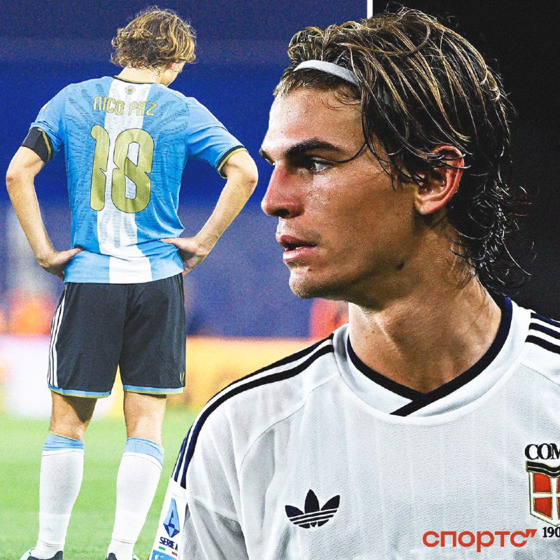
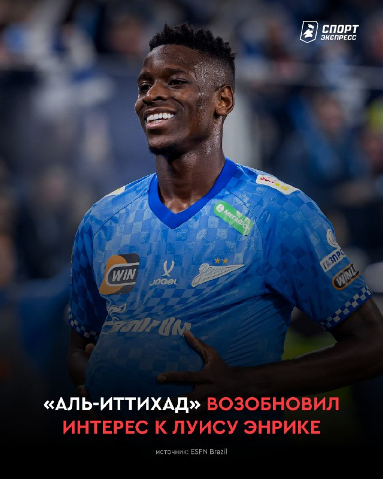

# Футбольный дайджест — 20 ноября 2026

_Период: с 19 по 20 ноября (ТГ-материалы и ESPN собраны 20 ноября в 07:08 МСК — свежие)_

## ⭐ Главное
- **«Реал» закрепляет основу: Тчуамени — до 2032, Куртуа подписал до 2028.** По Фабрицио Романо, Орельен Тчуамени подписал новый долгосрочный контракт до июня 2032 года, а Тибо Куртуа — до июня 2028-го; Романо добавляет, что после Гюлера и Тчуамени клуб готовит объявление ещё об одном новом соглашении. Клубного объявления по Куртуа в материалах пока нет — ждём подтверждения «Реала».
[Фабрицио Романо: Тчуамени](https://t.me/FabrizioRomanoTG/68406) · [Фабрицио Романо: Куртуа](https://t.me/FabrizioRomanoTG/68417)

## ⚽ Результаты
- **«Реал»** и **«Зенит»** не играли — международная пауза. Следующий матч «Реала» — «Сельта», 21 ноября, 23:00 МСК (Ла Лига, дома). [ESPN](https://www.espn.com/soccer/match/_/gameId/401882798)
- **«Зенит»:** следующий матч — «Рубин», 21 ноября, 17:30 МСК (РПЛ, в гостях). Семак перед игрой: «Ожидаем сложной, плотной игры, много единоборств. „Рубин“ умеет обороняться, у них хорошие стандартные положения». [ESPN](https://www.espn.com/soccer/match/_/gameId/401879801) · [Зенит](https://t.me/fczenit/38681)
- Сыгранные за период: Кубок Испании, «Порталуэте» — «Реал Унион» 0:0, по пенальти победил «Порталуэте». [ESPN](https://www.espn.com/soccer/match/_/gameId/401928518)

## 👤 Мои игроки
- **Роналду:** новостей нет. Сегодня, 20 ноября, в 20:30 МСК «Аль-Наср» в гостях у «Аль-Ахли» (перенесённый матч 9-го тура). [ESPN](https://www.espn.com/soccer/match/_/gameId/401900905)
- **Куртуа:** по Романо, подписал новый контракт с «Реалом» до июня 2028 года (см. «Главное»). [Фабрицио Романо](https://t.me/FabrizioRomanoTG/68417)
- **Мбаппе:** Рюдигер в интервью The Athletic: «Должен ли я говорить человеку, у которого уже 100 голов за „Реал“ за два года, делать мою работу? Это бессмысленно». [Фабрицио Романо](https://t.me/FabrizioRomanoTG/68395)
- **Батраков:** в фан-шопе «Галатасарая» его джерси — самый продаваемый товар, у входа играют нейро-песни про него, турки говорят о «Батраковомании»; стендов с его атрибутикой больше, чем у Леау и Осимхена. Три сезона назад скаут уже показывал руководству клуба его игру, летом «Галатасарай» заплатил «Локомотиву» €25 млн; Алексей забил четыре гола в первых четырёх матчах ЛЧ. Матч с «Самсунспором» — 21 ноября, 16:00 МСК. [Мяч Русь](https://t.me/myachrus/10254) · [Спорт-Экспресс](https://t.me/sportexpress/85044) · [ESPN](https://www.espn.com/soccer/match/_/gameId/401888245)
- **Холанд:** «Сити» — «Фулхэм» 21 ноября, 15:30 МСК. [ESPN](https://www.espn.com/soccer/match/_/gameId/401879233)
- **Беллингем, Сафонов, Глушенков, Аршавин:** новых подтверждённых новостей нет.

## 🔁 Трансферы
- **Официально:** новых клубных объявлений в материалах нет (продления Тчуамени и Куртуа — по Романо, объявления «Реала» ждём).
- **Слухи:** «Реал» планирует вернуть Нико Паса из «Комо» этим летом за €80 млн, аргентинец хочет роль «основного игрока» (COPE, пересказ Sports.ru). [Sports.ru](https://t.me/sportsru/131896)

- **Слухи:** «Зенит» хочет €30–40 млн за Луиса Энрике — «Аль-Иттихад» вышел на связь с футболистом (ESPN Brazil, пересказ «Спорт-Экспресс»); при предложении близкой суммы переговоры начнутся. [Спорт-Экспресс](https://t.me/sportexpress/85055)

- **Слухи:** президент «Баварии» Хайнер об Олисе и «Реале»: «Наша цель — чтобы Олисе остался на многие годы, чтобы вопрос о „Реале“ даже не возникал». «Мы не продающий клуб, а покупающий». [Фабрицио Романо](https://t.me/FabrizioRomanoTG/68411) · [Фабрицио Романо](https://t.me/FabrizioRomanoTG/68391)
- **Слухи:** «Манчестер Юнайтед» зимой попытается купить Коула Палмера и Льюиса Холла (Okko Спорт). [Okko Спорт](https://t.me/okkosport/44848)
- Романо: «Барселона» готова подтвердить новый контракт Хави Эспарта до июня 2030. [Фабрицио Романо](https://t.me/FabrizioRomanoTG/68389)

## 🩹 Травмы
- Нет новостей о травмах моих игроков.

## 🔥 Ещё важное
- **Рюдигер об «Реале»:** «Два года без побед — это ужасно». О Винисиусе: «Он работает каждый день, нам нужен хороший Вини в хорошей форме». О Хаби Алонсо: «Написал ему в день увольнения, с тех пор мы не говорили». [Фабрицио Романо](https://t.me/FabrizioRomanoTG/68392) · [Фабрицио Романо](https://t.me/FabrizioRomanoTG/68410) · [Фабрицио Романо](https://t.me/FabrizioRomanoTG/68393)
- **Котовщиков впервые в заявке на матч Ла Лиги.** 18-летний российский форвард «Эспаньола» вошёл в заявку на игру с «Атлетиком» (20 ноября, 23:00 МСК). [Sports.ru](https://t.me/sportsru/131879) · [Чемпионат](https://t.me/championat/89520)

- **Компани вернулся к работе в «Баварии»** через месяц после потери сознания на тренировке: «Я просто заболел… Возможно, недостаточно прислушивался к организму». «Бавария» подтвердила, что он будет на скамейке в эти выходные. [Sports.ru](https://t.me/sportsru/131882) · [Фабрицио Романо](https://t.me/FabrizioRomanoTG/68390)
- **Антонио Адан завершил карьеру в 39 лет** — вратарь, игравший за «Реал» и «Атлетико». [Okko Спорт](https://t.me/okkosport/44845)

## 📅 Ближайшие матчи
- **«Аль-Ахли» — «Аль-Наср» (Роналду)** — 20 ноября, 20:30 МСК. [ESPN](https://www.espn.com/soccer/match/_/gameId/401900905)
- **«Манчестер Сити» — «Фулхэм» (Холанд)** — 21 ноября, 15:30 МСК, АПЛ. [ESPN](https://www.espn.com/soccer/match/_/gameId/401879233)
- **«Галатасарай» — «Самсунспор» (Батраков)** — 21 ноября, 16:00 МСК. [ESPN](https://www.espn.com/soccer/match/_/gameId/401888245)
- **«Рубин» — «Зенит»** — 21 ноября, 17:30 МСК, РПЛ. [ESPN](https://www.espn.com/soccer/match/_/gameId/401879801)
- **«Реал» — «Сельта»** — 21 ноября, 23:00 МСК, Ла Лига. [ESPN](https://www.espn.com/soccer/match/_/gameId/401882798)
- **«Галатасарай» — «Астон Вилла» (Батраков)** — 24 ноября, 20:45 МСК, ЛЧ. [ESPN](https://www.espn.com/soccer/match/_/gameId/401915300)
- **«Реал» — «ПСВ»** — 24 ноября, 23:00 МСК, ЛЧ. [ESPN](https://www.espn.com/soccer/match/_/gameId/401915298)
- **«Манчестер Сити» — «Наполи» (Холанд)** — 24 ноября, 23:00 МСК, ЛЧ. [ESPN](https://www.espn.com/soccer/match/_/gameId/401915379)
- **«Зенит» — «Крылья Советов»** — 24 ноября, Кубок России; время уточняется. [Зенит](https://t.me/fczenit/38679)
- **«Зенит» — «Балтика»** — 5 декабря, 17:30 МСК, РПЛ. [Зенит](https://t.me/fczenit/38676)
