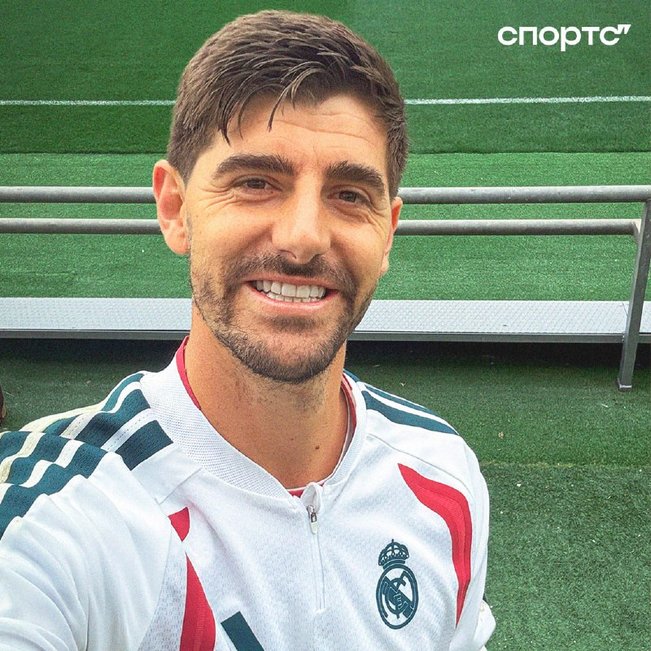
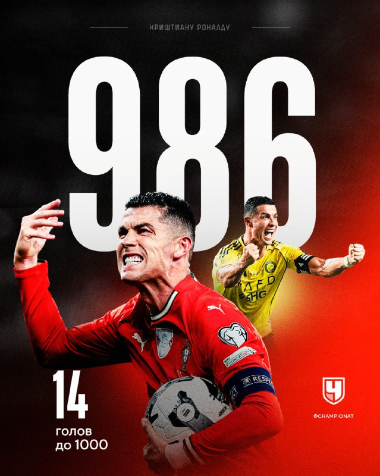
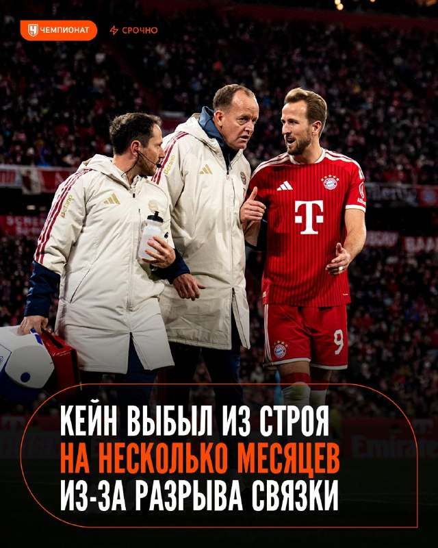

# Футбольный дайджест — 21 ноября 2026

_Период: с 20 по 21 ноября (ТГ-материалы и ESPN собраны 21 ноября в 07:06 МСК — свежие)_

## ⭐ Главное
- **Куртуа продлил контракт с «Реалом» до 2028 года.** Фабрицио Романо называет историю подтверждённой («Official, exclusive»): 34-летний вратарь подписал новый договор до июня 2028-го, Sports.ru сообщает то же. Это уже третье продление подряд после Гюлера и Тчуамени; Романо добавляет, что «Реал» готовит и другие. Клубного заявления в материалах пока нет — ждём подтверждения «Реала».
[Sports.ru](https://t.me/sportsru/131910) · [Фабрицио Романо](https://t.me/FabrizioRomanoTG/68432)

- **Роналду забил 986-й гол в карьере, но «Аль-Наср» проиграл «Аль-Ахли» 1:3.** Криштиану открыл счёт на 14-й минуте, затем попал в штангу с пенальти. После гола Галено (45+1'), пенальти Тони (71') и гола Ибаньеса (75') «Аль-Наср» уступил. До отметки 1000 голов — 14.
[Чемпионат](https://t.me/championat/89559) · [Sports.ru](https://t.me/sportsru/131916) · [ESPN](https://www.espn.com/soccer/match/_/gameId/401900905)

## ⚽ Результаты
- **«Реал»** не играл. Сегодня, 21 ноября, в 23:00 МСК принимает «Сельту» (Ла Лига). Моуринью накануне: «Эндрик нам нужен, Реал важнее любого игрока», «проблемы с Вини нет — он потрясающий игрок, я его хочу и он мне нужен», по Гюлеру: «Арда будет здесь очень долго, продление — естественный шаг».
[Фабрицио Романо: Эндрик](https://t.me/FabrizioRomanoTG/68423) · [Фабрицио Романо: Вини](https://t.me/FabrizioRomanoTG/68429) · [Фабрицио Романо: Гюлер](https://t.me/FabrizioRomanoTG/68428) · [ESPN](https://www.espn.com/soccer/match/_/gameId/401882798)
- **«Зенит»** не играл. Сегодня, 21 ноября, в 17:30 МСК — «Рубин» — «Зенит» (РПЛ, в Казани).
[ESPN](https://www.espn.com/soccer/match/_/gameId/401879801) · [Зенит](https://t.me/fczenit/38705)
- РПЛ, 15-й тур: «Ростов» — «Крылья Советов» 3:0 (Олусегун 14', Сулейманов 60', Шанталий 90+4'). «Ростов» шесть матчей подряд без поражений, «Крылья» впервые в сезоне проиграли в гостях и отстали от «Ростова» на 4 очка.
[ESPN](https://www.espn.com/soccer/match/_/gameId/401879805) · [Чемпионат](https://t.me/championat/89557) · [Sports.ru](https://t.me/sportsru/131917)
- Ла Лига: «Атлетик» — «Эспаньол» 0:1 (Роберто Фернандес 66').
[ESPN](https://www.espn.com/soccer/match/_/gameId/401882805)

## 👤 Мои игроки
- **Роналду:** гол в ворота «Аль-Ахли» (986-й в карьере, 14-я минута) и штанга с пенальти — «Аль-Наср» проиграл 1:3 (см. «Главное»). Фанаты клуба отмечают его дисциплину: молодые партнёры всегда пропускают Криштиану в автобус первым. Следующий матч — «Аль-Хазм» — «Аль-Наср», 28 ноября, 15:15 МСК.
[Фабрицио Романо](https://t.me/FabrizioRomanoTG/68443) · [Sports.ru](https://t.me/sportsru/131907) · [ESPN](https://www.espn.com/soccer/match/_/gameId/401900442)
- **Куртуа:** продлил контракт с «Реалом» до 2028 года (см. «Главное»).
[Sports.ru](https://t.me/sportsru/131910)
- **Мбаппе:** жеребьёвка плей-офф Лиги наций подарила новую встречу с Ямалем — в четвертьфинале Испания — Франция. Дат матчей в материалах нет.
[Sports.ru](https://t.me/sportsru/131906)
- **Сафонов:** «ПСЖ» планирует продлить контракт с Матвеем до 2032 года — вместе с Дуэ, Дембеле и Хвичей (Canal+). Зарплату наконец повысят: сейчас — около €3 млн в год. Ближайший матч «ПСЖ» — в Ницце сегодня в 19:15 МСК.
[Мяч Русь](https://t.me/myachrus/10262) · [Спорт-Экспресс](https://t.me/sportexpress/85066) · [ESPN](https://www.espn.com/soccer/match/_/gameId/401876398)
- **Батраков:** по версии CIES, в топе среди полузащитников до 23 лет по выигранным единоборствам. Сегодня в 16:00 МСК «Галатасарай» принимает «Самсунспор».
[Спорт-Экспресс](https://t.me/sportexpress/85068) · [ESPN](https://www.espn.com/soccer/match/_/gameId/401888245)
- **Холанд:** в четвертьфинале Лиги наций Норвегия сыграет с Англией. Сегодня в 15:30 МСК «Сити» — «Фулхэм».
[Чемпионат](https://t.me/championat/89545) · [ESPN](https://www.espn.com/soccer/match/_/gameId/401879233)
- **Беллингем, Глушенков, Аршавин:** новых подтверждённых новостей нет.

## 🔁 Трансферы
- **Официально:** клубных объявлений в материалах нет. По Романо, Брахим Диас подписал новый контракт с «Реалом» до июня 2031 года (заявление клуба — следом), с Федерико Вальверде достигнуто соглашение до 2031 года, подпись — в ближайшее время.
[Фабрицио Романо: Брахим](https://t.me/FabrizioRomanoTG/68439) · [Фабрицио Романо: Вальверде](https://t.me/FabrizioRomanoTG/68430)
- **Слухи:** Эндрик ведёт переговоры с «Миланом» о полноценном трансфере; «Реал» просит €70 млн и хочет пункт об обратном выкупе за €80 млн (ESPN Brasil, пересказ Sports.ru). При этом Моуринью говорит, что Эндрик ему нужен. Эндрик за сборную Бразилии в товарищеских матчах отыграл больше минут (156), чем за «Реал» в этом сезоне.
[Sports.ru](https://t.me/sportsru/131920) · [Мяч PRO](https://t.me/myachPRO/25341)
- **Слухи:** «Арсенал» готов конкурировать с «Реалом» за Майкла Олисе в 2027-м, но «Бавария» расставаться с ним не планирует (Bild, пересказ «Мяча»).
[Мяч PRO](https://t.me/myachPRO/25345)
- **Слухи:** выкуп Нико Паса «Реалом» — €80 млн летом 2027 (DAZN).
[Фабрицио Романо](https://t.me/FabrizioRomanoTG/68441)

## 🩹 Травмы
- **Кейн («Бавария»)** выбыл на несколько месяцев — разрыв связки голеностопа (синдесмоз), вернётся в феврале–марте и в 2026-м больше не сыграет. Олисе — ушиб стопы, вернётся в начале следующей недели. Оба получили повреждения в первом тайме матча с «Кёльном».
[Чемпионат](https://t.me/championat/89564) · [Фабрицио Романо: Кейн](https://t.me/FabrizioRomanoTG/68461) · [Фабрицио Романо: Олисе](https://t.me/FabrizioRomanoTG/68462)

- **Головин («Монако»)** с 8 ноября не восстановился после травмы икроножной мышцы, пропустит ещё 2–3 недели (Nice-Matin).
[Спорт-Экспресс](https://t.me/sportexpress/85069)

## 🔥 Ещё важное
- **«Бавария» не обыграла «Кёльн» (ничья)** — первый матч после паузы, 0:1 на 20-й минуте, Кейн заменён, Олисе не вышел на второй тайм. Упамекано психанул после замены. Компани впервые после болезни вернулся и руководил командой; «Боруссия» уже завтра может сбросить мюнхенцев с первого места.
[Мяч PRO](https://t.me/myachPRO/25349) · [Чемпионат](https://t.me/championat/89563) · [Sports.ru](https://t.me/sportsru/131924)
- **Почеттино возглавил «Манчестер Юнайтед».** На первой пресс-конференции: «Мой первый приоритет — выспаться, но я не могу: сплю 3–4 часа». Первый матч под его руководством — с «Ливерпулем». Берради: «Мы сделали всё, чтобы удержать Жуан Габриэла»; по Романо, Шешко в январе не уйдёт.
[Sports.ru](https://t.me/sportsru/131911) · [Фабрицио Романо](https://t.me/FabrizioRomanoTG/68458) · [Фабрицио Романо: Берради](https://t.me/FabrizioRomanoTG/68449)
- **Лига наций, четвертьфиналы:** Испания — Франция, Норвегия — Англия, Нидерланды — Португалия, Бельгия — Германия. Полуфиналы: победитель пары Нидерланды — Португалия сыграет с победителем Испания — Франция, Бельгия — Германия с Норвегия — Англия.
[Фабрицио Романо](https://t.me/FabrizioRomanoTG/68434) · [Чемпионат](https://t.me/championat/89545)
- **Медведев вышел в полуфинал Итогового турнира ATP,** в двух сетах обыграл Тиафо, не позволил взять ни одной своей подачи. Дальше — Зверев.
[Okko Спорт](https://t.me/okkosport/44876) · [Чемпионат](https://t.me/championat/89562)

## 📅 Ближайшие матчи
- **«Манчестер Сити» — «Фулхэм» (Холанд)** — 21 ноя, 15:30 МСК, АПЛ. [Источник](https://www.espn.com/soccer/match/_/gameId/401879233)
- **«Галатасарай» — «Самсунспор» (Батраков)** — 21 ноя, 16:00 МСК, Чемпионат Турции. [Источник](https://www.espn.com/soccer/match/_/gameId/401888245)
- **«Рубин» — «Зенит»** — 21 ноя, 17:30 МСК, РПЛ. [Источник](https://www.espn.com/soccer/match/_/gameId/401879801)
- **«Ницца» — «ПСЖ» (Сафонов)** — 21 ноя, 19:15 МСК, Лига 1. [Источник](https://www.espn.com/soccer/match/_/gameId/401876398)
- **«Реал» — «Сельта»** — 21 ноя, 23:00 МСК, Ла Лига. [Источник](https://www.espn.com/soccer/match/_/gameId/401882798)
- **«Галатасарай» — «Астон Вилла» (Батраков)** — 24 ноя, 20:45 МСК, ЛЧ. [Источник](https://www.espn.com/soccer/match/_/gameId/401915300)
- **«Реал» — «ПСВ»** — 24 ноя, 23:00 МСК, ЛЧ. [Источник](https://www.espn.com/soccer/match/_/gameId/401915298)
- **«Манчестер Сити» — «Наполи» (Холанд)** — 24 ноя, 23:00 МСК, ЛЧ. [Источник](https://www.espn.com/soccer/match/_/gameId/401915379)
- **«Зенит» — «Крылья Советов»** — 24 ноя, Кубок России; время уточняется. [Источник](https://t.me/fczenit/38679)
- **«ПСЖ» — «Рома» (Сафонов)** — 25 ноя, 23:00 МСК, ЛЧ. [Источник](https://www.espn.com/soccer/match/_/gameId/401915374)
- **«Аль-Хазм» — «Аль-Наср» (Роналду)** — 28 ноя, 15:15 МСК, Саудовская Про-лига. [Источник](https://www.espn.com/soccer/match/_/gameId/401900442)
- **«ЦСКА» — «Зенит»** — 28 ноя, 16:30 МСК, РПЛ. [Источник](https://www.espn.com/soccer/match/_/gameId/401879794)
- **«Реал» — «Алавес»** — 28 ноя, 23:00 МСК, Ла Лига. [Источник](https://www.espn.com/soccer/match/_/gameId/401882789)
