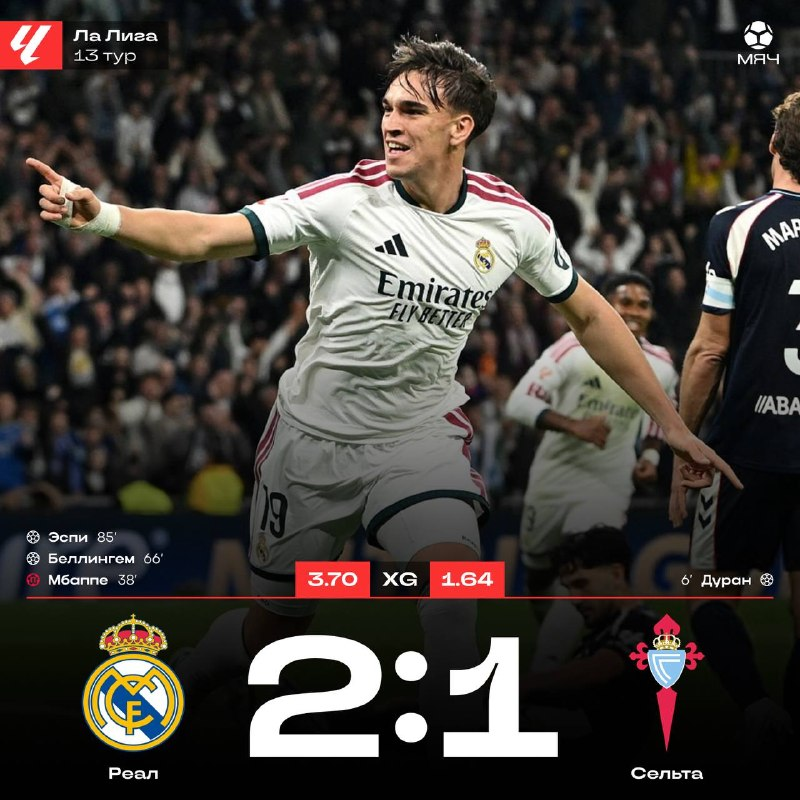
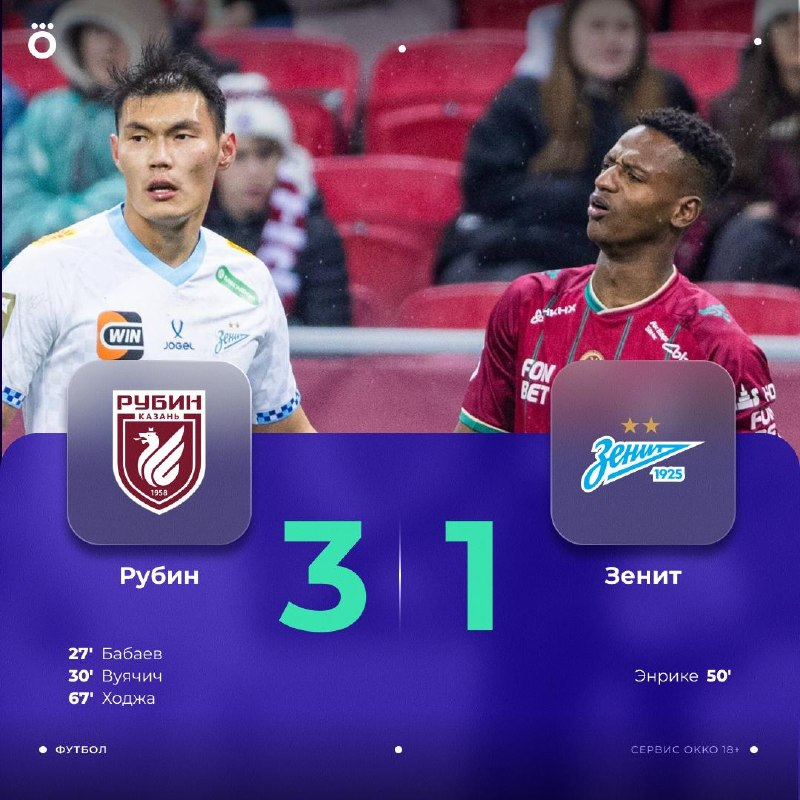
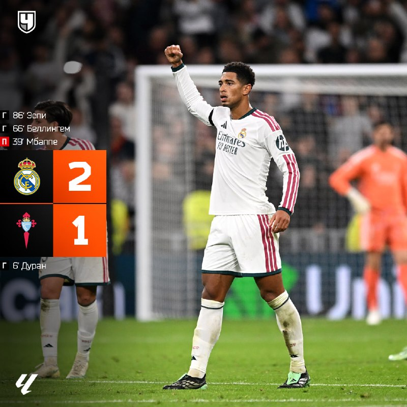
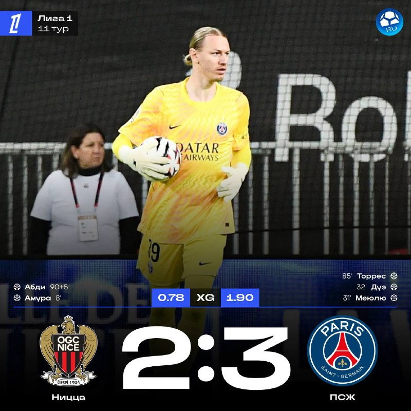
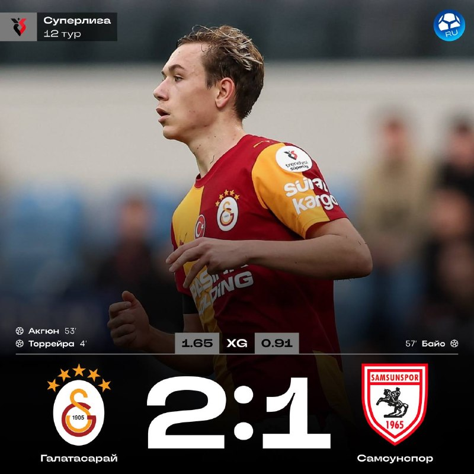

# Футбольный дайджест — 22 ноября 2026

_Период: с 21 по 22 ноября (ТГ-материалы и ESPN собраны 22 ноября в 07:08 МСК — свежие)_

## ⭐ Главное
- **«Реал» выиграл девятый матч подряд, вырвав победу у «Сельты» 2:1.** Дуран открыл счёт на 6-й минуте, Мбаппе не реализовал пенальти (38'), но Беллингем сравнял на 66-й, а Карлос Эспи, выйдя на 79-й, забил победный на 85-й — спустя 6 минут после выхода. Для Эспи это 4-й мяч за «Реал»: во всех четырёх он выручал команду в концовке. Винисиус отбыл дисквалификацию, но остался на скамейке и вышел только во втором тайме, ничем не отметившись; Мбаппе, по «Мячу», отдал ассист. По xG у «Реала» 3,70 против 1,64. Перед игрой клуб простился с Хесусом де Мигелем, пригласив на «Бернабеу» его семью.
[Мяч PRO](https://t.me/myachPRO/25380) · [Чемпионат](https://t.me/championat/89592) · [Sports.ru](https://t.me/sportsru/131964) · [ESPN](https://www.espn.com/soccer/match/_/gameId/401882798)

## ⚽ Результаты
- **«Зенит» проиграл «Рубину» в Казани 1:3** — первое поражение с сентября. Бабаев (27'), Вуячич (30') и Ходжа (67') ответили единственным голом Луиса Энрике (50', после подачи Педро). У Вуячича мог быть дубль — второй гол отменили за офсайд. Это первая победа «Рубина» над «Зенитом» дома за 5,5 лет и третья подряд при Олеге Кузьмине. Семак: в первом тайме не хватало остроты, после 3:1 вернуться в игру не удалось. «Зенит» может опуститься на третье место. **Дальше:** 24 ноября — «Зенит» — «Крылья Советов» (Кубок России, время уточняется); 28 ноября, 16:30 МСК — «ЦСКА» — «Зенит» (РПЛ; Вендел пропустит игру из-за перебора жёлтых).
[Окко Спорт](https://t.me/okkosport/44896) · [Мяч Русь](https://t.me/myachrus/10271) · [Чемпионат](https://t.me/championat/89581) · [Зенит](https://t.me/fczenit/38753) · [ESPN](https://www.espn.com/soccer/match/_/gameId/401879801)

- **«Реал»** — «Сельта» 2:1 (см. «Главное»). Следующий матч: 24 ноября, 23:00 МСК — «Реал» — «ПСВ» (Лига чемпионов); затем 28 ноября, 23:00 МСК — «Реал» — «Алавес» (Ла Лига).
[ESPN](https://www.espn.com/soccer/match/_/gameId/401915298)
- **«Ницца» — «ПСЖ» 2:3** (Лига 1): Амура (8') и Абди (90+5') — за «Ниццу»; Маюлю с пенальти (31'), Дуэ (32') и Ферран Торрес (85') — за парижан. Торрес забил впервые с 20 сентября.
[ESPN](https://www.espn.com/soccer/match/_/gameId/401876398) · [Окко Спорт](https://t.me/okkosport/44903)
- **Лига 1 / РПЛ / Ла Лига:** «Ахмат» обыграл ЦСКА 2:1 (Садулаев с пенальти, Мелькадзе; у ЦСКА — Карму), армейцы набрали 1 очко в трёх турах; «Балтика» выиграла в Оренбурге 2:0, «Факел» — в Тольятти 2:0 (первая победа при Биджиеве, но остался последним); «Алавес» — «Депортиво» 3:1; «Валенсия» обыграла «Райо» 1:0; «Севилья» — «Бетис» 1:1.
[ESPN: ЦСКА](https://www.espn.com/soccer/match/_/gameId/401879803) · [ESPN: Оренбург](https://www.espn.com/soccer/match/_/gameId/401879804) · [ESPN: Алавес](https://www.espn.com/soccer/match/_/gameId/401882806)

## 👤 Мои игроки
- **Беллингем:** сравнял счёт с «Сельтой» на 66-й минуте и отметил 100-й матч за «Реал» — 39 голов и 23 передачи (62 результативных действия).
[Фабрицио Романо](https://t.me/FabrizioRomanoTG/68509) · [Чемпионат](https://t.me/championat/89592)

- **Сафонов:** тяжёлый вечер в Ницце — всего 1 сейв, из 3 ударов в створ два закончились голами; «ПСЖ» победил 3:2. В концовке в Матвея влетел Будауи, ему оказывали помощь, но он доиграл. Ближайший матч «ПСЖ» — 25 ноября в 23:00 МСК с «Ромой» в ЛЧ. Напомним, по Canal+ клуб хочет продлить контракт вратаря до 2032-го.
[Мяч Русь](https://t.me/myachrus/10274) · [Окко Спорт](https://t.me/okkosport/44901) · [ESPN](https://www.espn.com/soccer/match/_/gameId/401876398)

- **Батраков:** «Галатасарай» обыграл «Самсунспор» 2:1 (Торрейра 4', Акгюн 53'). Алексей отыграл 66 минут: 2 острые передачи, 1 неудачное касание, но впервые за 4 матча — без результативного действия. Следующий матч — «Галатасарай» — «Астон Вилла», 24 ноября, 20:45 МСК (ЛЧ). Слух: по Ивану Карпову, «Комо» хочет купить Батракова на замену Нико Пасу.
[Мяч Русь](https://t.me/myachrus/10267) · [Sports.ru](https://t.me/sportsru/131960) · [ESPN](https://www.espn.com/soccer/match/_/gameId/401888245)

- **Роналду:** «Аль-Наср» в минувшие сутки не играл; последний матч — гол в ворота «Аль-Ахли» (986-й в карьере, до 1000 — 14) и штанга с пенальти, 1:3. Моуринью на пресс-конференции отказался говорить о первой международной паузе без Роналду в сборной Португалии: «Я умываю руки». Следующий матч — «Аль-Хазм» — «Аль-Наср», 28 ноября, 15:15 МСК.
[Спорт-Экспресс](https://t.me/sportexpress/85090) · [ESPN](https://www.espn.com/soccer/match/_/gameId/401900442)
- **Мбаппе:** не забил пенальти на 38-й минуте, но, по «Мячу PRO», отдал ассист; «Реал» победил 2:1.
[Мяч PRO](https://t.me/myachPRO/25380) · [Sports.ru](https://t.me/sportsru/131961)
- **Холанд:** «Манчестер Сити» сыграл вничью с «Фулхэмом» 1:1 (Мунис 16', Андерсон 57'); гол Холанда в первом тайме отменили за нарушение правил против вратаря Лено — VAR подтвердил решение. Следующий матч — «Сити» — «Наполи», 24 ноября, 23:00 МСК (ЛЧ).
[Чемпионат](https://t.me/championat/89575) · [ESPN](https://www.espn.com/soccer/match/_/gameId/401879233)
- **Глушенков, Аршавин:** новых подтверждённых новостей нет (Глушенков в матче с «Рубином» в источниках не отмечен).

## 🔁 Трансферы
- **[Официально]** Клубных объявлений в материалах нет.
- **[Слухи]** Владелец «Милана» Кардинале об Эндрике: «Один из лучших в мире на своей позиции, если не лучший. Посмотрим, что может произойти в январе». Ранее ESPN Brasil писал о переговорах игрока с «Миланом»; у Эндрика в этом сезоне 140 минут за «Реал» во всех турнирах (подсчёт «Мяч PRO»).
[Мяч PRO](https://t.me/myachPRO/25359)
- **[Слухи]** «Комо» присматривается к Батракову как замене Нико Пасу, которого летом «Реал» вернёт за €80 млн (Иван Карпов).
[Sports.ru](https://t.me/sportsru/131960)
- **[Слухи]** «Милан» продвигается по новому контракту Адриена Рабьо (Фабрицио Романо).
[Фабрицио Романо](https://t.me/FabrizioRomanoTG/68501)

## 🩹 Травмы
- **[ПСЖ]** **Дезире Дуэ** получил тяжёлую травму в первом тайме матча с «Ниццей», сразу после забитого гола: ушёл с поля на носилках в слезах. Луис Энрике подтвердил «серьёзную травму»; RMC Sport и французская пресса говорят о разрыве крестообразной связки и сроке до 9 месяцев, точный диагноз — после обследования. Хвича уже выбыл до конца сезона из-за крестов.
[Чемпионат](https://t.me/championat/89584) · [Фабрицио Романо](https://t.me/FabrizioRomanoTG/68505) · [Мяч PRO](https://t.me/myachPRO/25368)
- **[Арсенал]** **Давид Райя** заменён на 70-й минуте в матче с «Ньюкаслом» (1:1) после столкновения с Осулой — возможно, сломана рука (Sports.ru); диагноз не подтверждён.
[Sports.ru](https://t.me/sportsru/131957) · [Чемпионат](https://t.me/championat/89587)

## 🔥 Ещё важное
- **Надаль вошёл в совет директоров «Реала».** Кандидатуру теннисиста поддержали 99,5% делегатов (1704 из 1713) на внеочередной ассамблее; по The Athletic, он сразу получит право голоса.
[Чемпионат](https://t.me/championat/89578) · [Sports.ru](https://t.me/sportsru/131938)
- **«Челси» проиграл «Лидсу» дома,** Окафор оформил дубль; для «Челси» это третье поражение в последних четырёх матчах АПЛ. Хаби Алонсо: «Сегодня «Лидс» верил больше нас».
[Фабрицио Романо](https://t.me/FabrizioRomanoTG/68495) · [Фабрицио Романо: Алонсо](https://t.me/FabrizioRomanoTG/68499)
- **«Арсенал» потерял очки в Ньюкасле (1:1)** и упустил шанс воспользоваться осечкой «Сити»; пятиматчевая победная серия канониров прервана.
[Мяч PRO](https://t.me/myachPRO/25375) · [Чемпионат](https://t.me/championat/89587)
- **«Бока Хуниорс» выиграла Кубок Судамерикана** — первый крупный южноамериканский трофей за 18 лет; в финале против «Атлетико Минейро» к началу второго тайма вела 2:0; у «Минейро» — второй проигранный финал Судамерикана подряд.
[Окко Спорт](https://t.me/okkosport/44919)
- **«Интер Майами» сенсационно проиграл 0:3 «Коламбусу»** в первом матче плей-офф МЛС.
[Sports.ru](https://t.me/sportsru/131966)
- **Зверев и Алькарас сыграют финал Итогового турнира ATP:** Зверев обыграл Медведева 7:6, 6:4 в полуфинале.
[Окко Спорт](https://t.me/okkosport/44910) · [Спорт-Экспресс](https://t.me/sportexpress/85110)

## 📅 Ближайшие матчи
- **«Динамо» Москва — «Краснодар»** — 22 ноя, 14:00 МСК, РПЛ.
- **«Барселона» — «Вильярреал»** — 22 ноя, 16:00 МСК, Ла Лига.
- **«Динамо» Махачкала — «Спартак»** — 22 ноя, 16:30 МСК, РПЛ.
- **«Галатасарай» — «Астон Вилла» (Батраков)** — 24 ноя, 20:45 МСК, ЛЧ.
- **«Реал» — «ПСВ»** — 24 ноя, 23:00 МСК, ЛЧ.
- **«Манчестер Сити» — «Наполи» (Холанд)** — 24 ноя, 23:00 МСК, ЛЧ.
- **«Зенит» — «Крылья Советов»** — 24 ноя, Кубок России; время уточняется.
- **«ПСЖ» — «Рома» (Сафонов)** — 25 ноя, 23:00 МСК, ЛЧ.
- **«Аль-Хазм» — «Аль-Наср» (Роналду)** — 28 ноя, 15:15 МСК, Саудовская Про-лига.
- **«ЦСКА» — «Зенит»** — 28 ноя, 16:30 МСК, РПЛ.
- **«Реал» — «Алавес»** — 28 ноя, 23:00 МСК, Ла Лига.
- **«Арсенал» — «Манчестер Сити» (Холанд)** — 29 ноя, 19:30 МСК, АПЛ.
