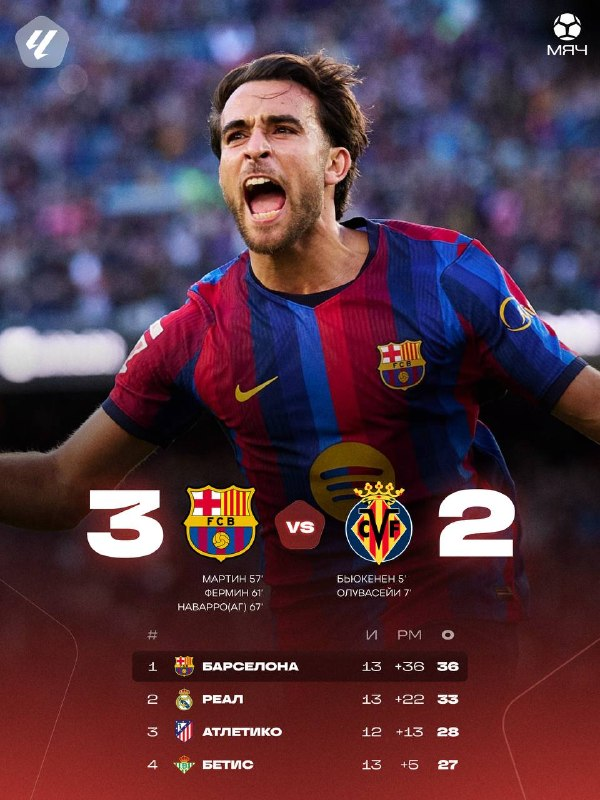
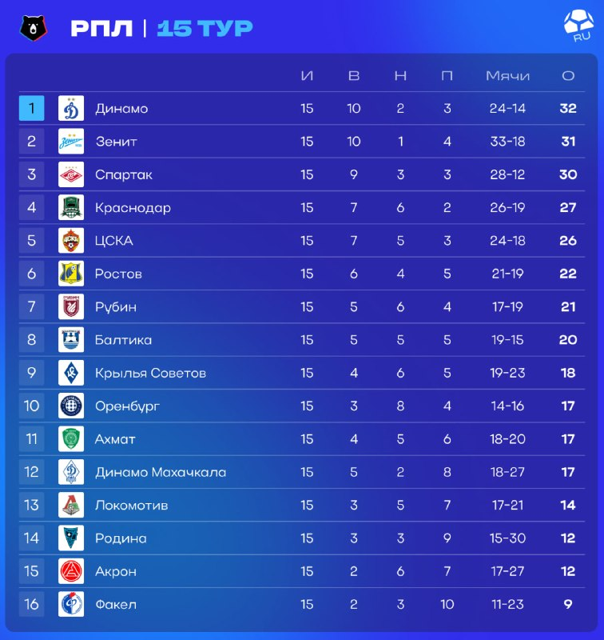
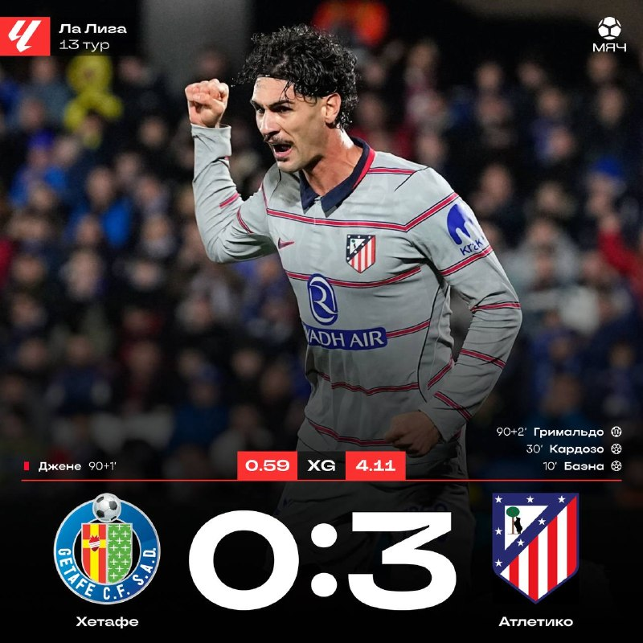
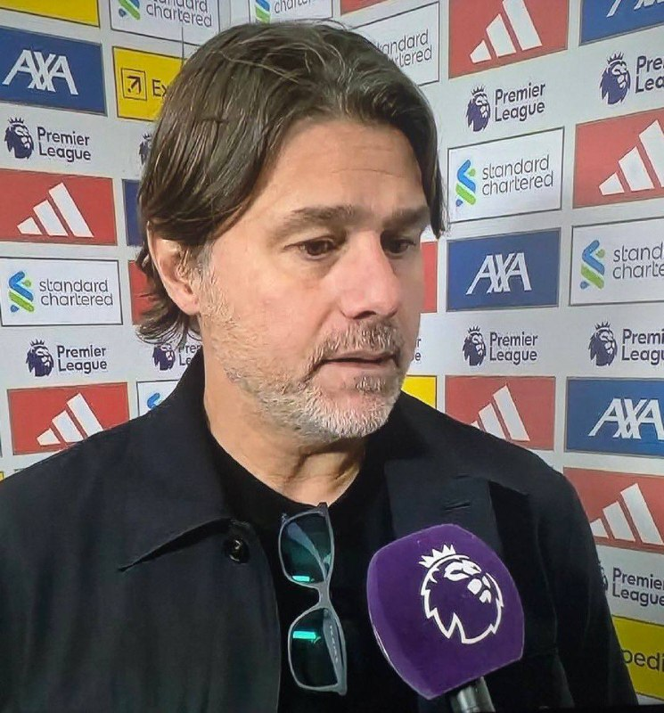

# Футбольный дайджест — 23 ноября 2026

_Период: с 22 по 23 ноября (ТГ-материалы и ESPN собраны 23 ноября в 07:25 МСК — свежие; WebSearch свежих данных почти не дал)_

## ⭐ Главное
- **«Барселона» перевернула игру с «Вильярреалом» (3:2) и опять уехала от «Реала» на три очка.** Каталонцы проигрывали 0:2 к 7-й минуте (Бьюкенен 5', Олувасейи 7'), но во втором тайме забили три мяча за 10 минут: Жерар Мартин (57'), Фермин Лопес (61') и автогол Пау Наварро (67'). Это 4-я победа подряд и 51 гол за 13 туров Ла Лиги. Таблица: «Барса» 36, «Реал» 33, «Атлетико» 31. Фермин при этом получил вторую жёлтую, сидя на скамейке, — рискует пропустить игру с «Атлетико» (Мяч PRO).
[Мяч PRO](https://t.me/myachPRO/25397) · [Мяч PRO: Фермин](https://t.me/myachPRO/25401) · [Окко Спорт](https://t.me/okkosport/44932) · [ESPN](https://www.espn.com/soccer/match/_/gameId/401882804)

## ⚽ Результаты
- **«Зенит» и «Реал» в эти сутки не играли.** После 15 туров РПЛ «Зенит» — 2-й с 31 очком, на очко позади лидирующего «Динамо» (32), «Спартак» — 3-й (30). Весь топ-5 потерял очки в туре: «Динамо» — «Краснодар» 1:1, «Динамо» Махачкала — «Спартак» 1:1 (Зобнин 14', Лесовой 89'). **«Зенит», дальше:** 24 ноября — «Зенит» — «Крылья Советов» (Кубок России, время уточняется); 28 ноября, 16:30 МСК — «ЦСКА» — «Зенит» (РПЛ); 5 декабря, 17:30 — «Зенит» — «Балтика» (по анонсу клуба). **«Реал», дальше:** 24 ноября, 23:00 МСК — «Реал» — «ПСВ» (ЛЧ); 28 ноября, 23:00 МСК — «Реал» — «Алавес» (Ла Лига).
[Мяч Русь](https://t.me/myachrus/10293) · [Спорт-Экспресс](https://t.me/sportexpress/85135) · [ESPN: Динамо](https://www.espn.com/soccer/match/_/gameId/401879807) · [ESPN: Спартак](https://www.espn.com/soccer/match/_/gameId/401879806) · [ЦСКА — Зенит](https://www.espn.com/soccer/match/_/gameId/401879794) · [Зенит](https://t.me/fczenit/38763)

- **«Хетафе» — «Атлетико» 0:3** (Баэна 10', Кардозо 30', Гримальдо с пенальти 90+2'). Два ассиста у Хулиана Альвареса — 1+4 в 9 матчах Ла Лиги; у Гримальдо 5-й гол за мадридцев. По xG 4,11 против 0,59. Симеоне стал тренером с наибольшим числом побед в истории Ла Лиги — 345.
[Мяч PRO](https://t.me/myachPRO/25421) · [Sports.ru](https://t.me/sportsru/132019) · [Фабрицио Романо](https://t.me/FabrizioRomanoTG/68553) · [ESPN](https://www.espn.com/soccer/match/_/gameId/401882803)

- **Ла Лига / РПЛ:** «Расинг» — «Реал Сосьедад» 3:2 (дубль Забири, Каналес с пенальти; у «Сосьедада» Ойярсабаль и Гедеш), «Осасуна» — «Малага» 1:0 (Бумидир), «Локомотив» в первом матче при Овчинникове обыграл «Родину» 1:0 (Мостовой, 8') и поднялся в зону стыков.
[ESPN: Расинг](https://www.espn.com/soccer/match/_/gameId/401882800) · [ESPN: Осасуна](https://www.espn.com/soccer/match/_/gameId/401882801) · [Мяч Русь](https://t.me/myachrus/10292) · [Чемпионат](https://t.me/championat/89612)

## 👤 Мои игроки
- **Роналду:** «Аль-Наср» в эти сутки не играл; новых подтверждённых новостей нет. Следующий матч — «Аль-Хазм» — «Аль-Наср», 28 ноября, 15:15 МСК.
[ESPN](https://www.espn.com/soccer/match/_/gameId/401900442)
- **Куртуа:** Моуринью: «Куртуа — лучший вратарь мира, и так уже много лет. Но мне очень нравится и Лунин, он заслуживает играть больше».
[Фабрицио Романо](https://t.me/FabrizioRomanoTG/68525)
- **Мбаппе:** Моуринью пошутил, что если выпустит в старте Мбаппе и Эспи, то в защитных переходах придётся выбегать на поле самому и останавливать соперника.
[Фабрицио Романо](https://t.me/FabrizioRomanoTG/68517)
- **Холанд, Беллингем, Сафонов, Батраков, Глушенков, Аршавин:** новых подтверждённых новостей в материалах нет. Ближайшие матчи: Батраков — 24 ноября, 20:45 МСК, «Галатасарай» — «Астон Вилла»; Холанд — 24 ноября, 23:00 МСК, «Сити» — «Наполи»; Сафонов — 25 ноября, 23:00 МСК, «ПСЖ» — «Рома».

## 🔁 Трансферы
- **[Официально]** Нет новостей.
- **[Слухи]** Эксклюзив Фабрицио Романо: «Уотфорд» ведёт продвинутые переговоры с Эдуардом Йорданеску — он главный кандидат на пост тренера вместо уволенного Алессио Дьонизи.
[Фабрицио Романо](https://t.me/FabrizioRomanoTG/68554)
- **[Слухи]** Руммениге публично подтвердил, что «Бавария» готова расстаться с Мусиалой из-за обмороков; сам он не представляет, какой клуб захочет купить игрока в такой ситуации.
[Sports.ru](https://t.me/sportsru/131997)

## 🩹 Травмы
- **[Бавария]** **Джамал Мусиала** снова потерял сознание — на тренировке в понедельник (Bild); ранее дважды это случалось во время матчей в августе. Игрок говорил о неврологической проблеме, которую можно вылечить; точный диагноз не раскрыт.
[Спорт-Экспресс](https://t.me/sportexpress/85133) · [Окко Спорт](https://t.me/okkosport/44931) · [Чемпионат](https://t.me/championat/89607)
- **[ПСЖ]** **Дезире Дуэ** — официально: разрыв крестообразной связки, выбыл до следующего сезона. Вечером травмы воры пытались ограбить его дом (Sports.ru).
[Фабрицио Романо](https://t.me/FabrizioRomanoTG/68530) · [Sports.ru](https://t.me/sportsru/132020)

## 🔥 Ещё важное
- **«Ливерпуль» разгромил «Манчестер Юнайтед» 4:0 в первом матче Почеттино.** Лемми Йоро удалён на 8-й минуте, Собослаи забил со штрафного, затем Вирц (гол и ассист, 10 ключевых передач, 5 созданных моментов), 18-летний Рио Нгумоа (гол и ассист) и Виктор Муньос. «МЮ» — 19-й с 8 очками за 11 туров, одна победа в АПЛ (над «Ипсвичем» 30 августа) и худший показатель обороны топ-5 лиг — 34 пропущенных во всех турнирах. Почеттино: красная карточка была несправедливой, «нам нужно принять реальность и принимать лучшие решения».
[Мяч PRO](https://t.me/myachPRO/25414) · [Фабрицио Романо](https://t.me/FabrizioRomanoTG/68545) · [Мяч PRO: Вирц](https://t.me/myachPRO/25413) · [Мяч PRO: 34 гола](https://t.me/myachPRO/25415)

- **«Интер» — «Аталанта» 4:4:** Эспозито оформил хет-трик, «Аталанта» отыгралась с 1:3; «Интер» упал на 3-е место (по «Мячу PRO», 32/30/29 очков у топ-3).
[Чемпионат](https://t.me/championat/89621) · [Мяч PRO](https://t.me/myachPRO/25420)
- **Алькарас обыграл Зверева в финале Итогового турнира ATP** — впервые взял титул, шестой за 2026 год; стал самым молодым теннисистом, выигравшим все четыре «Шлема» и Итоговый (к 23 годам).
[Sports.ru](https://t.me/sportsru/132014) · [Окко Спорт](https://t.me/okkosport/44938) · [Чемпионат](https://t.me/championat/89617)
- **«Милан» Аморима разгромил «Фрозиноне»** — третья победа подряд, возвращение в топ-4 Серии А.
[Sports.ru](https://t.me/sportsru/132012) · [Мяч PRO](https://t.me/myachPRO/25416)

## 📅 Ближайшие матчи
- **«Зенит» — «Крылья Советов»** — 24 ноя, Кубок России; время уточняется.
- **«Галатасарай» — «Астон Вилла» (Батраков)** — 24 ноя, 20:45 МСК, ЛЧ.
- **«Реал» — «ПСВ»** — 24 ноя, 23:00 МСК, ЛЧ.
- **«Манчестер Сити» — «Наполи» (Холанд)** — 24 ноя, 23:00 МСК, ЛЧ.
- **«Арсенал» — «Боруссия» Дортмунд** — 24 ноя, 23:00 МСК, ЛЧ.
- **«Сабах» — «Барселона»** — 25 ноя, 20:45 МСК, ЛЧ.
- **«ПСЖ» — «Рома» (Сафонов)** — 25 ноя, 23:00 МСК, ЛЧ.
- **«Атлетико» — «Викинг»** — 25 ноя, 23:00 МСК, ЛЧ.
- **«Аль-Хазм» — «Аль-Наср» (Роналду)** — 28 ноя, 15:15 МСК, Саудовская Про-лига.
- **«ЦСКА» — «Зенит»** — 28 ноя, 16:30 МСК, РПЛ.
- **«Реал» — «Алавес»** — 28 ноя, 23:00 МСК, Ла Лига.
- **«Арсенал» — «Манчестер Сити» (Холанд)** — 29 ноя, 19:30 МСК, АПЛ.
