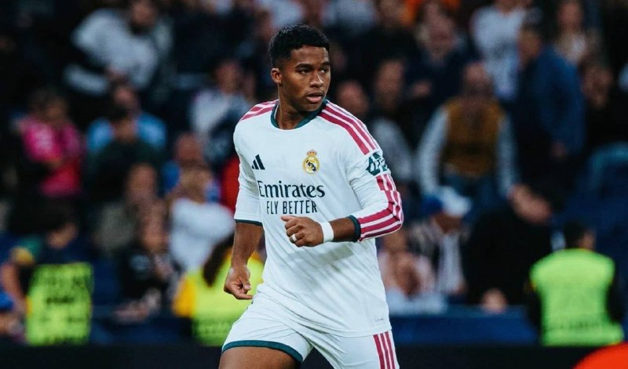
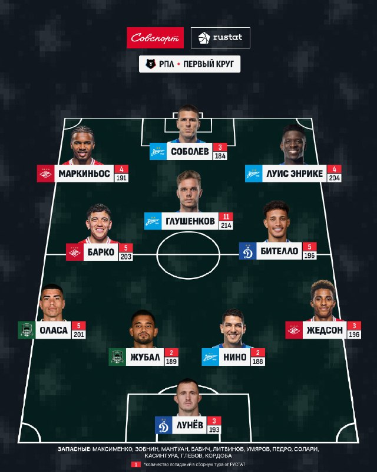
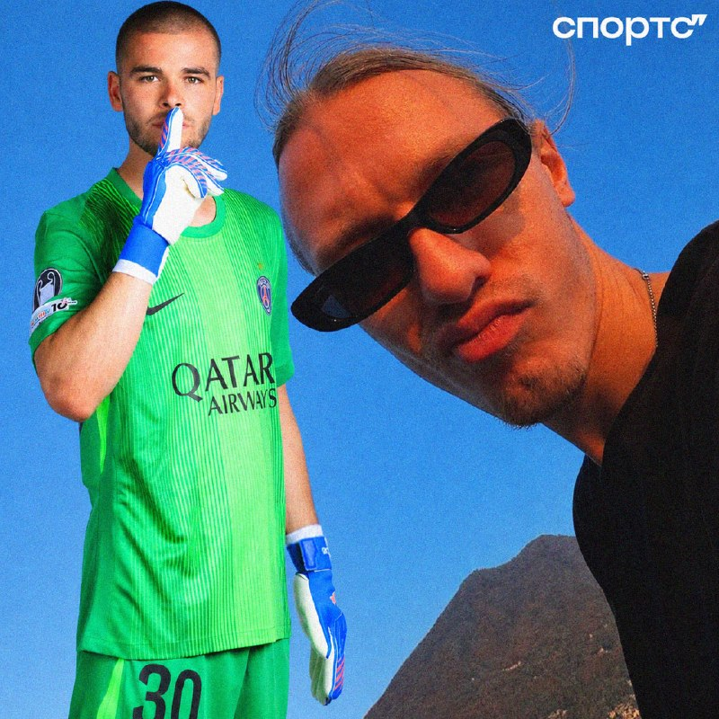
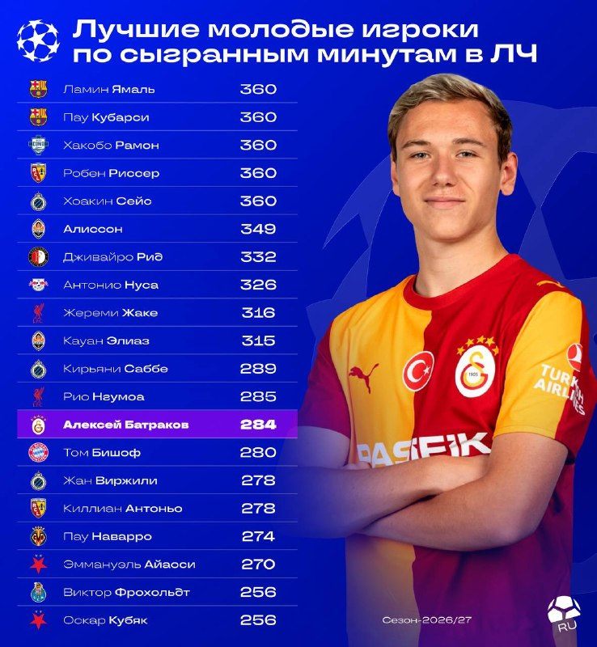
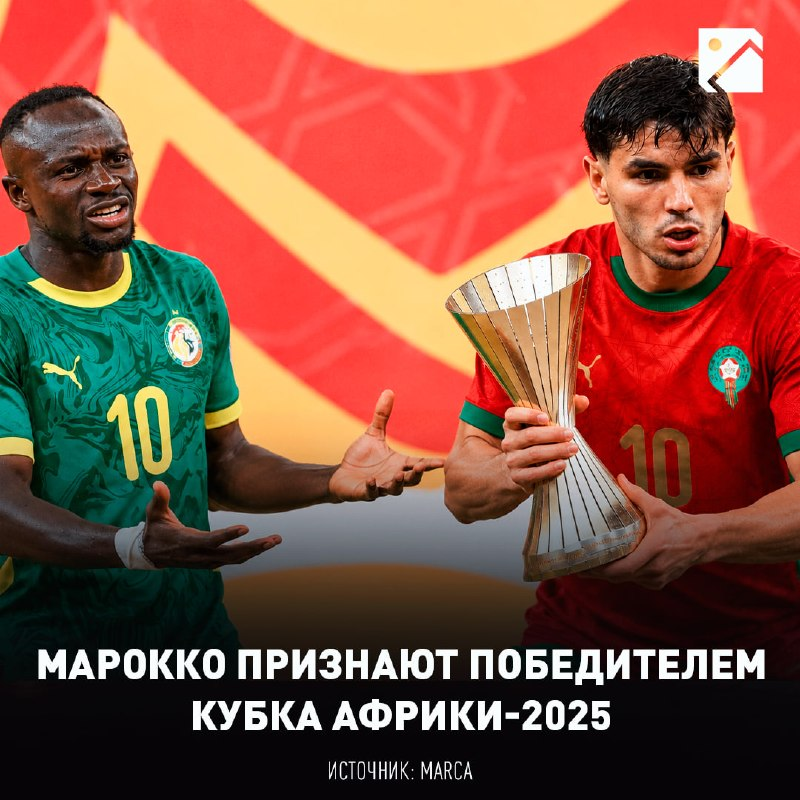

# Футбольный дайджест — 24 ноября 2026

_Период: с 23 по 24 ноября (ТГ-материалы и ESPN собраны 24 ноября в 07:16 МСК — свежие; WebSearch свежего почти не дал)_

## ⭐ Главное
- **Сегодня в 23:00 МСК «Реал» принимает «ПСВ» в Лиге чемпионов — и без Эндрика.** Клуб официально сообщил: у бразильца повреждение приводящей мышцы левой ноги, сроки возвращения неизвестны. В этом сезоне он провёл на поле всего 160 минут, а «Чемпионат» пишет, что Эндрик допустил уход в аренду из-за игрового времени (его 1+1 в камбэке против «Ромы» Моуринью не убедили). Зато Фабрицио Романо: Федерико Вальверде подпишет новый контракт с «Реалом» до июня 2031-го — «all set», официального объявления клуба пока нет. Дальше «Реал» играет с «Алавесом» 28 ноября в 23:00 МСК.
[Мяч PRO](https://t.me/myachPRO/25428) · [Sports.ru](https://t.me/sportsru/132031) · [Фабрицио Романо: Эндрик](https://t.me/FabrizioRomanoTG/68560) · [Чемпионат](https://t.me/championat/89639) · [Фабрицио Романо: Вальверде](https://t.me/FabrizioRomanoTG/68555) · [ESPN: Реал — ПСВ](https://www.espn.com/soccer/match/_/gameId/401915298)

## ⚽ Результаты
- **«Зенит» сегодня играет в Кубке России с «Крыльями Советов»** — по одному источнику, в 19:30 МСК (время уточняется по официальным данным); судит бригада Данила Набоки. Накануне «Зенит» получил четыре места в символической сборной первого круга РПЛ («Совспорт» + РУСТАТ): Соболев, Луис Энрике, Нино и Максим Глушенков — у него высший индекс 214 и 11 попаданий в сборную тура. Педро всё ещё топ-1 РПЛ по голевым передачам. А «Мяч Русь» в авторской колонке сравнивает Семака с поздним Гвардиолой в «Сити»: игра бывает стерильной, нужно что-то менять (мнение канала). Следом — 28 ноября, 16:30 МСК, «ЦСКА» — «Зенит» (РПЛ).
[Зенит: сборная](https://t.me/fczenit/38771) · [Зенит: Педро](https://t.me/fczenit/38767) · [Зенит: судьи](https://t.me/fczenit/38765) · [Мяч Русь](https://t.me/myachrus/10302) · [Зенит](https://t.me/fczenit/38766) · [ESPN: ЦСКА — Зенит](https://www.espn.com/soccer/match/_/gameId/401879794)

- **«Реал» и «Зенит» за эти сутки не играли.** Последний матч «Реала» — камбэк с «Сельтой» (Винисиус вышел и перевернул игру). Ла Лига, вчерашний вечер: «Леванте» — «Эльче» 1:1 (Ревиво 62', Рекена 88').
[ESPN](https://www.espn.com/soccer/match/_/gameId/401882802)

## 👤 Мои игроки
- **Роналду:** «Аль-Наср» не играл, подтверждённых новостей нет. Следующий матч — «Аль-Хазм» — «Аль-Наср», 28 ноября, 15:15 МСК.
[ESPN](https://www.espn.com/soccer/match/_/gameId/401900442)
- **Сафонов:** «ПСЖ» близок к продлению контракта до 2032 года (нынешний — до 2029-го). По Le Parisien, сейчас он получает ~400 тыс. в месяц, по новому соглашению будет зарабатывать больше Шевалье, который 10 месяцев сидит на лавке. Следующий матч — «ПСЖ» — «Рома», 25 ноября, 23:00 МСК.
[Sports.ru](https://t.me/sportsru/132038) · [Чемпионат](https://t.me/championat/89642) · [Спорт-Экспресс](https://t.me/sportexpress/85159)

- **Батраков:** четыре гола в четырёх матчах ЛЧ; тренер «Галатасарая» Бурук надеется на пятый — уже сегодня, 20:45 МСК, против «Астон Виллы». По «Мячу Русь», он в топе молодых игроков ЛЧ по сыгранным минутам (284 — 13-е место) и лучший в этом списке по показателю «минуты на гол»: 71 против 120 у Ямаля.
[Мяч Русь](https://t.me/myachrus/10301) · [Спорт-Экспресс](https://t.me/sportexpress/85152)

- **Куртуа:** «Моя цель — закончить карьеру в “Реале” и завершить её здесь. Нужно лишь оставаться здоровым». О Беллингеме: «прирождённый победитель, лидер на поле с отличным менталитетом, такого нужно иметь в команде».
[Фабрицио Романо: Куртуа](https://t.me/FabrizioRomanoTG/68561) · [Фабрицио Романо: о Беллингеме](https://t.me/FabrizioRomanoTG/68576)
- **Холанд, Мбаппе, Глушенков, Аршавин:** Холанд — сегодня в 23:00 МСК «Сити» — «Наполи»; новых подтверждённых новостей по остальным нет (Глушенков — в сборной первого круга, см. «Результаты»).

## 🔁 Трансферы
- **[Официально]** Нет новостей.
- **[Слухи]** Романо: Вальверде подпишет новый контракт с «Реалом» до 2031-го — «all set» (не объявлено клубом).
[Фабрицио Романо](https://t.me/FabrizioRomanoTG/68555)
- **[Слухи]** Романо: Маркус Крёше начнёт работать директором по футболу «Милана» с декабря, к январскому окну; устная договорённость была ещё в октябре, «Милан» заплатит около 4 млн евро компенсации. Официального объявления нет.
[Фабрицио Романо](https://t.me/FabrizioRomanoTG/68573)

## 🩹 Травмы
- **[Реал]** **Эндрик** — повреждение приводящей мышцы левой ноги, сроки неизвестны (официально, клуб).
[Мяч PRO](https://t.me/myachPRO/25428) · [Фабрицио Романо](https://t.me/FabrizioRomanoTG/68560)
- **[Барселона]** **Ламин Ямаль** пропустит матч ЛЧ с «Сабахом» из-за лёгкого дискомфорта в правой лодыжке и не полетит в Баку; к воскресному матчу с «Депортиво» должен быть готов.
[Фабрицио Романо](https://t.me/FabrizioRomanoTG/68556) · [Sports.ru](https://t.me/sportsru/132026)
- **[Арсенал]** **Давид Райя:** операция не нужна, травма «менее серьёзна, чем думали» (Артета).
[Фабрицио Романо](https://t.me/FabrizioRomanoTG/68569)

## 🔥 Ещё важное
- **Марокко официально объявят победителем Кубка Африки-2025.** По Marca и «Спорт-Экспрессу», CAS отклонил апелляцию Сенегала; официальный вердикт ожидается сегодня. Причина — скандальный уход сенегальцев с поля в финале: команда протестовала против пенальти в свои ворота на последних минутах при 0:0, матч возобновили через 13 минут, Браим Диас пенальти не забил, а Сенегал победил в дополнительное время; позже КАФ присудила «технарь».
[Спорт-Экспресс](https://t.me/sportexpress/85163) · [Sports.ru](https://t.me/sportsru/132043) · [Фабрицио Романо](https://t.me/FabrizioRomanoTG/68557)

- **Месси бросил мяч в лицо сопернику в MLS — и получил только жёлтую.** Арбитр объяснил, что сила была минимальной и до уровня насильственного поведения не дошла; тренер «Коламбуса» Лоран Куртуа расстроен: «Все понимают, что это больше, чем просто жёлтая карточка».
[Мяч PRO](https://t.me/myachPRO/25433) · [Sports.ru](https://t.me/sportsru/132047)
- **«Лев» у стадиона «Галатасарая» оказался ложной тревогой.** Накануне матча с «Астон Виллой» писали, что в 15 км от арены бегает лев и подняли 70 силовиков и дроны; по итогам выяснилось, что животного не было, матч в силе.
[Спорт-Экспресс](https://t.me/sportexpress/85161) · [Мяч PRO](https://t.me/myachPRO/25431) · [Чемпионат](https://t.me/championat/89643)
- **ЦСКА требует у ЭСК разъяснений по пенальти в матче с «Ахматом»** и заодно жалуется на «системную дискредитацию судейства»; ЦСКА играет с «Зенитом» 28 ноября.
[Спорт-Экспресс](https://t.me/sportexpress/85162)

## 📅 Ближайшие матчи
- **«Зенит» — «Крылья Советов»** — 24 ноя, Кубок России, 19:30 МСК (по одному источнику).
- **«Галатасарай» — «Астон Вилла» (Батраков)** — 24 ноя, 20:45 МСК, ЛЧ.
- **«Реал» — «ПСВ»** — 24 ноя, 23:00 МСК, ЛЧ.
- **«Манчестер Сити» — «Наполи» (Холанд)** — 24 ноя, 23:00 МСК, ЛЧ.
- **«Арсенал» — «Боруссия» Дортмунд** — 24 ноя, 23:00 МСК, ЛЧ.
- **«Сабах» — «Барселона»** — 25 ноя, 20:45 МСК, ЛЧ.
- **«ПСЖ» — «Рома» (Сафонов)** — 25 ноя, 23:00 МСК, ЛЧ.
- **«Атлетико» — «Викинг»** — 25 ноя, 23:00 МСК, ЛЧ.
- **«Аль-Хазм» — «Аль-Наср» (Роналду)** — 28 ноя, 15:15 МСК, Саудовская Про-лига.
- **«ЦСКА» — «Зенит»** — 28 ноя, 16:30 МСК, РПЛ.
- **«Реал» — «Алавес»** — 28 ноя, 23:00 МСК, Ла Лига.
- **«Арсенал» — «Манчестер Сити» (Холанд)** — 29 ноя, 19:30 МСК, АПЛ.
- **«Бешикташ» — «Галатасарай» (Батраков)** — 30 ноя, 21:00 МСК, чемпионат Турции.
