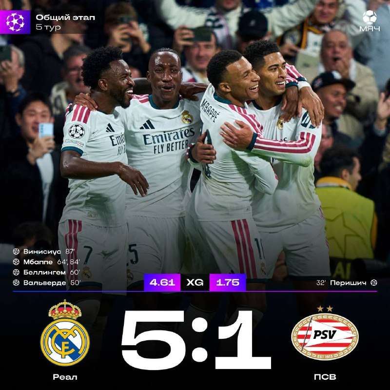
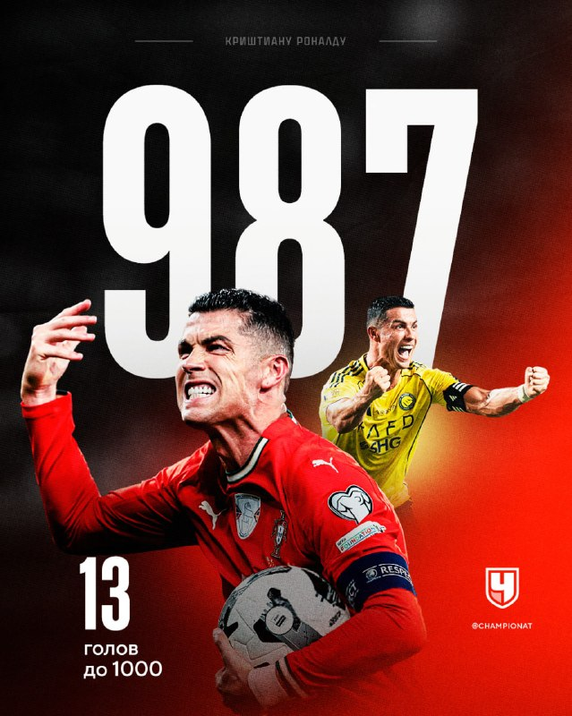
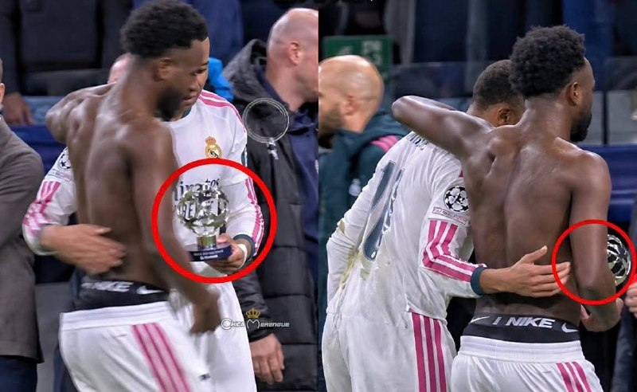
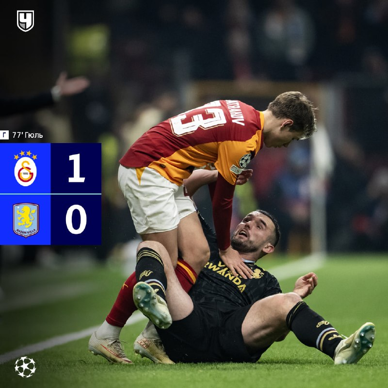

# Футбольный дайджест — 25 ноября 2026

_Период: с 24 по 25 ноября (ТГ-материалы и ESPN собраны 25 ноября в 07:24 МСК — свежие; WebSearch свежего почти не дал)_

## ⭐ Главное
- **«Реал» разгромил «ПСВ» 5:1 после 0:1 — десятая победа подряд, пять из пяти в ЛЧ.** Перишич с пенальти (32') вывел гостей вперёд, но во втором тайме мадридцы забили пять: Вальверде (50', передача Гюлера пяткой), шедевр Беллингема (60'), дубль Мбаппе (64', 84') и первый с августа гол Винисиуса (87'). «Реал» единолично возглавил таблицу — 15 очков из 15. Моуринью про перерыв: «Раздевалка — как Вегас: что происходит в Вегасе, остаётся в Вегасе». Следом — «Алавес» 28 ноября, 23:00 МСК.
[Мяч PRO](https://t.me/myachPRO/25459) · [Чемпионат](https://t.me/championat/89670) · [Фабрицио Романо](https://t.me/FabrizioRomanoTG/68618) · [ESPN](https://www.espn.com/soccer/match/_/gameId/401915298)

## ⚽ Результаты
- **Реал Мадрид — ПСВ 5:1** (Лига чемпионов · 5-й тур). Перишич (пен.) 32' — Вальверде 50', Беллингем 60', Мбаппе 64', 84', Винисиус 87'. Следующий матч: «Алавес» (дома), 28 ноября, 23:00 МСК, Ла Лига.
[ESPN](https://www.espn.com/soccer/match/_/gameId/401915298) · [Спорт-Экспресс](https://t.me/sportexpress/85201)
- **Зенит — Крылья Советов 1:0** (Кубок России · группа C, 24 ноября (вечер, в прошлом выпуске — анонс)). Гол Вендела издали; в концовке гол «Крыльев» (Макаров) отменили за игру рукой Горшкова. «Зенит» выиграл все матчи группы (17 очков) и вышел в плей-офф Пути РПЛ с первого места. Следующий матч: «ЦСКА» — «Зенит», 28 ноября, 16:30 МСК, РПЛ.
[Зенит](https://t.me/fczenit/38814) · [Мяч Русь](https://t.me/myachrus/10312) · [Спорт-Экспресс](https://t.me/sportexpress/85196)
- **Остальной вечер ЛЧ:** «Галатасарай» — «Астон Вилла» 1:0 (Гюль 77'); «Манчестер Сити» — «Наполи» 2:2 (Хёйлунд, Буадди, Ланг, Шерки 86'); «Арсенал» — «Боруссия» Д 1:1 (Дьёкереш, Байер); «Комо» — АЕК 1:0; «Бетис» выиграл в Братиславе 2:0 (дубль Чо Эрнандеса); «Лейпциг» — «Ланс» 3:1; «Фейеноорд» — «Порту» 0:1; «Бёдо/Глимт» — ЛАСК 1:0.
[Чемпионат](https://t.me/championat/89671) · [ESPN](https://www.espn.com/soccer/match/_/gameId/401915379)

## 👤 Мои игроки
- **Роналду забил 987-й гол в карьере** — сам заработал и реализовал пенальти в ворота катарского «Аль-Садда» в азиатской Лиге чемпионов («Аль-Наср» выиграл 2:1). Второй его гол отменили за офсайд — Криш передразнил «слепого» лайнсмена. До тысячи — 13. Следующий матч — «Аль-Хазм» — «Аль-Наср», 28 ноября, 15:15 МСК.
[Чемпионат](https://t.me/championat/89666) · [Спорт-Экспресс](https://t.me/sportexpress/85199) · [Фабрицио Романо](https://t.me/FabrizioRomanoTG/68602)

- **Мбаппе:** дубль «ПСВ» (64', 84'), 76-й гол в ЛЧ и седьмой матч подряд с голом в турнире — впервые для француза; 19 голов в 18 матчах ЛЧ за «Реал». Награду лучшему игроку матча отдал Винисиусу: «Спасибо, Кики».
[Мяч PRO](https://t.me/myachPRO/25462) · [Фабрицио Романо](https://t.me/FabrizioRomanoTG/68609) · [Фабрицио Романо](https://t.me/FabrizioRomanoTG/68634)

- **Беллингем:** вышел на второй тайм и забил шедевр внешней стороной стопы с 25 метров («лучший гол в моей жизни»), 10-е результативное действие за сезон. О «Золотом мяче»: «Мне всё равно, он для журналистов». Бернарду Силва: «Джуд хорош во всём».
[Мяч PRO](https://t.me/myachPRO/25453) · [Фабрицио Романо](https://t.me/FabrizioRomanoTG/68606) · [Фабрицио Романо](https://t.me/FabrizioRomanoTG/68628)
- **Батраков:** отыграл 74 минуты, остался без гола в ЛЧ впервые за пять матчей; получил жёлтую за стычку с Макгинном. Через три минуты после замены Гюль принёс «Галатасараю» победу 1:0 (третья победа в пяти матчах). Играл ложную девятку из-за отсутствия Осимхена. Следом — «Бешикташ», 30 ноября, 21:00 МСК.
[Чемпионат](https://t.me/championat/89665) · [Мяч Русь](https://t.me/myachrus/10314) · [Спорт-Экспресс](https://t.me/sportexpress/85198)

- **Холанд:** «Сити» — «Наполи» 2:2, без гола; «Холанда держали крепко — даже вратарь». У «Сити» три матча без побед. Следом — «Арсенал» — «Сити», 29 ноября, 19:30 МСК.
[Чемпионат](https://t.me/championat/89669) · [ESPN](https://www.espn.com/soccer/match/_/gameId/401915379)
- **Вальверде:** сравнял счёт на 50-й после передачи Гюлера («у Арды глаза на затылке!»).
[Мяч PRO](https://t.me/myachPRO/25453) · [Фабрицио Романо](https://t.me/FabrizioRomanoTG/68633)
- **Сафонов:** сегодня в 23:00 МСК «ПСЖ» — «Рома» в ЛЧ. Контракт до 2032-го пока не оформлен (см. прошлый выпуск). У «ПСЖ» надолго выбыли Кварацхелия и Дуэ.
[Фабрицио Романо](https://t.me/FabrizioRomanoTG/68585) · [ESPN](https://www.espn.com/soccer/match/_/gameId/401915374)
- **Куртуа, Глушенков, Аршавин:** свежих подтверждённых новостей нет. У Глушенкова — тема конфликта с Карпиным в сборной остаётся в инфополе (колонка «Мяча Русь»).
[Мяч Русь](https://t.me/myachrus/10309)

## 🔁 Трансферы
- **[Официально]** «Тоттенхэм» подписал новый долгосрочный контракт с 18-летним Люком Уильямсом-Барнеттом после первого старта в АПЛ; Романо: Йорданеску согласовал условия и станет тренером «Уотфорда».
[Фабрицио Романо](https://t.me/FabrizioRomanoTG/68591) · [Фабрицио Романо](https://t.me/FabrizioRomanoTG/68623)
- **[Слухи]** «Манчестер Юнайтед» выделит Почеттино менее 50 млн фунтов на зиму, планируют двух игроков, один — возможно, в аренду (Daily Mail, через Sports.ru).
[Sports.ru](https://t.me/sportsru/132053)
- **[Слухи]** Слуцкого настойчиво зовут в «Локомотив», но он отказывается (источник Ивана Карпова, через Sports.ru).
[Sports.ru](https://t.me/sportsru/132063)

## 🩹 Травмы
- **[ПСЖ]** **Кварацхелия и Дуэ** выбыли надолго (слова Хакими); у Дуэ — разрыв «крестов».
[Фабрицио Романо](https://t.me/FabrizioRomanoTG/68585)
- **[Арсенал]** **Райя** — обновлений нет (Артета); в матче с «Боруссией» его заменил Кепа.
[Фабрицио Романо](https://t.me/FabrizioRomanoTG/68622)
- **[Реал]** **Эндрик** — повреждение приводящей мышцы, сроки неизвестны (из прошлого выпуска; новых данных нет).

## 🔥 Ещё важное
- **Сенегал снова чемпион Африки-2025 — поправка к прошлому выпуску.** CAS отменил техническое поражение Сенегала за уход с поля в финале, титул вернули сенегальцам, а не Марокко. Марокко может обжаловать решение из-за сообщений о телефонном разговоре главы федерации Сенегала с одним из судей CAS.
[Чемпионат](https://t.me/championat/89655) · [Спорт-Экспресс](https://t.me/sportexpress/85188) · [Фабрицио Романо](https://t.me/FabrizioRomanoTG/68588)
- **АПЛ отменила красную карточку Йоро** в матче «Манчестер Юнайтед» — «Ливерпуль» (0:4): удаление признано ошибочным.
[Фабрицио Романо](https://t.me/FabrizioRomanoTG/68589) · [Sports.ru](https://t.me/sportsru/132068)
- **ЦСКА и «Зенит» определились в Кубке:** ЦСКА (2-е место группы D) обыграл «Акрон» 1:0 (пенальти Облякова) и вышел в плей-офф Пути РПЛ — попал на «Спартак».
[Чемпионат](https://t.me/championat/89658) · [Мяч Русь](https://t.me/myachrus/10307)
- **Мирра Андреева выиграла Итоговый турнир WTA** (7:5, 6:3 над Свитолиной, без потерянных сетов) — 3,37 млн долларов.
[Sports.ru](https://t.me/sportsru/132077)

## 📅 Ближайшие матчи
- **«Сабах» — «Барселона»** — 25 ноя, 20:45 МСК, ЛЧ.
- **«ПСЖ» — «Рома» (Сафонов)** — 25 ноя, 23:00 МСК, ЛЧ.
- **«Атлетико» — «Викинг»** — 25 ноя, 23:00 МСК, ЛЧ.
- **«ЦСКА» — «Зенит»** — 28 ноя, 16:30 МСК, РПЛ.
- **«Аль-Хазм» — «Аль-Наср» (Роналду)** — 28 ноя, 15:15 МСК, Саудовская Про-лига.
- **«Реал» — «Алавес»** — 28 ноя, 23:00 МСК, Ла Лига.
- **«Арсенал» — «Манчестер Сити» (Холанд)** — 29 ноя, 19:30 МСК, АПЛ.
- **«Бешикташ» — «Галатасарай» (Батраков)** — 30 ноя, 21:00 МСК, чемпионат Турции.
- **«Реал Сосьедад» — «Реал»** — 2 дек, 21:00 МСК, Ла Лига.
