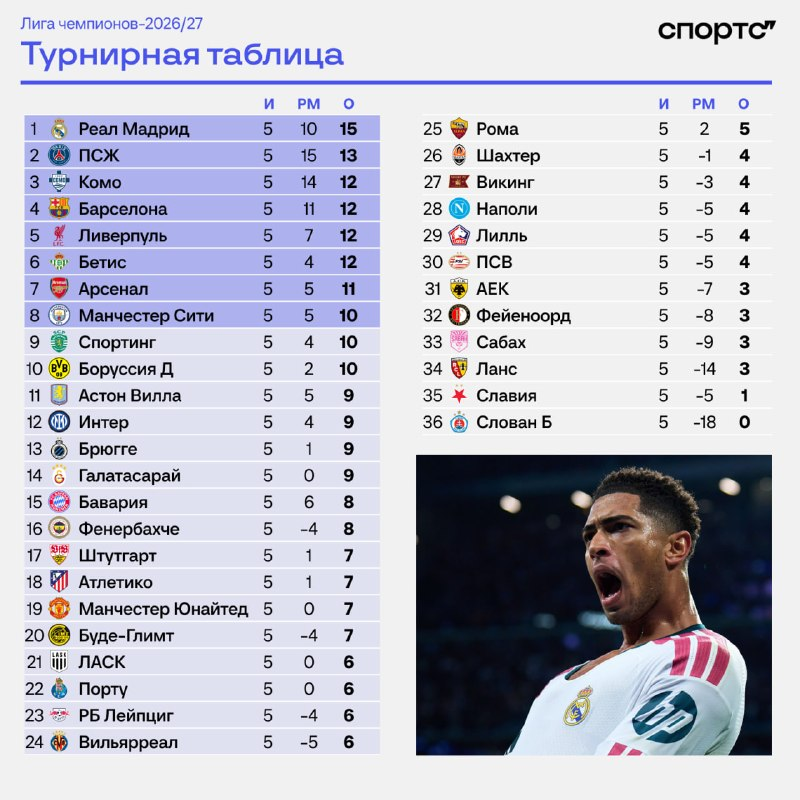
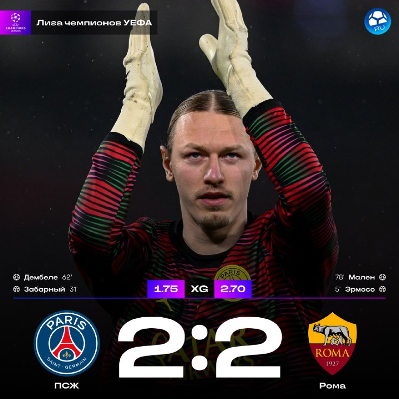

# Футбольный дайджест — 26 ноября 2026

_Период: с 25 ноября (после прошлого выпуска) по утро 26 ноября. ТГ-материалы и ESPN собраны 26 ноября в 07:20 МСК — свежие; WebSearch по теме свежего не дал. Вчера у «Реала» и «Зенита» матчей не было._

## ⭐ Главное
- **«Реал» — единственный в ЛЧ без потерянных очков и лидер таблицы: «ПСЖ» вничью с «Ромой» 2:2 впервые в сезоне.** После пяти туров у мадридцев 15 из 15 и разница мячей +10, у «ПСЖ» 13, у «Комо», «Барселоны», «Ливерпуля» и «Бетиса» по 12. Чемпионат пишет, что «Реал» первым вышел в плей-офф ЛЧ. Вчера у «Реала» был выходной, а Жозе Моуринью пришёл на баскетбольный матч Евролиги. Следом — «Алавес», 28 ноября, 23:00 МСК.
[Sports.ru](https://t.me/sportsru/132138) · [Мяч PRO](https://t.me/myachPRO/25493) · [Чемпионат](https://t.me/championat/89704)

## ⚽ Результаты
- **«Реал» и «Зенит» вчера не играли.** Последний матч «Реала» — 5:1 с «ПСВ» (ЛЧ, 24 ноября). Следующий: «Реал» — «Алавес», 28 ноября, 23:00 МСК, Ла Лига. Последний матч «Зенита» — 1:0 с «Крыльями Советов» (Кубок России, 24 ноября). Следующий: «ЦСКА» — «Зенит», 28 ноября, 16:30 МСК, РПЛ.
[ESPN](https://www.espn.com/soccer/match/_/gameId/401879794) · [ESPN](https://www.espn.com/soccer/match/_/gameId/401882789)
- **Вечер ЛЧ, 25 ноября:** «ПСЖ» — «Рома» 2:2 (Эрмосо 5', Забарный 31', Дембеле 62' с пенальти, Мален 78' с пенальти); «Ливерпуль» выиграл в Брюгге 3:0 (Исак дубль, Вирц); «Сабах» — «Барселона» 1:4 (Гордон дубль, Адейеми, Жезус); «Спортинг» — «МЮ» 2:2 (Суарес дубль, Бруну Фернандеш дубль; три пенальти за матч); «Лилль» — «Бавария» 2:1; «Интер» — «Штутгарт» 2:0; «Атлетико» — «Викинг» 2:0; «Славия» — «Вильярреал» 0:1; «Шахтёр» — «Фенербахче» 0:1.
[ESPN](https://www.espn.com/soccer/match/_/gameId/401915374) · [Чемпионат](https://t.me/championat/89702) · [Чемпионат](https://t.me/championat/89700)

## 👤 Мои игроки
- **Роналду:** вчера «Аль-Наср» не играл; следующий матч — «Аль-Хазм» — «Аль-Наср», 28 ноября, 15:15 МСК. Зато Гвардиола вступился за Криштиану: Португальская федерация «должна обеспечить достойное завершение карьеры», нельзя отпускать его из сборной «вот так» — нужно праздник, где он почувствует любовь соотечественников.
[Фабрицио Романо](https://t.me/FabrizioRomanoTG/68642)
- **Сафонов:** «ПСЖ» — «Рома» 2:2. Первый гол Эрмосо (5') Матвей взять не мог — игрок остался один в штрафной; Мален с пенальти (78') тоже не по зубам. Но Сафонов сделал 2 важных сейва, предотвратил 0,7 гола, точных передач 40 из 43 (93%); оценка Sofascore — выше только у Дембеле. «ПСЖ» впервые в этой ЛЧ потерял очки, 2-е место, 13 очков.
[Мяч Русь](https://t.me/myachrus/10323) · [Чемпионат](https://t.me/championat/89701) · [ESPN](https://www.espn.com/soccer/match/_/gameId/401915374)

- **Беллингем и Моуринью:** Жозе — «Беллингем — лучший полузащитник мира сейчас», а то, что Джуда не было в топ-10 «Золотого мяча», — «скандал». Джуд: «Возможно, лучший момент в карьере», «Моуринью изменил всё в “Реале”», о будущем: «Я обожаю жизнь здесь, всё идеально». За Винисиуса: «Все ждут повода его добить — мы рядом».
[Фабрицио Романо](https://t.me/FabrizioRomanoTG/68647) · [Фабрицио Романо](https://t.me/FabrizioRomanoTG/68652) · [Фабрицио Романо](https://t.me/FabrizioRomanoTG/68650)
- **Холанд:** «Сити» пропускает 10 матчей подряд во всех турнирах (такого не было с 2019 года) и выиграл лишь один из последних семи. Следующий матч — «Арсенал» — «Сити», 29 ноября, 19:30 МСК.
[Чемпионат](https://t.me/championat/89682)
- **Батраков:** вчера «Галатасарай» не играл. Следующий матч — «Бешикташ» — «Галатасарай», 30 ноября, 21:00 МСК.
[ESPN](https://www.espn.com/soccer/match/_/gameId/401888237)
- **Мбаппе, Куртуа, Глушенков, Аршавин:** вчера не играли, свежих подтверждённых новостей нет.

## 🔁 Трансферы
- **[Официально]** Нет новостей.
- **[Почти официально]** «Ливерпуль» устно договорился с 16-летним сенегальским вингером Сиди Барамой Ндяе (Романо: «here we go»); переход — в январе 2028-го, когда ему исполнится 18. Клуб пока не объявлял. Также Романо: Калверт-Льюин договорился о новом контракте с «Лидсом» до июня 2029 года, формальности впереди.
[Фабрицио Романо](https://t.me/FabrizioRomanoTG/68660) · [Фабрицио Романо](https://t.me/FabrizioRomanoTG/68663)
- **[Слухи]** Нино («Зенит») — переговоры о новом контракте зашли в тупик, клуб открыт к продаже защитника уже в январе, скидок не будет (ESPN, через «Спорт-Экспресс»).
[Спорт-Экспресс](https://t.me/sportexpress/85210)
- **[Слухи]** Эндрик: Уэсли из «Ромы» заявил, что звал его в римский клуб — «решение за ним, но мы были бы рады». Это слова игрока, не переговоры.
[Фабрицио Романо](https://t.me/FabrizioRomanoTG/68675)
- Луис Энрике: «Барселона» не будет подписывать игрока в январе «на полгода».
[Фабрицио Романо](https://t.me/FabrizioRomanoTG/68644)

## 🩹 Травмы
- **[Ливерпуль]** **Виктор Муньос** — подозрение на разрыв «крестов» после матча с «Брюгге» (Sports.ru).
[Sports.ru](https://t.me/sportsru/132137)
- **[Бавария]** **Мусиала** — клуб и агентство официально заявили: футболист проходит обследование с 22 апреля 2025 года из-за неврологических симптомов; «Мяч PRO» пишет об абсансах и возможном завершении карьеры (данные врачей расходятся).
[Фабрицио Романо](https://t.me/FabrizioRomanoTG/68651) · [Мяч PRO](https://t.me/myachPRO/25469)
- **[Барселона]** **Фермин Лопес** дисквалифицирован на два матча: пропустит «Депортиво» и «Атлетико» (апелляцию отклонили).
[Чемпионат](https://t.me/championat/89688)
- **[Реал]** **Эндрик** — травма из прошлых выпусков, новых данных нет.

## 🔥 Ещё важное
- **Гвардиола: «Следующий шаг — сборная».** Пеп не уверен, что вообще вернётся в футбол; переговоры с Италией, по ESPN, продлились «минуту» — он хочет паузу минимум на год, итальянцы не исключают приглашения в 2027-м.
[Чемпионат](https://t.me/championat/89689) · [Sports.ru](https://t.me/sportsru/132117)
- **«МЮ» упустил победу в Лиссабоне (2:2):** три пенальти, Ламменс сначала взял пенальти, потом привёз новый и уронил мяч, из-за чего Суарес сравнял; Тилеманс удалён. Первой победы при Почеттино всё ещё нет.
[Чемпионат](https://t.me/championat/89702) · [Sports.ru](https://t.me/sportsru/132136)
- **Лапорта — про «Реал»:** «Мы будем брать с “Реала” деньги за использование нашего имени», «они одержимы “Барсой”». Контекст — иск «Барсы» к Пересу.
[Фабрицио Романо](https://t.me/FabrizioRomanoTG/68653) · [Чемпионат](https://t.me/championat/89684)

## 📅 Ближайшие матчи
- **«ЦСКА» — «Зенит»** — 28 ноя, 16:30 МСК, РПЛ.
- **«Аль-Хазм» — «Аль-Наср» (Роналду)** — 28 ноя, 15:15 МСК, Саудовская Про-лига.
- **«Реал» — «Алавес»** — 28 ноя, 23:00 МСК, Ла Лига.
- **«Арсенал» — «Манчестер Сити» (Холанд)** — 29 ноя, 19:30 МСК, АПЛ.
- **«Бешикташ» — «Галатасарай» (Батраков)** — 30 ноя, 21:00 МСК, чемпионат Турции.
- **«Реал Сосьедад» — «Реал»** — 2 дек, 21:00 МСК, Ла Лига.
