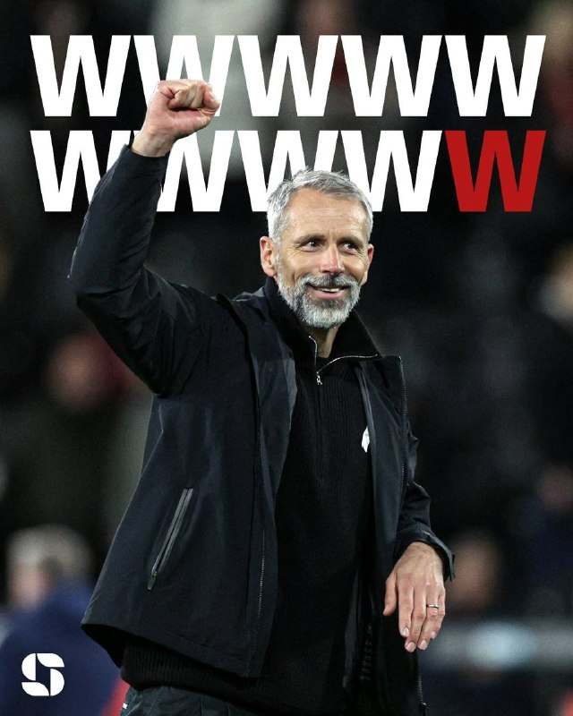
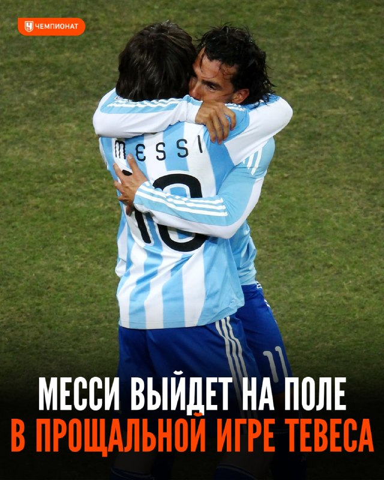
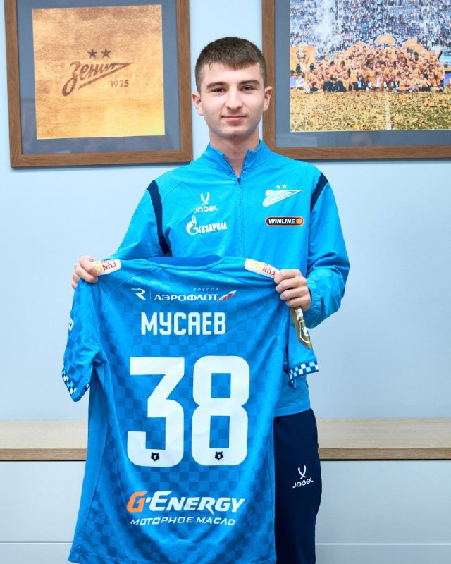
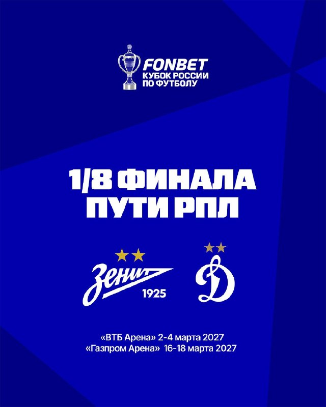

# Футбольный дайджест — 27 ноября 2026

_Период: с утра 26 ноября (после прошлого выпуска) по утро 27 ноября. ТГ-материалы и ESPN собраны 27 ноября в 07:23 МСК — свежие; WebSearch по теме ничего нового не дал. Вчера у «Реала» и «Зенита» матчей не было._

## ⭐ Главное
- **«Борнмут» догнал «Реал» по длине победной серии: десять побед подряд во всех турнирах.** Подопечные Марко Розе вчера в Лиге Европы камбэкнули над «Сельтой» (2:1), хотя почти весь матч играли в меньшинстве — Диаките удалили в первом тайме. По данным «Мяча PRO» и «Чемпионата», в топ-5 лиг такая серия сейчас только у «Реала» и «Борнмута»; англичане стали единственной командой с пятью победами в пяти матчах ЛЕ и возглавили общий этап. Свою серию «Реал» продлит в субботу с «Алавесом» (28 ноября, 23:00 МСК, Ла Лига).
[Мяч PRO](https://t.me/myachPRO/25507) · [Чемпионат](https://t.me/championat/89726) · [Sports.ru](https://t.me/sportsru/132164)

## ⚽ Результаты
- **«Реал» и «Зенит» вчера не играли.** Последний матч «Реала» — 5:1 с «ПСВ» (ЛЧ, 24 ноября). Следующий: «Реал» — «Алавес», 28 ноября, 23:00 МСК, Ла Лига. Последний матч «Зенита» — 1:0 с «Крыльями Советов» (Кубок России, 24 ноября). Следующий: «ЦСКА» — «Зенит», 28 ноября, 16:30 МСК, РПЛ; судить будет Танашев, VAR — Инал (Мяч Русь).
[ESPN](https://www.espn.com/soccer/match/_/gameId/401879794) · [ESPN](https://www.espn.com/soccer/match/_/gameId/401882789) · [Мяч Русь](https://t.me/myachrus/10332)
- **Еврокубки, 26 ноября:** «Милан» камбэкнул с 0:2 в Пирее — Хатчинсон 1+2, Пулишич забил победный; «Ювентус» разгромил «Омонию» (Консейсау гол и две передачи); «Аталанта» за семь минут вырвала победу у «Борац» (к 86-й проигрывала 0:2); «Кристал Пэлас» обыграл «Реал Сосьедад», который вёл с гола Сарра; «Кайрат» впервые победил в основной стадии еврокубка — обыграл «Мьельбю» (ЛК), решающий гол Тапалова.
[Чемпионат](https://t.me/championat/89727) · [Sports.ru](https://t.me/sportsru/132166) · [Sports.ru](https://t.me/sportsru/132168) · [Sports.ru](https://t.me/sportsru/132167) · [Чемпионат](https://t.me/championat/89721)

## 👤 Мои игроки
- **Роналду:** «Аль-Наср» вчера не играл; следующий матч — «Аль-Хазм» — «Аль-Наср», 28 ноября, 15:15 МСК. Новое: Тевес устроит прощальный матч 20 декабря на «Бомбонере», Месси выйдет в нём, приглашены Буффон, Агуэро, Рикельме, Батистута. Главная интрига — приедет ли Криштиану: ответа на приглашение пока нет, а Тевес мечтает сыграть с ним и Месси в одной команде.
[Чемпионат](https://t.me/championat/89729)

- **Мбаппе, Куртуа, Сафонов, Батраков, Беллингем, Холанд, Глушенков, Аршавин:** вчера не играли, свежих подтверждённых новостей нет. Ближайшие: «Арсенал» — «Сити» (Холанд), 29 ноября, 19:30 МСК; «Бешикташ» — «Галатасарай» (Батраков), 30 ноября, 21:00 МСК; «ПСЖ» — «Лорьян» (Сафонов), 28 ноября, 22:45 МСК.

## 🔁 Трансферы
- **[Официально]** «Зенит» продлил контракт с воспитанником Амиром Мусаевым — до конца 2031 года.
[@fczenit](https://t.me/fczenit/38862)

- **[Официально]** Доминик Калверт-Льюин подписал новый контракт с «Лидсом» до июня 2029 года (Романо: confirmed).
[Фабрицио Романо](https://t.me/FabrizioRomanoTG/68688)
- **[Почти официально]** Карлос Аугусто в пятницу подпишет новый контракт с «Интером» до июня 2031 года — сделка с бразильским защитником согласована (Романо). Клуб пока не объявлял.
[Фабрицио Романо](https://t.me/FabrizioRomanoTG/68687)
- **[Слухи]** У англичанина Арчи Брауна («Фенербахче») в контракте пункт о выкупе на €23 млн, действует и зимой, и летом; интерес проявили несколько клубов (Романо).
[Фабрицио Романо](https://t.me/FabrizioRomanoTG/68686)

## 🩹 Травмы
- Нет новостей по ключевым игрокам.

## 🔥 Ещё важное
- **«Зенит» сыграет с «Динамо» в 1/8 финала Пути РПЛ Кубка России.** Первый матч — в Москве 2–4 марта, ответный на «Газпром Арене» 16–18 марта 2027-го; точные даты и время объявят позже. ЦСКА и «Спартак» встретятся уже в четвертьфинале верхней сетки. Из сенсаций: «Локомотив» вылетел ещё до плей-офф. Семак: первый круг закончили, «начинается всё с чистого листа».
[@fczenit](https://t.me/fczenit/38866) · [Чемпионат](https://t.me/championat/89723) · [Мяч Русь](https://t.me/myachrus/10333) · [@fczenit](https://t.me/fczenit/38857)

- **Арсен Захарян впервые за 996 дней вышел в старте в еврокубке** — «Реал Сосьедад» в Лондоне начал с гола Сарра (после атаки, которую начал Арсен), но после удаления Мартина проиграл «Пэласу» и остаётся вне зоны плей-офф ЛЕ.
[Чемпионат](https://t.me/championat/89724) · [Окко Спорт](https://t.me/okkosport/45102) · [Sports.ru](https://t.me/sportsru/132167)
- **Антирекорд Тарковски:** спустя 350 матчей в АПЛ защитник «Эвертона» получил первую красную карточку.
[Мяч PRO](https://t.me/myachPRO/25500)

## 📅 Ближайшие матчи
- **«Аль-Хазм» — «Аль-Наср» (Роналду)** — 28 ноя, 15:15 МСК, Саудовская Про-лига.
- **«ЦСКА» — «Зенит»** — 28 ноя, 16:30 МСК, РПЛ.
- **«ПСЖ» — «Лорьян» (Сафонов)** — 28 ноя, 22:45 МСК, Лига 1.
- **«Реал» — «Алавес»** — 28 ноя, 23:00 МСК, Ла Лига.
- **«Арсенал» — «Манчестер Сити» (Холанд)** — 29 ноя, 19:30 МСК, АПЛ.
- **«Бешикташ» — «Галатасарай» (Батраков)** — 30 ноя, 21:00 МСК, чемпионат Турции.
- **«Реал Сосьедад» — «Реал»** — 2 дек, 21:00 МСК, Ла Лига.
- **«Аль-Наср» — «Аль-Кадисия» (Роналду)** — 4 дек, 20:30 МСК, Саудовская Про-лига.
