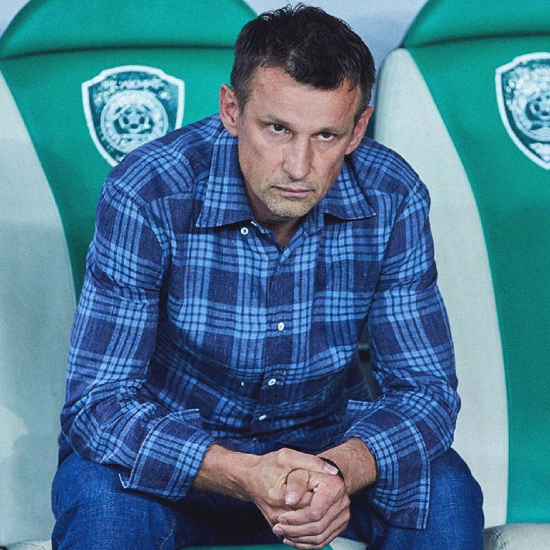
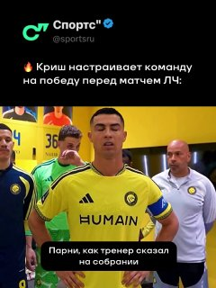

# Футбольный дайджест — 28 ноября 2026

_С утра 27 ноября (после прошлого выпуска) по утро 28 ноября. ТГ-материалы и ESPN собраны 28 ноября в 07:12 МСК — свежие; WebSearch дал мало нового (превью ЦСКА — «Зенит» и подтверждений по голам Роналду не нашёл). Вчера «Реал» и «Зенит» не играли — оба играют сегодня._

## ⭐ Главное
- **Сегодня «Зенит» едет в Москву к ЦСКА (16:30 МСК, 16-й тур РПЛ), а у Сергея Семака «шаткие» позиции.** По данным Sports.ru со ссылкой на Ивана Карпова, тренер может лишиться работы при поражении от ЦСКА, а зимой отставка вероятна в любом случае. Это не подтверждено клубом — информация инсайдерская. Судить будет Инал Танашев из Нальчика (в восьмой раз на играх «Зенита»), на VAR — Артур Федоров. Сразу после игры, вечером, «Реал» принимает «Алавес» (23:00 МСК).
[Sports.ru](https://t.me/sportsru/132175) · [@fczenit](https://t.me/fczenit/38871)

## ⚽ Результаты
- **«Реал» и «Зенит» вчера не играли.** Последний матч «Реала» — 5:1 с «ПСВ» (ЛЧ, 24 ноября). Следующий: «Реал» — «Алавес», 28 ноября, 23:00 МСК, Ла Лига. Последний матч «Зенита» — 1:0 с «Крыльями Советов» (Кубок России, 24 ноября). Следующий: «ЦСКА» — «Зенит», 28 ноября, 16:30 МСК, РПЛ; затем «Зенит» — «Балтика», 5 декабря, 17:30 МСК.
[ESPN](https://www.espn.com/soccer/match/_/gameId/401882789) · [ESPN](https://www.espn.com/soccer/match/_/gameId/401879794) · [ESPN](https://www.espn.com/soccer/match/_/gameId/401879785)
- **Другие результаты:** Ла Лига — «Леванте» уступил «Расингу» из Сантандера 1:3 (дубль Пабло Гарсии, гол Забири; у хозяев отличился Иван Ромеро). АПЛ — «Ноттингем Форест» обыграл «Челси» 3:1, Гиббс-Уайт оформил дубль; для «Челси» это третье поражение подряд в АПЛ. МЛС — «Интер Майами» Месси вылетел в первом раунде плей-офф: 0:3 и 0:1 от «Коламбуса».
[ESPN](https://www.espn.com/soccer/match/_/gameId/401882791) · [Мяч PRO](https://t.me/myachPRO/25519) · [Sports.ru](https://t.me/sportsru/132196) · [Чемпионат](https://t.me/championat/89751)

## 👤 Мои игроки
- **Роналду:** «Аль-Наср» вчера не играл; сегодня в 15:15 МСК выезд к «Аль-Хазму». По сети гуляет речь Криштиану в раздевалке перед матчем азиатской ЛЧ с «Аль-Саддом» — «Аль-Наср» вдохновился и выиграл 2:1; у Sports.ru гонка за 1000 голов показывает «уже 987» (мы эту цифру независимо не проверили). А Роналду-младший оформил дубль за молодёжку «Аль-Насра» и отпраздновал гол новым жестом «MAU» — «плохой/опасный» по-португальски, а в римском счёте M — это 1000. Намёк на цель?
[Sports.ru](https://t.me/sportsru/132189) · [Чемпионат](https://t.me/championat/89748) · [Фабрицио Романо](https://t.me/FabrizioRomanoTG/68716)

- **Глушенков:** признан лучшим игроком «Зенита» по итогам октября — «долгожданная награда», как пишет клуб. Сегодня против ЦСКА.
[@fczenit](https://t.me/fczenit/38867)

- **Мбаппе и Беллингем:** Моуринью объяснил их игровое время не статусом, а результативностью: «Они на уровне, который вне конкуренции». Там же про Винисиуса: «Раньше спрашивали, не пора ли ему уйти, теперь — выйдет ли в старте. Он стал лучше и реально помогает нам». Романо: слухи о ПСЖ и Винисиусе ничем не подкреплены, бразилец полностью сосредоточен на «Реале».
[Фабрицио Романо](https://t.me/FabrizioRomanoTG/68701) · [Фабрицио Романо](https://t.me/FabrizioRomanoTG/68699) · [Фабрицио Романо](https://t.me/FabrizioRomanoTG/68713)
- **Сафонов:** по данным L’Équipe, Люка Шевалье готов уйти из «ПСЖ» зимой — не играет с января, когда основным вратарём стал Матвей. Сегодня «ПСЖ» — «Лорьян» (22:45 МСК).
[Sports.ru](https://t.me/sportsru/132172) · [Спорт-Экспресс](https://t.me/sportexpress/85259)
- **Батраков:** «Галатасарай» заплатил за него в августе €25 млн, а по «осенней форме» отступные, по подсчёту «Спорт-Экспресса», вырастут в 3,2 раза. Следующий матч — дерби с «Бешикташем» 30 ноября в 21:00 МСК.
[Спорт-Экспресс](https://t.me/sportexpress/85255)
- **Куртуа, Холанд, Аршавин:** новостей нет; про Холанда — см. слухи в «Трансферах». Ближайший матч Холанда: «Арсенал» — «Сити», 29 ноября, 19:30 МСК.
[ESPN](https://www.espn.com/soccer/match/_/gameId/401878753)

## 🔁 Трансферы
- **[Официально]** Брахим Диас подписал новый долгосрочный контракт с «Реалом» — до июня 2031 года.
[Фабрицио Романо](https://t.me/FabrizioRomanoTG/68696)
- **[Официально]** «МЮ» активировал опцию продления контракта Бруну Фернандеша до июня 2028 года. По Романо, переговоры о новом долгосрочном соглашении стоят на паузе с октября, а клуб страхуется на случай ухода в 2027-м.
[Фабрицио Романо](https://t.me/FabrizioRomanoTG/68709) · [Sports.ru](https://t.me/sportsru/132183)
- **[Слухи]** Гари Невилл «абсолютно уверен», что Эрлинг Холанд перейдёт в «Реал» — возможно, уже в конце этого сезона: Холанд станет центрфорвардом, Мбаппе уйдёт на фланг, а Винисиус покинет клуб. Это мнение эксперта, не сообщение инсайдера; Моуринью при этом заявил, что в январе никто не должен приходить или уходить («дверь закрыта»).
[Sports.ru](https://t.me/sportsru/132178) · [Чемпионат](https://t.me/championat/89738) · [Фабрицио Романо](https://t.me/FabrizioRomanoTG/68707)

- **[Слухи]** «Зенит» и ЦСКА могут предложить «Галатасараю» €30 млн за Юнуса Акгюна, сообщает турецкий инсайдер Кучюк; игрок — капитан и уходить зимой не планирует.
[Чемпионат](https://t.me/championat/89741)
- **[Слухи]** Люка Шевалье может покинуть «ПСЖ» зимой из-за отсутствия игровой практики (L’Équipe).
[Sports.ru](https://t.me/sportsru/132172)

## 🩹 Травмы
- **Ферлан Менди** вернулся после долгой травмы: Моуринью подтвердил, что защитник будет на скамейке в матче с «Алавесом».
[Фабрицио Романо](https://t.me/FabrizioRomanoTG/68700)
- **Джамал Мусиала («Бавария»)** выбыл с новой мышечной травмой бедра — по Sports.ru на 4–6 недель, по Романо, до начала 2027 года; в 2026-м больше не сыграет. Также Савиньо надолго выбыл с травмой бедра (подтвердил Роберто Де Дзерби), а Карлос Балеба, по словам Почеттино, пропустит 10–12 недель.
[Фабрицио Романо](https://t.me/FabrizioRomanoTG/68714) · [Sports.ru](https://t.me/sportsru/132186) · [Фабрицио Романо](https://t.me/FabrizioRomanoTG/68711) · [Фабрицио Романо](https://t.me/FabrizioRomanoTG/68706)

## 🔥 Ещё важное
- **«Челси» без Алонсо-эффекта:** четыре поражения в последних пяти матчах АПЛ плюс вылет из Кубка лиги в серии пенальти. Хаби Алонсо: «Обидно снова проиграть, нужно искать решения».
[Фабрицио Романо](https://t.me/FabrizioRomanoTG/68721) · [Мяч PRO](https://t.me/myachPRO/25519)
- **Арбитров, назначивших пенальти в ворота ЦСКА, отстранили.** Чистякова, Москалёва и Абросимова уберут на несколько туров РПЛ после спорного пенальти в матче с «Ахматом» (1:2); ЭСК РФС единогласно признала решение ошибочным. Это перед самым матчем ЦСКА с «Зенитом».
[Чемпионат](https://t.me/championat/89743) · [Спорт-Экспресс](https://t.me/sportexpress/85270)
- **Гвардиола:** «Я не вернусь в «Барселону» тренером» — слова из интервью Bundesliga Magazine.
[Фабрицио Романо](https://t.me/FabrizioRomanoTG/68717)

## 📅 Ближайшие матчи
- **«Аль-Хазм» — «Аль-Наср» (Роналду)** — 28 ноя, 15:15 МСК, Саудовская Про-лига.
- **«ЦСКА» — «Зенит»** — 28 ноя, 16:30 МСК, РПЛ.
- **«ПСЖ» — «Лорьян» (Сафонов)** — 28 ноя, 22:45 МСК, Лига 1.
- **«Реал» — «Алавес»** — 28 ноя, 23:00 МСК, Ла Лига.
- **«Арсенал» — «Манчестер Сити» (Холанд)** — 29 ноя, 19:30 МСК, АПЛ.
- **«Бешикташ» — «Галатасарай» (Батраков)** — 30 ноя, 21:00 МСК, чемпионат Турции.
- **«Реал Сосьедад» — «Реал»** — 2 дек, 21:00 МСК, Ла Лига.
- **«Манчестер Сити» — «Лидс» (Холанд)** — 2 дек, 22:30 МСК, АПЛ.
- **«Галатасарай» — «Чайкур Ризеспор» (Батраков)** — 4 дек, 20:00 МСК, чемпионат Турции.
- **«Аль-Наср» — «Аль-Кадисия» (Роналду)** — 4 дек, 20:30 МСК, Саудовская Про-лига.
- **«Тулуза» — «ПСЖ» (Сафонов)** — 4 дек, 22:45 МСК, Лига 1.
- **«Зенит» — «Балтика»** — 5 дек, 17:30 МСК, РПЛ.
- **«Брентфорд» — «Манчестер Сити» (Холанд)** — 5 дек, 23:00 МСК, АПЛ.
